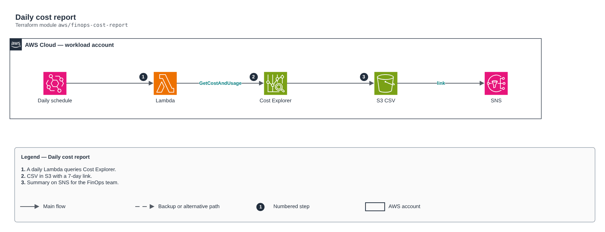

# Daily cost report

[Português](README.md) · **English**

> `aws/finops-cost-report` · category **automacao** · origin: Telecom CCoE and landing zone (2025)

> Designed in May 2025. With no time to keep the repository up to date back then, it is being published and updated now.

Daily cost report: a scheduled Lambda queries Cost Explorer, writes a CSV to S3 (with expiration) and sends a summary on SNS. For detailed analysis use the cur-focus-export module (FOCUS in Parquet) + Athena/QuickSight.

## Architecture



Editable source: [`diagram.drawio`](diagram.drawio) (open it in draw.io / diagrams.net), with Portuguese and English pages.

1. A daily Lambda queries Cost Explorer.
2. CSV in S3 with a 7-day link.
3. Summary on SNS for the FinOps team.

## Usage

```hcl
module "finops_cost_report" {
  source = "git::https://github.com/raphaelfcs/automacao_terraform.git//aws/finops-cost-report?ref=v1.0.0"

  name_prefix         = local.name_prefix
  bucket_name         = "demo-finops-relatorios-123456789012"
  alert_topic_arn     = "arn:aws:sns:sa-east-1:123456789012:demo-dev-alertas"
  cost_allocation_tag = "CentroCusto"
  tags                = local.tags
}
```

## Examples

| Example | Files |
|---|---|
| [`basico`](examples/basico) | `main.tf`, `locals.tf`, `backend.tf` |

Each example has its own backend (state isolated per module and example). Different environments only use another `backend.tf`/`*.tfvars`, without duplicating code.

## Inputs

| Name | Type | Default | Required | Description |
|---|---|---|---|---|
| `name_prefix` | `string` | - | **yes** | Resource prefix. |
| `bucket_name` | `string` | - | **yes** | CSV bucket (created by the module). |
| `alert_topic_arn` | `string` | - | **yes** | Summary SNS topic (subscribe the FinOps team's e-mail to it). |
| `schedule_expression` | `string` | `"cron(0 11 * * ? *)"` | no | Schedule (UTC in classic EventBridge): 11h UTC = 8h in São Paulo. |
| `cost_allocation_tag` | `string` | `""` | no | Cost allocation tag enabled in Billing (e.g. CostCenter). Empty = by service only. |
| `top_n` | `number` | `10` | no | How many items to list in the summary. |
| `report_retention_days` | `number` | `400` | no | CSV retention in S3. |
| `kms_key_arn` | `string` | `null` | no | Bucket and log group KMS key. |
| `tags` | `map(string)` | `{}` | no | Tags applied. |

## Outputs

| Name | Description |
|---|---|
| `function_arn` | Function ARN. |
| `bucket_name` | Reports bucket. |

## Files

- `iam.tf`: policies, roles and permissions
- `main.tf`: main resources
- `outputs.tf`: outputs
- `variables.tf`: inputs and validations
- `versions.tf`: Terraform and provider versions
- `src/`: supporting files (code, templates or policies)
- `examples/`: ready-to-use compositions
- `tests/`: `terraform test` with mocked providers

## Well-Architected

- Operational excellence: manual routine replaced by a managed service or a least-privilege function.
- Cost optimization: on-demand/scheduled execution, no servers running.

## Tests

```bash
cd aws/finops-cost-report
terraform init -backend=false
terraform test
```
