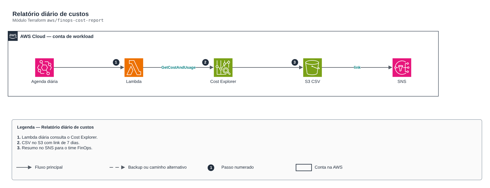

# Relatório diário de custos

> `aws/finops-cost-report` · categoria **automacao** · origem: CCoE e landing zone de telecom (2025)

> Idealizado em maio de 2025. Por falta de tempo para manter o repositório em dia na época, está sendo publicado e atualizado agora.

Relatório diário de custos: Lambda agendada consulta o Cost Explorer, grava CSV no S3 (com expiração) e envia resumo no SNS. Para análise detalhada use o módulo cur-focus-export (FOCUS em Parquet) + Athena/QuickSight.

## Arquitetura



Fonte editável: [`diagram.drawio`](diagram.drawio) (abra no draw.io / diagrams.net).

1. Lambda diária consulta o Cost Explorer.
2. CSV no S3 com link de 7 dias.
3. Resumo no SNS para o time FinOps.

## Uso

```hcl
module "finops_cost_report" {
  source = "git::https://github.com/raphaelfcs/automacao_terraform.git//aws/finops-cost-report?ref=v1.0.0"

  name_prefix         = local.name_prefix
  bucket_name         = "demo-finops-relatorios-123456789012"
  alert_topic_arn     = "arn:aws:sns:sa-east-1:123456789012:demo-dev-alertas"
  cost_allocation_tag = "CentroCusto"
  tags                = local.tags
}
```

## Exemplos

| Exemplo | Arquivos |
|---|---|
| [`basico`](examples/basico) | `main.tf`, `locals.tf`, `backend.tf` |

Cada exemplo tem seu próprio backend (state isolado por módulo e exemplo). Ambientes diferentes usam apenas outro `backend.tf`/`*.tfvars`, sem duplicar código.

## Entradas

| Nome | Tipo | Padrão | Obrigatória | Descrição |
|---|---|---|---|---|
| `name_prefix` | `string` | - | **sim** | Prefixo dos recursos. |
| `bucket_name` | `string` | - | **sim** | Bucket dos CSVs (criado pelo módulo). |
| `alert_topic_arn` | `string` | - | **sim** | Tópico SNS do resumo (assine o e-mail do time FinOps nele). |
| `schedule_expression` | `string` | `"cron(0 11 * * ? *)"` | não | Agenda (UTC no EventBridge clássico): 11h UTC = 8h em São Paulo. |
| `cost_allocation_tag` | `string` | `""` | não | Tag de alocação de custos ativada no Billing (ex.: CentroCusto). Vazio = só por serviço. |
| `top_n` | `number` | `10` | não | Quantos itens listar no resumo. |
| `report_retention_days` | `number` | `400` | não | Retenção dos CSVs no S3. |
| `kms_key_arn` | `string` | `null` | não | Chave KMS do bucket e do log group. |
| `tags` | `map(string)` | `{}` | não | Tags aplicadas. |

## Saídas

| Nome | Descrição |
|---|---|
| `function_arn` | ARN da função. |
| `bucket_name` | Bucket dos relatórios. |

## Arquivos

- `iam.tf`: políticas, papéis e permissões
- `main.tf`: recursos principais
- `outputs.tf`: saídas
- `variables.tf`: entradas e validações
- `versions.tf`: versões do Terraform e providers
- `src/`: arquivos auxiliares (código, templates ou políticas)
- `examples/`: composições prontas para uso
- `tests/`: `terraform test` com providers simulados

## Well-Architected

- Excelência operacional: rotina manual substituída por serviço gerenciado ou função com permissões mínimas.
- Otimização de custos: execução sob demanda/agendada, sem servidores ligados.

## Testes

```bash
cd aws/finops-cost-report
terraform init -backend=false
terraform test
```
