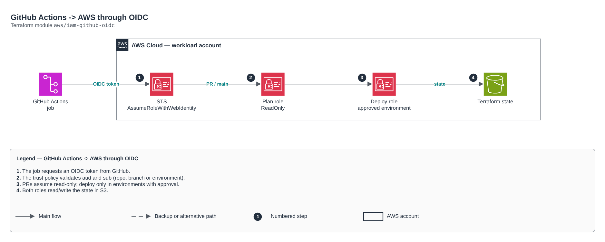

# GitHub Actions -> AWS through OIDC

[Português](README.md) · **English**

> `aws/iam-github-oidc` · category **devops** · origin: Architecture case studies (2026)

> Designed in October 2026 and published now.

GitHub Actions -> AWS trust without static keys (OIDC). Two roles per repository: plan (read-only, assumable by pull requests and the main branch) and deploy (write, assumable ONLY by jobs in GitHub Environments with approval). Terraform state lives in an existing bucket (see the tf-backend-bootstrap module).

## Architecture



Editable source: [`diagram.drawio`](diagram.drawio) (open it in draw.io / diagrams.net), with Portuguese and English pages.

1. The job requests an OIDC token from GitHub.
2. The trust policy validates aud and sub (repo, branch or environment).
3. PRs assume read-only; deploy only in environments with approval.
4. Both roles read/write the state in S3.

## Usage

```hcl
module "iam_github_oidc" {
  source = "git::https://github.com/raphaelfcs/automacao_terraform.git//aws/iam-github-oidc?ref=v1.0.0"

  github_org           = "minha-org"
  github_repo          = "infra"
  allowed_environments = ["dev", "prd"]
  managed_role_prefix  = "app-"
  state_bucket_arn     = "arn:aws:s3:::demo-tfstate-123456789012"
  tags                 = local.tags
}
```

## Examples

| Example | Files |
|---|---|
| [`basico`](examples/basico) | `main.tf`, `locals.tf`, `backend.tf` |

Each example has its own backend (state isolated per module and example). Different environments only use another `backend.tf`/`*.tfvars`, without duplicating code.

## Inputs

| Name | Type | Default | Required | Description |
|---|---|---|---|---|
| `github_org` | `string` | - | **yes** | GitHub organization or user that owns the repository. |
| `github_repo` | `string` | - | **yes** | Repository name. |
| `default_branch` | `string` | `"main"` | no | Main branch (may assume the plan role). |
| `allowed_environments` | `list(string)` | `["sandbox"]` | no | GitHub Environments that may assume the deploy role (configure manual approval on them). |
| `allow_pull_requests` | `bool` | `true` | no | Allows PRs to assume the read role (terraform plan). |
| `deploy_policy_arns` | `list(string)` | `["arn:aws:iam::aws:policy/PowerUserAc...` | no | Deploy role policies. Sandbox: PowerUser + limited IAM. Production: specific policies. |
| `managed_role_prefix` | `string` | `null` | no | Prefix of the IAM roles the deploy may create/change (e.g. "app-"). null = none. |
| `permissions_boundary_arn` | `string` | `null` | no | Permissions boundary applied to the deploy role. |
| `state_bucket_arn` | `string` | `null` | no | Terraform state bucket ARN. null = no state policy. |
| `create_oidc_provider` | `bool` | `true` | no | Creates the GitHub OIDC provider (only one per account). |
| `tags` | `map(string)` | `{}` | no | Additional tags. |

## Outputs

| Name | Description |
|---|---|
| `deploy_role_arn` | Set as AWS_DEPLOY_ROLE_ARN in GitHub. |
| `plan_role_arn` | Set as AWS_PLAN_ROLE_ARN in GitHub. |
| `oidc_provider_arn` | GitHub OIDC provider ARN. |

## Files

- `iam.tf`: policies, roles and permissions
- `locals.tf`: derived values
- `main.tf`: main resources
- `outputs.tf`: outputs
- `variables.tf`: inputs and validations
- `versions.tf`: Terraform and provider versions
- `examples/`: ready-to-use compositions
- `tests/`: `terraform test` with mocked providers

## Well-Architected

- Operational excellence: GitOps, the desired state lives in Git and is reconciled continuously.
- Security: repository credentials kept out of the code.

## Tests

```bash
cd aws/iam-github-oidc
terraform init -backend=false
terraform test
```
