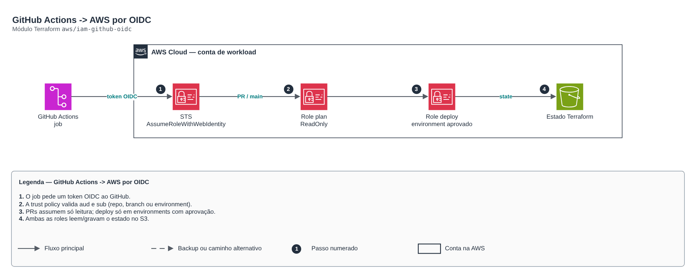

# GitHub Actions -> AWS por OIDC

**Português** · [English](README.en.md)

> `aws/iam-github-oidc` · categoria **devops** · origem: Estudos de caso de arquitetura (2026)

> Idealizado em outubro de 2026 e publicado agora.

Confiança GitHub Actions -> AWS sem chaves fixas (OIDC). Duas roles por repositório: - plan: leitura, assumível por pull requests e pela branch principal; - deploy: escrita, assumível SOMENTE por jobs em GitHub Environments com aprovação. O estado do Terraform fica num bucket existente (veja o módulo tf-backend-bootstrap).

## Arquitetura



Fonte editável: [`diagram.drawio`](diagram.drawio) (abra no draw.io / diagrams.net), com páginas em português e inglês.

1. O job pede um token OIDC ao GitHub.
2. A trust policy valida aud e sub (repo, branch ou environment).
3. PRs assumem só leitura; deploy só em environments com aprovação.
4. Ambas as roles leem/gravam o estado no S3.

## Uso

```hcl
module "iam_github_oidc" {
  source = "git::https://github.com/raphaelfcs/automacao_terraform.git//aws/iam-github-oidc?ref=v1.0.0"

  github_org           = "minha-org"
  github_repo          = "infra"
  allowed_environments = ["dev", "prd"]
  managed_role_prefix  = "app-"
  state_bucket_arn     = "arn:aws:s3:::demo-tfstate-123456789012"
  tags                 = local.tags
}
```

## Exemplos

| Exemplo | Arquivos |
|---|---|
| [`basico`](examples/basico) | `main.tf`, `locals.tf`, `backend.tf` |

Cada exemplo tem seu próprio backend (state isolado por módulo e exemplo). Ambientes diferentes usam apenas outro `backend.tf`/`*.tfvars`, sem duplicar código.

## Entradas

| Nome | Tipo | Padrão | Obrigatória | Descrição |
|---|---|---|---|---|
| `github_org` | `string` | - | **sim** | Organização ou usuário do GitHub dono do repositório. |
| `github_repo` | `string` | - | **sim** | Nome do repositório. |
| `default_branch` | `string` | `"main"` | não | Branch principal (pode assumir a role de plan). |
| `allowed_environments` | `list(string)` | `["sandbox"]` | não | GitHub Environments que podem assumir a role de deploy (configure aprovação manual neles). |
| `allow_pull_requests` | `bool` | `true` | não | Permite que PRs assumam a role de leitura (terraform plan). |
| `deploy_policy_arns` | `list(string)` | `["arn:aws:iam::aws:policy/PowerUserAc...` | não | Políticas da role de deploy. Sandbox: PowerUser + IAM limitado. Produção: políticas específicas. |
| `managed_role_prefix` | `string` | `null` | não | Prefixo das roles IAM que o deploy pode criar/alterar (ex.: "app-"). null = nenhuma. |
| `permissions_boundary_arn` | `string` | `null` | não | Permissions boundary aplicado à role de deploy. |
| `state_bucket_arn` | `string` | `null` | não | ARN do bucket de estado do Terraform. null = sem política de estado. |
| `create_oidc_provider` | `bool` | `true` | não | Cria o OIDC provider do GitHub (apenas um por conta). |
| `tags` | `map(string)` | `{}` | não | Tags adicionais. |

## Saídas

| Nome | Descrição |
|---|---|
| `deploy_role_arn` | Configure como AWS_DEPLOY_ROLE_ARN no GitHub. |
| `plan_role_arn` | Configure como AWS_PLAN_ROLE_ARN no GitHub. |
| `oidc_provider_arn` | ARN do OIDC provider do GitHub. |

## Arquivos

- `iam.tf`: políticas, papéis e permissões
- `locals.tf`: valores derivados
- `main.tf`: recursos principais
- `outputs.tf`: saídas
- `variables.tf`: entradas e validações
- `versions.tf`: versões do Terraform e providers
- `examples/`: composições prontas para uso
- `tests/`: `terraform test` com providers simulados

## Well-Architected

- Excelência operacional: GitOps, o estado desejado vive no Git e é reconciliado continuamente.
- Segurança: credenciais do repositório fora do código.

## Testes

```bash
cd aws/iam-github-oidc
terraform init -backend=false
terraform test
```
