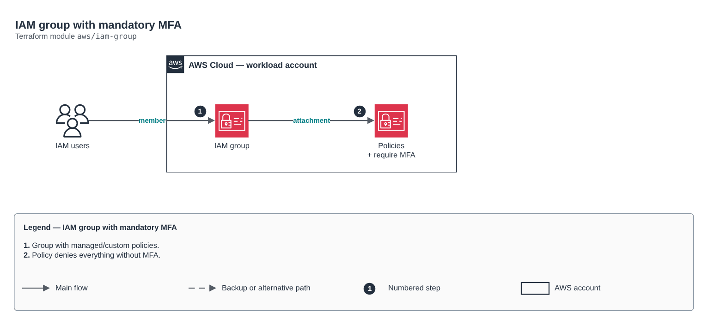

# IAM group with mandatory MFA

[Português](README.md) · **English**

> `aws/iam-group` · category **seguranca** · origin: Fintechs and Open Finance on AWS (2021)

> Designed in June 2021. With no time to keep the repository up to date back then, it is being published and updated now.

IAM group with managed and custom policies and declared members. For people, prefer IAM Identity Center (identity-center-permission-set module); use IAM groups for legacy accounts, break-glass or integrations that require an IAM user.

## Architecture



Editable source: [`diagram.drawio`](diagram.drawio) (open it in draw.io / diagrams.net), with Portuguese and English pages.

1. Group with managed/custom policies.
2. Policy denies everything without MFA.

## Usage

```hcl
module "iam_group" {
  source = "git::https://github.com/raphaelfcs/automacao_terraform.git//aws/iam-group?ref=v1.0.0"

  name                = "break-glass"
  managed_policy_arns = ["arn:aws:iam::aws:policy/AdministratorAccess"]
  require_mfa         = true
}
```

## Examples

| Example | Files |
|---|---|
| [`break-glass`](examples/break-glass) | `main.tf`, `locals.tf`, `backend.tf` |

Each example has its own backend (state isolated per module and example). Different environments only use another `backend.tf`/`*.tfvars`, without duplicating code.

## Inputs

| Name | Type | Default | Required | Description |
|---|---|---|---|---|
| `name` | `string` | - | **yes** | Group name. |
| `path` | `string` | `"/"` | no | IAM path. |
| `members` | `list(string)` | `[]` | no | Member IAM users (managed exclusively by this group). |
| `managed_policy_arns` | `list(string)` | `[]` | no | Attached managed policies. |
| `custom_policies` | `map(string)` | `{}` | no | Custom policies: name -> JSON. |
| `require_mfa` | `bool` | `true` | no | Attaches the policy that requires MFA for any action. |

## Outputs

| Name | Description |
|---|---|
| `group_name` | Group name. |
| `group_arn` | Group ARN. |
| `custom_policy_arns` | Name -> custom policy ARN map. |

## Files

- `iam.tf`: policies, roles and permissions
- `main.tf`: main resources
- `outputs.tf`: outputs
- `variables.tf`: inputs and validations
- `versions.tf`: Terraform and provider versions
- `examples/`: ready-to-use compositions
- `tests/`: `terraform test` with mocked providers

## Well-Architected

- Security: least privilege in policies, customer-managed key encryption and an audit trail.
- Operational excellence: everything declared in code, reviewed in PRs and tested with `terraform test`.

## Tests

```bash
cd aws/iam-group
terraform init -backend=false
terraform test
```
