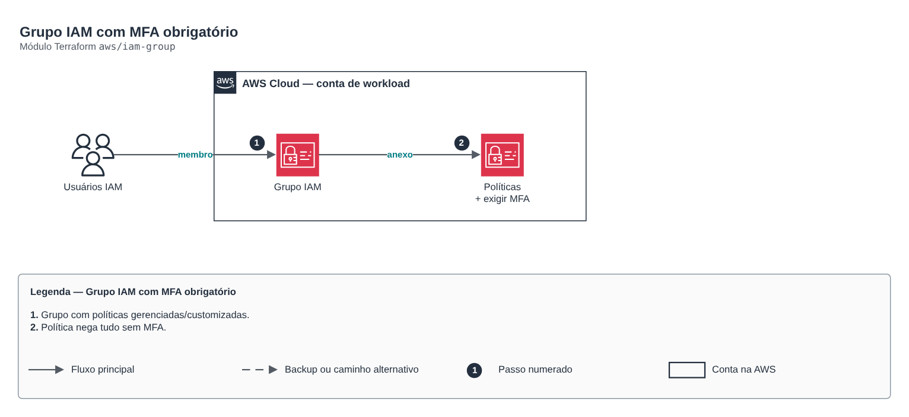

# Grupo IAM com MFA obrigatório

> `aws/iam-group` · categoria **seguranca** · origem: Fintechs e Open Finance em AWS (2021)

> Idealizado em junho de 2021. Por falta de tempo para manter o repositório em dia na época, está sendo publicado e atualizado agora.

Grupo IAM com políticas gerenciadas e customizadas e membros declarados. Para pessoas, prefira IAM Identity Center (módulo identity-center-permission-set); use grupos IAM para contas legadas, break-glass ou integrações que exigem usuário IAM.

## Arquitetura



Fonte editável: [`diagram.drawio`](diagram.drawio) (abra no draw.io / diagrams.net).

1. Grupo com políticas gerenciadas/customizadas.
2. Política nega tudo sem MFA.

## Uso

```hcl
module "iam_group" {
  source = "git::https://github.com/raphaelfcs/automacao_terraform.git//aws/iam-group?ref=v1.0.0"

  name                = "break-glass"
  managed_policy_arns = ["arn:aws:iam::aws:policy/AdministratorAccess"]
  require_mfa         = true
}
```

## Exemplos

| Exemplo | Arquivos |
|---|---|
| [`break-glass`](examples/break-glass) | `main.tf`, `locals.tf`, `backend.tf` |

Cada exemplo tem seu próprio backend (state isolado por módulo e exemplo). Ambientes diferentes usam apenas outro `backend.tf`/`*.tfvars`, sem duplicar código.

## Entradas

| Nome | Tipo | Padrão | Obrigatória | Descrição |
|---|---|---|---|---|
| `name` | `string` | - | **sim** | Nome do grupo. |
| `path` | `string` | `"/"` | não | Path IAM. |
| `members` | `list(string)` | `[]` | não | Usuários IAM membros (gerenciados por este grupo, de forma exclusiva). |
| `managed_policy_arns` | `list(string)` | `[]` | não | Políticas gerenciadas anexadas. |
| `custom_policies` | `map(string)` | `{}` | não | Políticas customizadas: nome -> JSON. |
| `require_mfa` | `bool` | `true` | não | Anexa a política que exige MFA para qualquer ação. |

## Saídas

| Nome | Descrição |
|---|---|
| `group_name` | Nome do grupo. |
| `group_arn` | ARN do grupo. |
| `custom_policy_arns` | Mapa nome -> ARN das políticas customizadas. |

## Arquivos

- `iam.tf`: políticas, papéis e permissões
- `main.tf`: recursos principais
- `outputs.tf`: saídas
- `variables.tf`: entradas e validações
- `versions.tf`: versões do Terraform e providers
- `examples/`: composições prontas para uso
- `tests/`: `terraform test` com providers simulados

## Well-Architected

- Segurança: privilégio mínimo nas políticas, criptografia com chave gerenciada pelo cliente e trilha de auditoria.
- Excelência operacional: tudo declarado em código, revisado em PR e testado com `terraform test`.

## Testes

```bash
cd aws/iam-group
terraform init -backend=false
terraform test
```
