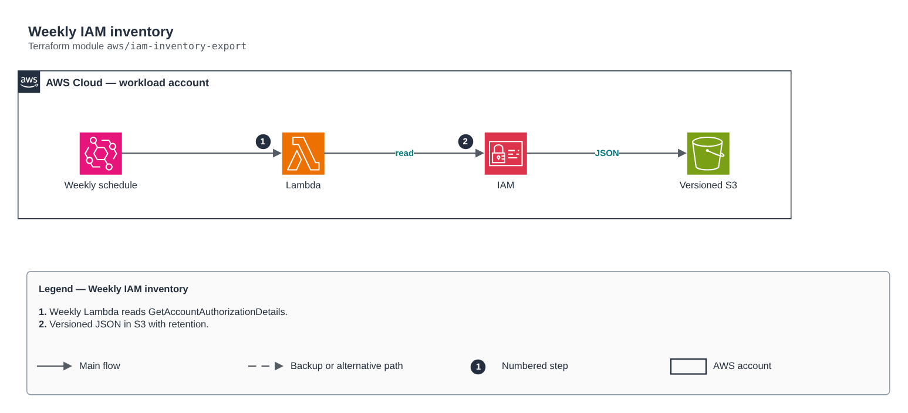

# Weekly IAM inventory

[Português](README.md) · **English**

> `aws/iam-inventory-export` · category **automacao** · origin: Telecom CCoE and landing zone (2025)

> Designed in June 2025. With no time to keep the repository up to date back then, it is being published and updated now.

Weekly IAM inventory as JSON in S3 (versioned, encrypted, with retention): users, groups, roles and local policies with their documents.

## Architecture



Editable source: [`diagram.drawio`](diagram.drawio) (open it in draw.io / diagrams.net), with Portuguese and English pages.

1. Weekly Lambda reads GetAccountAuthorizationDetails.
2. Versioned JSON in S3 with retention.

## Usage

```hcl
module "iam_inventory_export" {
  source = "git::https://github.com/raphaelfcs/automacao_terraform.git//aws/iam-inventory-export?ref=v1.0.0"

  name_prefix = local.name_prefix
  bucket_name = "demo-iam-inventario-123456789012"
  tags        = local.tags
}
```

## Examples

| Example | Files |
|---|---|
| [`basico`](examples/basico) | `main.tf`, `locals.tf`, `backend.tf` |

Each example has its own backend (state isolated per module and example). Different environments only use another `backend.tf`/`*.tfvars`, without duplicating code.

## Inputs

| Name | Type | Default | Required | Description |
|---|---|---|---|---|
| `name_prefix` | `string` | - | **yes** | Resource prefix. |
| `bucket_name` | `string` | - | **yes** | Inventory bucket. |
| `schedule_expression` | `string` | `"cron(0 6 ? * SUN *)"` | no | Export schedule. |
| `retention_days` | `number` | `365` | no | Inventory retention. |
| `kms_key_arn` | `string` | `null` | no | Bucket and log group KMS key. |
| `tags` | `map(string)` | `{}` | no | Tags applied. |

## Outputs

| Name | Description |
|---|---|
| `bucket_name` | Inventory bucket. |
| `function_arn` | Function ARN. |

## Files

- `iam.tf`: policies, roles and permissions
- `main.tf`: main resources
- `outputs.tf`: outputs
- `variables.tf`: inputs and validations
- `versions.tf`: Terraform and provider versions
- `src/`: supporting files (code, templates or policies)
- `examples/`: ready-to-use compositions
- `tests/`: `terraform test` with mocked providers

## Well-Architected

- Operational excellence: manual routine replaced by a managed service or a least-privilege function.
- Cost optimization: on-demand/scheduled execution, no servers running.

## Tests

```bash
cd aws/iam-inventory-export
terraform init -backend=false
terraform test
```
