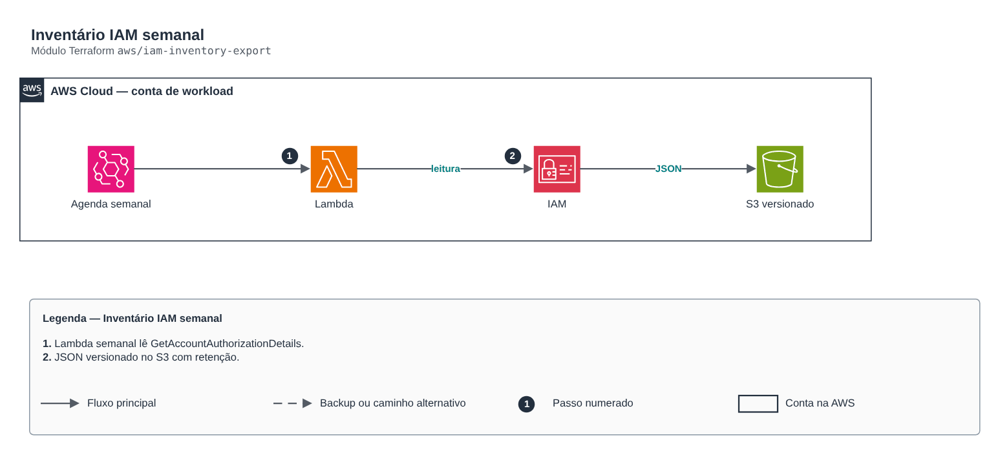

# Inventário IAM semanal

**Português** · [English](README.en.md)

> `aws/iam-inventory-export` · categoria **automacao** · origem: CCoE e landing zone de telecom (2025)

> Idealizado em junho de 2025. Por falta de tempo para manter o repositório em dia na época, está sendo publicado e atualizado agora.

Inventário IAM semanal em JSON no S3 (versionado, cifrado, com retenção): usuários, grupos, roles e políticas locais com seus documentos.

## Arquitetura



Fonte editável: [`diagram.drawio`](diagram.drawio) (abra no draw.io / diagrams.net), com páginas em português e inglês.

1. Lambda semanal lê GetAccountAuthorizationDetails.
2. JSON versionado no S3 com retenção.

## Uso

```hcl
module "iam_inventory_export" {
  source = "git::https://github.com/raphaelfcs/automacao_terraform.git//aws/iam-inventory-export?ref=v1.0.0"

  name_prefix = local.name_prefix
  bucket_name = "demo-iam-inventario-123456789012"
  tags        = local.tags
}
```

## Exemplos

| Exemplo | Arquivos |
|---|---|
| [`basico`](examples/basico) | `main.tf`, `locals.tf`, `backend.tf` |

Cada exemplo tem seu próprio backend (state isolado por módulo e exemplo). Ambientes diferentes usam apenas outro `backend.tf`/`*.tfvars`, sem duplicar código.

## Entradas

| Nome | Tipo | Padrão | Obrigatória | Descrição |
|---|---|---|---|---|
| `name_prefix` | `string` | - | **sim** | Prefixo dos recursos. |
| `bucket_name` | `string` | - | **sim** | Bucket do inventário. |
| `schedule_expression` | `string` | `"cron(0 6 ? * SUN *)"` | não | Agenda da exportação. |
| `retention_days` | `number` | `365` | não | Retenção dos inventários. |
| `kms_key_arn` | `string` | `null` | não | Chave KMS do bucket e do log group. |
| `tags` | `map(string)` | `{}` | não | Tags aplicadas. |

## Saídas

| Nome | Descrição |
|---|---|
| `bucket_name` | Bucket do inventário. |
| `function_arn` | ARN da função. |

## Arquivos

- `iam.tf`: políticas, papéis e permissões
- `main.tf`: recursos principais
- `outputs.tf`: saídas
- `variables.tf`: entradas e validações
- `versions.tf`: versões do Terraform e providers
- `src/`: arquivos auxiliares (código, templates ou políticas)
- `examples/`: composições prontas para uso
- `tests/`: `terraform test` com providers simulados

## Well-Architected

- Excelência operacional: rotina manual substituída por serviço gerenciado ou função com permissões mínimas.
- Otimização de custos: execução sob demanda/agendada, sem servidores ligados.

## Testes

```bash
cd aws/iam-inventory-export
terraform init -backend=false
terraform test
```
