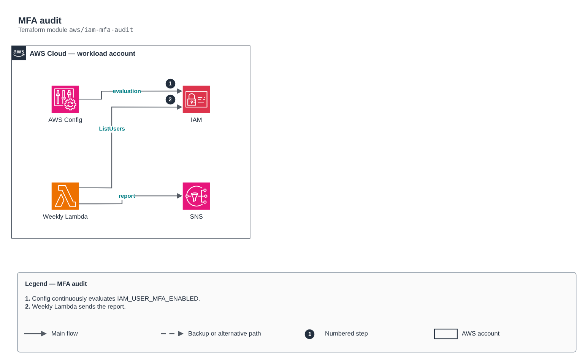

# MFA audit

[Português](README.md) · **English**

> `aws/iam-mfa-audit` · category **automacao** · origin: Telecom CCoE and landing zone (2025)

> Designed in July 2025. With no time to keep the repository up to date back then, it is being published and updated now.

MFA audit: managed AWS Config rule (continuous) + a weekly Lambda that sends, over SNS, the report of IAM users with console access and no MFA. Redesign of the old MFA Lambda that e-mailed fixed recipients through SES.

## Architecture



Editable source: [`diagram.drawio`](diagram.drawio) (open it in draw.io / diagrams.net), with Portuguese and English pages.

1. Config continuously evaluates IAM_USER_MFA_ENABLED.
2. Weekly Lambda sends the report.

## Usage

```hcl
module "iam_mfa_audit" {
  source = "git::https://github.com/raphaelfcs/automacao_terraform.git//aws/iam-mfa-audit?ref=v1.0.0"

  name_prefix     = local.name_prefix
  alert_topic_arn = "arn:aws:sns:sa-east-1:123456789012:demo-dev-alertas"
  tags            = local.tags
}
```

## Examples

| Example | Files |
|---|---|
| [`basico`](examples/basico) | `main.tf`, `locals.tf`, `backend.tf` |

Each example has its own backend (state isolated per module and example). Different environments only use another `backend.tf`/`*.tfvars`, without duplicating code.

## Inputs

| Name | Type | Default | Required | Description |
|---|---|---|---|---|
| `name_prefix` | `string` | - | **yes** | Resource prefix. |
| `alert_topic_arn` | `string` | - | **yes** | Report SNS topic. |
| `schedule_expression` | `string` | `"cron(0 11 ? * MON *)"` | no | Report schedule. |
| `create_config_rule` | `bool` | `true` | no | Creates the managed Config rule (requires an active recorder in the account). |
| `kms_key_arn` | `string` | `null` | no | KMS key of the function log group. |
| `tags` | `map(string)` | `{}` | no | Tags applied. |

## Outputs

| Name | Description |
|---|---|
| `function_arn` | Audit function ARN. |

## Files

- `iam.tf`: policies, roles and permissions
- `main.tf`: main resources
- `outputs.tf`: outputs
- `variables.tf`: inputs and validations
- `versions.tf`: Terraform and provider versions
- `src/`: supporting files (code, templates or policies)
- `examples/`: ready-to-use compositions
- `tests/`: `terraform test` with mocked providers

## Well-Architected

- Operational excellence: manual routine replaced by a managed service or a least-privilege function.
- Cost optimization: on-demand/scheduled execution, no servers running.

## Tests

```bash
cd aws/iam-mfa-audit
terraform init -backend=false
terraform test
```
