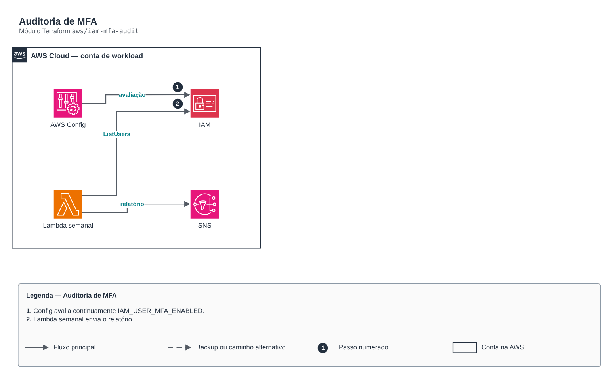

# Auditoria de MFA

**Português** · [English](README.en.md)

> `aws/iam-mfa-audit` · categoria **automacao** · origem: CCoE e landing zone de telecom (2025)

> Idealizado em julho de 2025. Por falta de tempo para manter o repositório em dia na época, está sendo publicado e atualizado agora.

Auditoria de MFA: regra gerenciada do AWS Config (contínua) + Lambda semanal que envia por SNS o relatório de usuários IAM com console e sem MFA. Redesenho da antiga Lambda de MFA que enviava e-mail por SES com destinatários fixos.

## Arquitetura



Fonte editável: [`diagram.drawio`](diagram.drawio) (abra no draw.io / diagrams.net), com páginas em português e inglês.

1. Config avalia continuamente IAM_USER_MFA_ENABLED.
2. Lambda semanal envia o relatório.

## Uso

```hcl
module "iam_mfa_audit" {
  source = "git::https://github.com/raphaelfcs/automacao_terraform.git//aws/iam-mfa-audit?ref=v1.0.0"

  name_prefix     = local.name_prefix
  alert_topic_arn = "arn:aws:sns:sa-east-1:123456789012:demo-dev-alertas"
  tags            = local.tags
}
```

## Exemplos

| Exemplo | Arquivos |
|---|---|
| [`basico`](examples/basico) | `main.tf`, `locals.tf`, `backend.tf` |

Cada exemplo tem seu próprio backend (state isolado por módulo e exemplo). Ambientes diferentes usam apenas outro `backend.tf`/`*.tfvars`, sem duplicar código.

## Entradas

| Nome | Tipo | Padrão | Obrigatória | Descrição |
|---|---|---|---|---|
| `name_prefix` | `string` | - | **sim** | Prefixo dos recursos. |
| `alert_topic_arn` | `string` | - | **sim** | Tópico SNS do relatório. |
| `schedule_expression` | `string` | `"cron(0 11 ? * MON *)"` | não | Agenda do relatório. |
| `create_config_rule` | `bool` | `true` | não | Cria a regra gerenciada do Config (exige recorder ativo na conta). |
| `kms_key_arn` | `string` | `null` | não | Chave KMS do log group da função. |
| `tags` | `map(string)` | `{}` | não | Tags aplicadas. |

## Saídas

| Nome | Descrição |
|---|---|
| `function_arn` | ARN da função de auditoria. |

## Arquivos

- `iam.tf`: políticas, papéis e permissões
- `main.tf`: recursos principais
- `outputs.tf`: saídas
- `variables.tf`: entradas e validações
- `versions.tf`: versões do Terraform e providers
- `src/`: arquivos auxiliares (código, templates ou políticas)
- `examples/`: composições prontas para uso
- `tests/`: `terraform test` com providers simulados

## Well-Architected

- Excelência operacional: rotina manual substituída por serviço gerenciado ou função com permissões mínimas.
- Otimização de custos: execução sob demanda/agendada, sem servidores ligados.

## Testes

```bash
cd aws/iam-mfa-audit
terraform init -backend=false
terraform test
```
