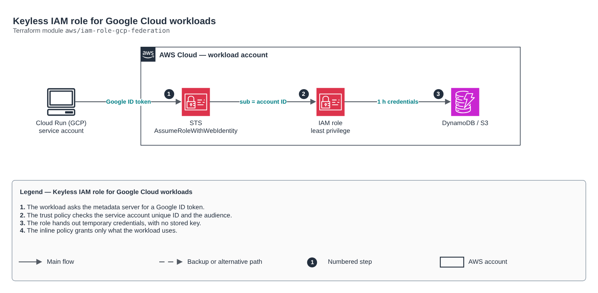

# Keyless IAM role for Google Cloud workloads

[Português](README.md) · **English**

> `aws/iam-role-gcp-federation` · category **seguranca** · origin: Health records platform (2026)

> Designed in November 2026 and published now.

IAM role assumed by a Google Cloud service account, with no access key: the GCP workload (Cloud Run, GKE, Cloud Functions) presents a Google ID token and receives temporary credentials through AssumeRoleWithWebIdentity. The trust policy checks the service account unique ID (azp and sub) and the requested audience (oaud), so another service account in the same project cannot get in.

## Architecture



Editable source: [`diagram.drawio`](diagram.drawio) (open it in draw.io / diagrams.net), with Portuguese and English pages.

1. The workload asks the metadata server for a Google ID token.
2. The trust policy checks the service account unique ID and the audience.
3. The role hands out temporary credentials, with no stored key.
4. The inline policy grants only what the workload uses.

## Usage

```hcl
module "iam_role_gcp_federation" {
  source = "git::https://github.com/raphaelfcs/automacao_terraform.git//aws/iam-role-gcp-federation?ref=v1.0.0"

  role_name                  = "${local.name_prefix}-gcp-api"
  google_service_account_ids = ["112233445566778899001"]
  policy_json                = jsonencode({ Version = "2012-10-17", Statement = [{ Effect = "Allow", Action = ["dynamodb:GetItem", "dynamodb:PutItem", "dynamodb:Query"], Resource = "arn:aws:dynamodb:sa-east-1:123456789012:table/demo-dev-itens*" }] })
  tags                       = local.tags
}
```

## Examples

| Example | Files |
|---|---|
| [`cloud-run`](examples/cloud-run) | `main.tf`, `locals.tf`, `backend.tf` |

Each example has its own backend (state isolated per module and example). Different environments only use another `backend.tf`/`*.tfvars`, without duplicating code.

## Inputs

| Name | Type | Default | Required | Description |
|---|---|---|---|---|
| `role_name` | `string` | - | **yes** | Role name. |
| `google_service_account_ids` | `list(string)` | - | **yes** | Unique IDs (numeric, 21 digits) of the GCP service accounts that may assume the role. |
| `audience` | `string` | `"sts.amazonaws.com"` | no | Audience the workload requests in the ID token (becomes the aud claim; AWS compares it as oaud). |
| `policy_json` | `string` | - | **yes** | Inline policy with the minimum the workload needs. |
| `max_session_duration` | `number` | `3600` | no | Maximum session duration in seconds. |
| `permissions_boundary_arn` | `string` | `null` | no | Role permissions boundary (optional). |
| `tags` | `map(string)` | `{}` | no | Tags applied. |

## Outputs

| Name | Description |
|---|---|
| `role_arn` | Role ARN (goes into the workload configuration on GCP). |
| `role_name` | Role name. |

## Files

- `main.tf`: main resources
- `outputs.tf`: outputs
- `variables.tf`: inputs and validations
- `versions.tf`: Terraform and provider versions
- `examples/`: ready-to-use compositions
- `tests/`: `terraform test` with mocked providers

## Well-Architected

- Security: least privilege in policies, customer-managed key encryption and an audit trail.
- Operational excellence: everything declared in code, reviewed in PRs and tested with `terraform test`.

## Tests

```bash
cd aws/iam-role-gcp-federation
terraform init -backend=false
terraform test
```
