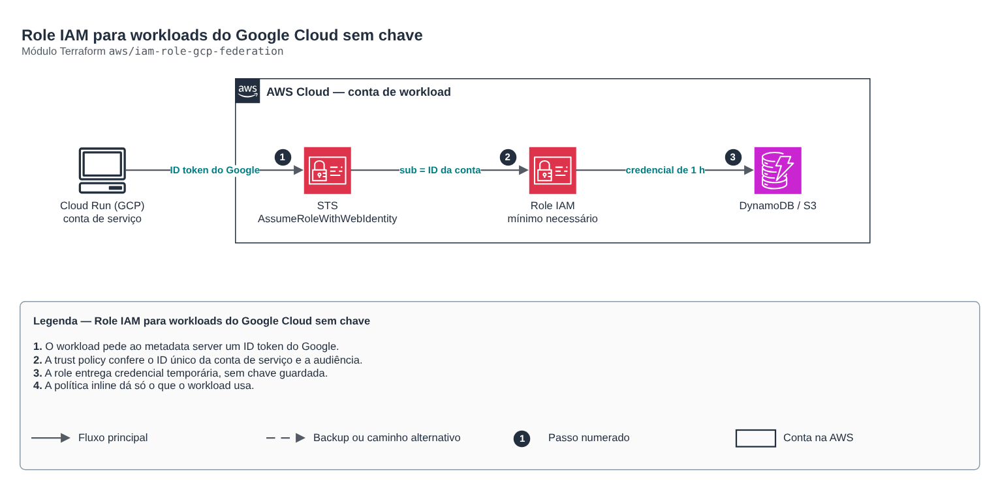

# Role IAM para workloads do Google Cloud sem chave

**Português** · [English](README.en.md)

> `aws/iam-role-gcp-federation` · categoria **seguranca** · origem: Plataforma de documentos de saúde (2026)

> Idealizado em novembro de 2026 e publicado agora.

Role IAM assumida por uma conta de serviço do Google Cloud, sem chave de acesso: o workload no GCP (Cloud Run, GKE, Cloud Functions) apresenta um ID token do Google e recebe credencial temporária via AssumeRoleWithWebIdentity. A trust policy confere o ID único da conta de serviço (azp e sub) e a audiência pedida (oaud), então outra conta de serviço do mesmo projeto não entra.

## Arquitetura



Fonte editável: [`diagram.drawio`](diagram.drawio) (abra no draw.io / diagrams.net), com páginas em português e inglês.

1. O workload pede ao metadata server um ID token do Google.
2. A trust policy confere o ID único da conta de serviço e a audiência.
3. A role entrega credencial temporária, sem chave guardada.
4. A política inline dá só o que o workload usa.

## Uso

```hcl
module "iam_role_gcp_federation" {
  source = "git::https://github.com/raphaelfcs/automacao_terraform.git//aws/iam-role-gcp-federation?ref=v1.0.0"

  role_name                  = "${local.name_prefix}-gcp-api"
  google_service_account_ids = ["112233445566778899001"]
  policy_json                = jsonencode({ Version = "2012-10-17", Statement = [{ Effect = "Allow", Action = ["dynamodb:GetItem", "dynamodb:PutItem", "dynamodb:Query"], Resource = "arn:aws:dynamodb:sa-east-1:123456789012:table/demo-dev-itens*" }] })
  tags                       = local.tags
}
```

## Exemplos

| Exemplo | Arquivos |
|---|---|
| [`cloud-run`](examples/cloud-run) | `main.tf`, `locals.tf`, `backend.tf` |

Cada exemplo tem seu próprio backend (state isolado por módulo e exemplo). Ambientes diferentes usam apenas outro `backend.tf`/`*.tfvars`, sem duplicar código.

## Entradas

| Nome | Tipo | Padrão | Obrigatória | Descrição |
|---|---|---|---|---|
| `role_name` | `string` | - | **sim** | Nome da role. |
| `google_service_account_ids` | `list(string)` | - | **sim** | IDs únicos (numéricos, 21 dígitos) das contas de serviço do GCP que podem assumir a role. |
| `audience` | `string` | `"sts.amazonaws.com"` | não | Audiência que o workload pede no ID token (vira o claim aud; o AWS compara como oaud). |
| `policy_json` | `string` | - | **sim** | Política inline com o mínimo que o workload precisa. |
| `max_session_duration` | `number` | `3600` | não | Duração máxima da sessão em segundos. |
| `permissions_boundary_arn` | `string` | `null` | não | Permissions boundary da role (opcional). |
| `tags` | `map(string)` | `{}` | não | Tags aplicadas. |

## Saídas

| Nome | Descrição |
|---|---|
| `role_arn` | ARN da role (vai na configuração do workload no GCP). |
| `role_name` | Nome da role. |

## Arquivos

- `main.tf`: recursos principais
- `outputs.tf`: saídas
- `variables.tf`: entradas e validações
- `versions.tf`: versões do Terraform e providers
- `examples/`: composições prontas para uso
- `tests/`: `terraform test` com providers simulados

## Well-Architected

- Segurança: privilégio mínimo nas políticas, criptografia com chave gerenciada pelo cliente e trilha de auditoria.
- Excelência operacional: tudo declarado em código, revisado em PR e testado com `terraform test`.

## Testes

```bash
cd aws/iam-role-gcp-federation
terraform init -backend=false
terraform test
```
