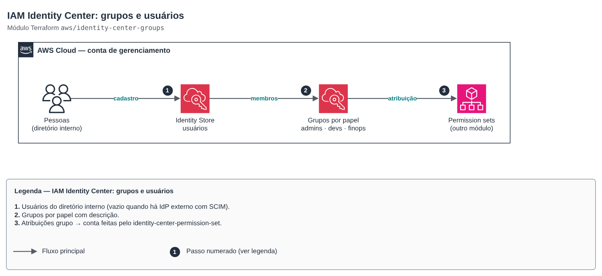

# IAM Identity Center: groups and users

[Português](README.md) · **English**

> `aws/identity-center-groups` · category **seguranca** · origin: SaaS platform landing zone (2026)

> Created in November 2026 for the landing zone of an in-house SaaS platform.

IAM Identity Center groups (and, optionally, users) in the internal directory: the base of federated human access, with no IAM users. Permission sets and group → account assignments live in `identity-center-permission-set`, which references these groups by name.

## Architecture



Editable source: [`diagram.drawio`](diagram.drawio) (open in draw.io / diagrams.net), with pages in Portuguese and English.

1. Internal directory users (empty when an external IdP with SCIM is used).
2. Role groups with descriptions.
3. Group → account assignments made by identity-center-permission-set.

Users created through the API get no automatic invitation: in the console, use *Reset password* to send the email.

## Usage

```hcl
module "identity_center_groups" {
  source = "git::https://github.com/raphaelfcs/automacao_terraform.git//aws/identity-center-groups?ref=v1.1.0"

  groups = {
    demo-admins   = "Administradores da plataforma (todas as contas)"
    demo-devs     = "Desenvolvimento: escrita em dev, leitura em prd"
    demo-readonly = "Somente leitura"
    demo-finops   = "Custos e faturamento"
  }

  users = {
    "admin@example.com" = {
      given_name  = "Admin"
      family_name = "Plataforma"
      groups      = ["demo-admins", "demo-finops"]
    }
  }
}
```

## Examples

| Example | Files |
|---|---|
| [`grupos-e-usuarios`](examples/grupos-e-usuarios) | `main.tf`, `locals.tf`, `backend.tf` |

Each example has its own backend (state isolated per module and example). Other environments only change `backend.tf`/`*.tfvars`, without duplicating code.

## Inputs

| Name | Type | Default | Required | Description |
|---|---|---|---|---|
| `groups` | `map(string)` | — | yes | Groups by name (DisplayName) with the description. |
| `users` | `map(object({given_name = string, fami...` | `{}` | no | Internal directory users by user_name (usually the email) and their groups. With an external IdP (SCIM), leave empty. |

## Outputs

| Name | Description |
|---|---|
| `group_ids` | Identity Store ID of each group. |
| `user_ids` | Identity Store ID of each user. |
| `identity_store_id` | Identity Store ID. |

## Files

- `locals.tf`: derived values
- `main.tf`: main resources
- `outputs.tf`: outputs
- `variables.tf`: inputs and validations
- `versions.tf`: Terraform and provider versions
- `examples/`: ready-to-use compositions
- `tests/`: `terraform test` with mocked providers

## Well-Architected

- Security: human access by group and role, with temporary credentials and Identity Center MFA.
- Operational excellence: joiners and leavers through pull requests, with history.

## Tests

```bash
cd aws/identity-center-groups
terraform init -backend=false
terraform test
```
