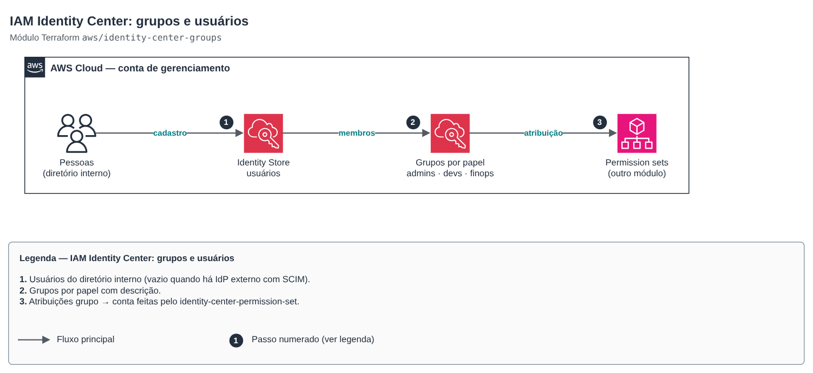

# IAM Identity Center: grupos e usuários

**Português** · [English](README.en.md)

> `aws/identity-center-groups` · categoria **seguranca** · origem: landing zone de plataforma SaaS (2026)

> Criado em novembro de 2026, para a landing zone de uma plataforma SaaS própria.

Grupos (e, opcionalmente, usuários) do IAM Identity Center no diretório interno: a base do acesso humano federado, sem usuários IAM. Os permission sets e as atribuições grupo → conta ficam no módulo `identity-center-permission-set`, que referencia estes grupos pelo nome.

## Arquitetura



Fonte editável: [`diagram.drawio`](diagram.drawio) (abra no draw.io / diagrams.net), com páginas em português e inglês.

1. Usuários do diretório interno (vazio quando há IdP externo com SCIM).
2. Grupos por papel com descrição.
3. Atribuições grupo → conta feitas pelo identity-center-permission-set.

Usuários criados por API não recebem convite automático: no console, use *Reset password* para enviar o e-mail.

## Uso

```hcl
module "identity_center_groups" {
  source = "git::https://github.com/raphaelfcs/automacao_terraform.git//aws/identity-center-groups?ref=v1.1.0"

  groups = {
    demo-admins   = "Administradores da plataforma (todas as contas)"
    demo-devs     = "Desenvolvimento: escrita em dev, leitura em prd"
    demo-readonly = "Somente leitura"
    demo-finops   = "Custos e faturamento"
  }

  users = {
    "admin@example.com" = {
      given_name  = "Admin"
      family_name = "Plataforma"
      groups      = ["demo-admins", "demo-finops"]
    }
  }
}
```

## Exemplos

| Exemplo | Arquivos |
|---|---|
| [`grupos-e-usuarios`](examples/grupos-e-usuarios) | `main.tf`, `locals.tf`, `backend.tf` |

Cada exemplo tem seu próprio backend (state isolado por módulo e exemplo). Ambientes diferentes usam apenas outro `backend.tf`/`*.tfvars`, sem duplicar código.

## Entradas

| Nome | Tipo | Padrão | Obrigatória | Descrição |
|---|---|---|---|---|
| `groups` | `map(string)` | — | sim | Grupos por nome (DisplayName) com a descrição. |
| `users` | `map(object({given_name = string, fami...` | `{}` | não | Usuários do diretório interno por user_name (geralmente o e-mail) e os grupos de cada um. Com IdP externo (SCIM), deixe vazio. |

## Saídas

| Nome | Descrição |
|---|---|
| `group_ids` | ID de cada grupo no Identity Store. |
| `user_ids` | ID de cada usuário no Identity Store. |
| `identity_store_id` | ID do Identity Store. |

## Arquivos

- `locals.tf`: valores derivados
- `main.tf`: recursos principais
- `outputs.tf`: saídas
- `variables.tf`: entradas e validações
- `versions.tf`: versões do Terraform e providers
- `examples/`: composições prontas para uso
- `tests/`: `terraform test` com providers simulados

## Well-Architected

- Segurança: acesso humano por grupo e por papel, com credenciais temporárias e MFA do Identity Center.
- Excelência operacional: entrada e saída de pessoas por PR, com histórico.

## Testes

```bash
cd aws/identity-center-groups
terraform init -backend=false
terraform test
```
