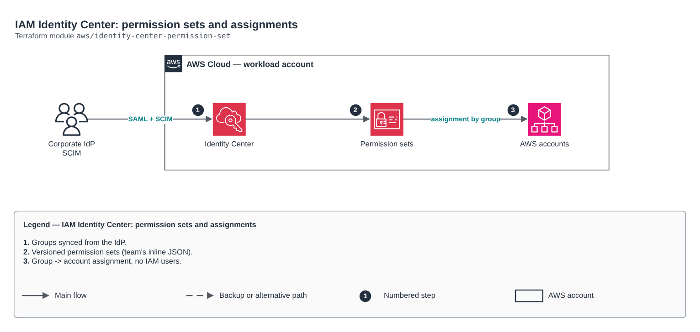

# IAM Identity Center: permission sets and assignments

[Português](README.md) · **English**

> `aws/identity-center-permission-set` · category **seguranca** · origin: Telecom CCoE and landing zone (2025)

> Designed in September 2025. With no time to keep the repository up to date back then, it is being published and updated now.

IAM Identity Center permission sets (federated human access, no IAM users): managed, inline (JSON) and customer-managed policies, permissions boundary and group -> account assignments. Runs in the management or delegated administrator account.

## Architecture



Editable source: [`diagram.drawio`](diagram.drawio) (open it in draw.io / diagrams.net), with Portuguese and English pages.

1. Groups synced from the IdP.
2. Versioned permission sets (team's inline JSON).
3. Group -> account assignment, no IAM users.

## Usage

```hcl
module "identity_center_permission_set" {
  source = "git::https://github.com/raphaelfcs/automacao_terraform.git//aws/identity-center-permission-set?ref=v1.0.0"

  permission_sets = {
    RedeLeitura = { description = "Rede somente leitura", managed_policy_arns = ["arn:aws:iam::aws:policy/job-function/ViewOnlyAccess"], inline_policy = file("${path.module}/politicas/rede-leitura.json") }
    Deploy      = { description = "Deploy de aplicacoes", session_duration = "PT2H", managed_policy_arns = ["arn:aws:iam::aws:policy/PowerUserAccess"] }
  }
  account_assignments = [
    { permission_set = "RedeLeitura", group = "time-rede", account_id = "123456789012" },
    { permission_set = "Deploy", group = "time-apps", account_id = "123456789012" },
  ]
  tags = local.tags
}
```

## Examples

| Example | Files |
|---|---|
| [`times`](examples/times) | `main.tf`, `locals.tf`, `backend.tf` |

Each example has its own backend (state isolated per module and example). Different environments only use another `backend.tf`/`*.tfvars`, without duplicating code.

## Inputs

| Name | Type | Default | Required | Description |
|---|---|---|---|---|
| `permission_sets` | `map(...)` | - | **yes** | Permission sets by name. |
| `account_assignments` | `list(...)` | `[]` | no | Assignments: Identity Store group (DisplayName) gets the permission set on the account. |
| `tags` | `map(string)` | `{}` | no | Permission set tags. |

## Outputs

| Name | Description |
|---|---|
| `permission_set_arns` | Name -> permission set ARN map. |
| `assignment_count` | Number of assignments created. |

## Files

- `iam.tf`: policies, roles and permissions
- `main.tf`: main resources
- `outputs.tf`: outputs
- `variables.tf`: inputs and validations
- `versions.tf`: Terraform and provider versions
- `examples/`: ready-to-use compositions
- `tests/`: `terraform test` with mocked providers

## Well-Architected

- Security: least privilege in policies, customer-managed key encryption and an audit trail.
- Operational excellence: everything declared in code, reviewed in PRs and tested with `terraform test`.

## Tests

```bash
cd aws/identity-center-permission-set
terraform init -backend=false
terraform test
```
