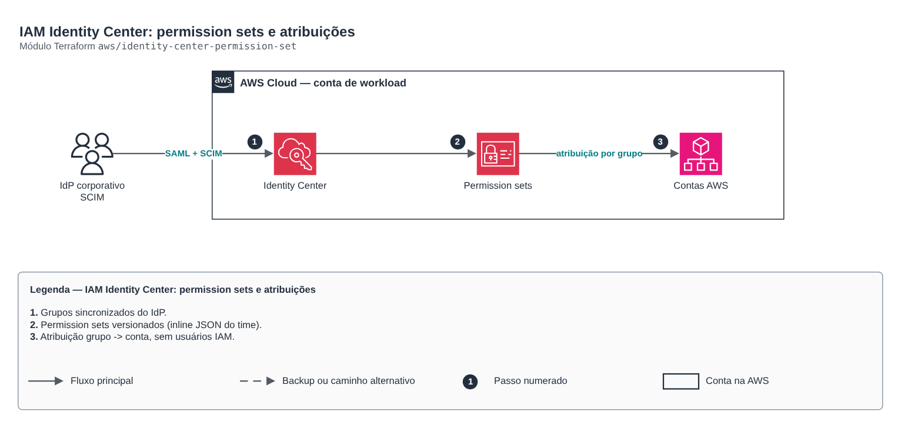

# IAM Identity Center: permission sets e atribuições

**Português** · [English](README.en.md)

> `aws/identity-center-permission-set` · categoria **seguranca** · origem: CCoE e landing zone de telecom (2025)

> Idealizado em setembro de 2025. Por falta de tempo para manter o repositório em dia na época, está sendo publicado e atualizado agora.

Permission sets do IAM Identity Center (acesso humano federado, sem usuários IAM): políticas gerenciadas, inline (JSON), customer managed e permissions boundary, e as atribuições grupo -> conta. Roda na conta de gerenciamento ou na administradora delegada.

## Arquitetura



Fonte editável: [`diagram.drawio`](diagram.drawio) (abra no draw.io / diagrams.net), com páginas em português e inglês.

1. Grupos sincronizados do IdP.
2. Permission sets versionados (inline JSON do time).
3. Atribuição grupo -> conta, sem usuários IAM.

## Uso

```hcl
module "identity_center_permission_set" {
  source = "git::https://github.com/raphaelfcs/automacao_terraform.git//aws/identity-center-permission-set?ref=v1.0.0"

  permission_sets = {
    RedeLeitura = { description = "Rede somente leitura", managed_policy_arns = ["arn:aws:iam::aws:policy/job-function/ViewOnlyAccess"], inline_policy = file("${path.module}/politicas/rede-leitura.json") }
    Deploy      = { description = "Deploy de aplicacoes", session_duration = "PT2H", managed_policy_arns = ["arn:aws:iam::aws:policy/PowerUserAccess"] }
  }
  account_assignments = [
    { permission_set = "RedeLeitura", group = "time-rede", account_id = "123456789012" },
    { permission_set = "Deploy", group = "time-apps", account_id = "123456789012" },
  ]
  tags = local.tags
}
```

## Exemplos

| Exemplo | Arquivos |
|---|---|
| [`times`](examples/times) | `main.tf`, `locals.tf`, `backend.tf` |

Cada exemplo tem seu próprio backend (state isolado por módulo e exemplo). Ambientes diferentes usam apenas outro `backend.tf`/`*.tfvars`, sem duplicar código.

## Entradas

| Nome | Tipo | Padrão | Obrigatória | Descrição |
|---|---|---|---|---|
| `permission_sets` | `map(...)` | - | **sim** | Permission sets por nome. |
| `account_assignments` | `list(...)` | `[]` | não | Atribuições: grupo do Identity Store (DisplayName) recebe o permission set na conta. |
| `tags` | `map(string)` | `{}` | não | Tags dos permission sets. |

## Saídas

| Nome | Descrição |
|---|---|
| `permission_set_arns` | Mapa nome -> ARN do permission set. |
| `assignment_count` | Quantidade de atribuições criadas. |

## Arquivos

- `iam.tf`: políticas, papéis e permissões
- `main.tf`: recursos principais
- `outputs.tf`: saídas
- `variables.tf`: entradas e validações
- `versions.tf`: versões do Terraform e providers
- `examples/`: composições prontas para uso
- `tests/`: `terraform test` com providers simulados

## Well-Architected

- Segurança: privilégio mínimo nas políticas, criptografia com chave gerenciada pelo cliente e trilha de auditoria.
- Excelência operacional: tudo declarado em código, revisado em PR e testado com `terraform test`.

## Testes

```bash
cd aws/identity-center-permission-set
terraform init -backend=false
terraform test
```
