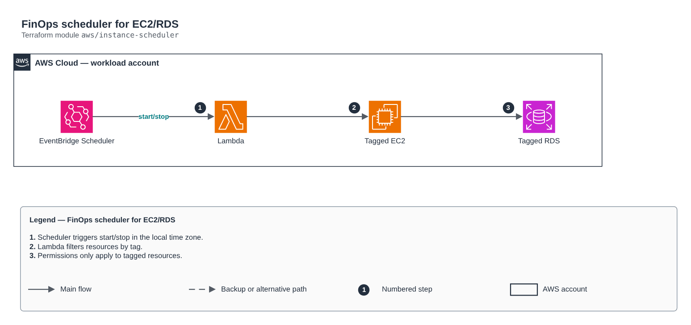

# FinOps scheduler for EC2/RDS

[Português](README.md) · **English**

> `aws/instance-scheduler` · category **automacao** · origin: Retail, migration to AWS (2017-2018)

> Designed in October 2018. With no time to keep the repository up to date back then, it is being published and updated now.

Tag-based FinOps scheduler for EC2/RDS: EventBridge Scheduler (cron with time zone) invokes the Lambda with {"action": "start"|"stop"}. Redesign of the old Start-EC2/Stop-EC2/RdsStopTime scripts. For EKS node groups use the autoscaling-schedule module.

## Architecture



Editable source: [`diagram.drawio`](diagram.drawio) (open it in draw.io / diagrams.net), with Portuguese and English pages.

1. Scheduler triggers start/stop in the local time zone.
2. Lambda filters resources by tag.
3. Permissions only apply to tagged resources.

## Usage

```hcl
module "instance_scheduler" {
  source = "git::https://github.com/raphaelfcs/automacao_terraform.git//aws/instance-scheduler?ref=v1.0.0"

  name_prefix = local.name_prefix
  start_cron  = "cron(0 8 ? * MON-FRI *)"
  stop_cron   = "cron(0 19 ? * MON-FRI *)"
  tags        = local.tags
}
```

## Examples

| Example | Files |
|---|---|
| [`basico`](examples/basico) | `main.tf`, `locals.tf`, `backend.tf` |

Each example has its own backend (state isolated per module and example). Different environments only use another `backend.tf`/`*.tfvars`, without duplicating code.

## Inputs

| Name | Type | Default | Required | Description |
|---|---|---|---|---|
| `name_prefix` | `string` | - | **yes** | Resource prefix. |
| `schedule_tag` | `string` | `"Agenda"` | no | Tag key that marks scheduled resources. |
| `schedule_value` | `string` | `"horario-comercial"` | no | Tag value. |
| `start_cron` | `string` | `"cron(0 7 ? * MON-FRI *)"` | no | Start expression (EventBridge Scheduler). |
| `stop_cron` | `string` | `"cron(0 20 ? * MON-FRI *)"` | no | Stop expression. |
| `timezone` | `string` | `"America/Sao_Paulo"` | no | Time zone of the expressions. |
| `dry_run` | `bool` | `false` | no | Only logs what it would do. |
| `ebs_kms_key_arns` | `list(string)` | `[]` | no | EBS volume CMKs (so start works with CMK-encrypted volumes). |
| `kms_key_arn` | `string` | `null` | no | KMS key of the function log group. |
| `tags` | `map(string)` | `{}` | no | Tags applied. |

## Outputs

| Name | Description |
|---|---|
| `function_arn` | Scheduler function ARN. |
| `schedule_arns` | Start/stop schedule ARNs. |

## Files

- `iam.tf`: policies, roles and permissions
- `main.tf`: main resources
- `outputs.tf`: outputs
- `variables.tf`: inputs and validations
- `versions.tf`: Terraform and provider versions
- `src/`: supporting files (code, templates or policies)
- `examples/`: ready-to-use compositions
- `tests/`: `terraform test` with mocked providers

## Well-Architected

- Operational excellence: manual routine replaced by a managed service or a least-privilege function.
- Cost optimization: on-demand/scheduled execution, no servers running.

## Tests

```bash
cd aws/instance-scheduler
terraform init -backend=false
terraform test
```
