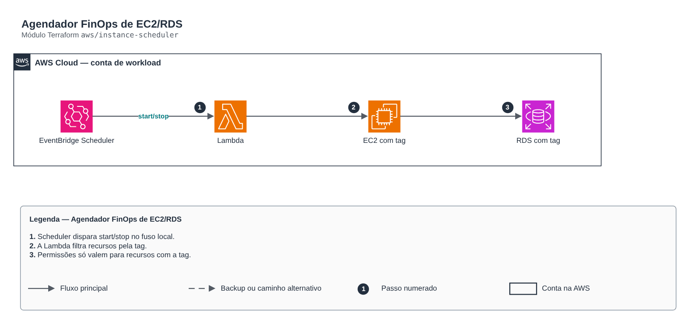

# Agendador FinOps de EC2/RDS

**Português** · [English](README.en.md)

> `aws/instance-scheduler` · categoria **automacao** · origem: Varejo, migração para AWS (2017-2018)

> Idealizado em outubro de 2018. Por falta de tempo para manter o repositório em dia na época, está sendo publicado e atualizado agora.

Agendador FinOps de EC2/RDS por tag: EventBridge Scheduler (cron com fuso horário) invoca a Lambda com {"action": "start"|"stop"}. Redesenho dos antigos scripts Start-EC2/Stop-EC2/RdsStopTime. Para node groups EKS use o módulo autoscaling-schedule.

## Arquitetura



Fonte editável: [`diagram.drawio`](diagram.drawio) (abra no draw.io / diagrams.net), com páginas em português e inglês.

1. Scheduler dispara start/stop no fuso local.
2. A Lambda filtra recursos pela tag.
3. Permissões só valem para recursos com a tag.

## Uso

```hcl
module "instance_scheduler" {
  source = "git::https://github.com/raphaelfcs/automacao_terraform.git//aws/instance-scheduler?ref=v1.0.0"

  name_prefix = local.name_prefix
  start_cron  = "cron(0 8 ? * MON-FRI *)"
  stop_cron   = "cron(0 19 ? * MON-FRI *)"
  tags        = local.tags
}
```

## Exemplos

| Exemplo | Arquivos |
|---|---|
| [`basico`](examples/basico) | `main.tf`, `locals.tf`, `backend.tf` |

Cada exemplo tem seu próprio backend (state isolado por módulo e exemplo). Ambientes diferentes usam apenas outro `backend.tf`/`*.tfvars`, sem duplicar código.

## Entradas

| Nome | Tipo | Padrão | Obrigatória | Descrição |
|---|---|---|---|---|
| `name_prefix` | `string` | - | **sim** | Prefixo dos recursos. |
| `schedule_tag` | `string` | `"Agenda"` | não | Chave da tag que marca recursos agendados. |
| `schedule_value` | `string` | `"horario-comercial"` | não | Valor da tag. |
| `start_cron` | `string` | `"cron(0 7 ? * MON-FRI *)"` | não | Expressão de início (EventBridge Scheduler). |
| `stop_cron` | `string` | `"cron(0 20 ? * MON-FRI *)"` | não | Expressão de parada. |
| `timezone` | `string` | `"America/Sao_Paulo"` | não | Fuso horário das expressões. |
| `dry_run` | `bool` | `false` | não | Só registra o que faria. |
| `ebs_kms_key_arns` | `list(string)` | `[]` | não | CMKs dos volumes EBS (para o start funcionar com volumes cifrados por CMK). |
| `kms_key_arn` | `string` | `null` | não | Chave KMS do log group da função. |
| `tags` | `map(string)` | `{}` | não | Tags aplicadas. |

## Saídas

| Nome | Descrição |
|---|---|
| `function_arn` | ARN da função agendadora. |
| `schedule_arns` | ARNs das agendas start/stop. |

## Arquivos

- `iam.tf`: políticas, papéis e permissões
- `main.tf`: recursos principais
- `outputs.tf`: saídas
- `variables.tf`: entradas e validações
- `versions.tf`: versões do Terraform e providers
- `src/`: arquivos auxiliares (código, templates ou políticas)
- `examples/`: composições prontas para uso
- `tests/`: `terraform test` com providers simulados

## Well-Architected

- Excelência operacional: rotina manual substituída por serviço gerenciado ou função com permissões mínimas.
- Otimização de custos: execução sob demanda/agendada, sem servidores ligados.

## Testes

```bash
cd aws/instance-scheduler
terraform init -backend=false
terraform test
```
