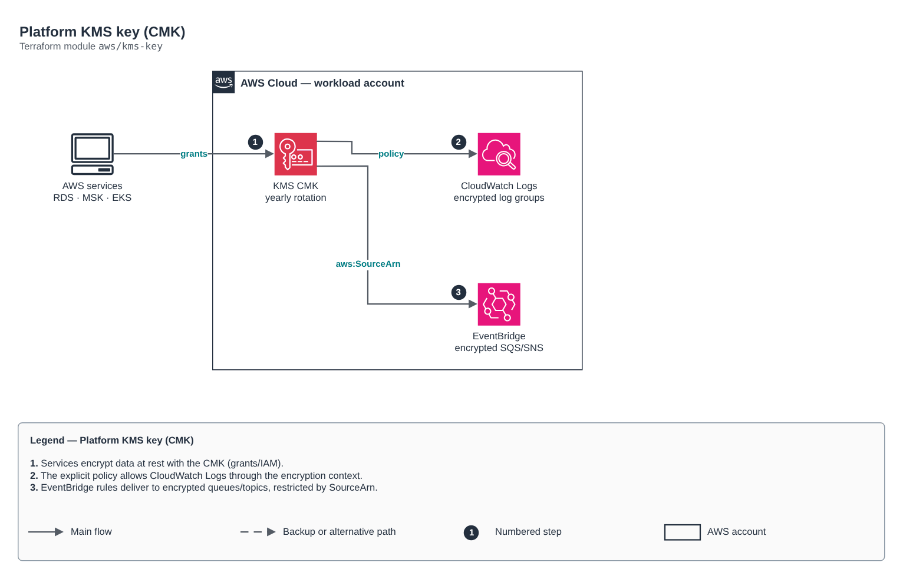

# Platform KMS key (CMK)

[Português](README.md) · **English**

> `aws/kms-key` · category **seguranca** · origin: Telecom microservices platform (2026)

> Designed in September 2026 and published now.

Customer-managed KMS key (CMK) for encryption at rest across services in the same account (RDS, MSK, ElastiCache, EBS, S3, EKS secrets, CloudWatch Logs). Automatic rotation always on (Well-Architected Security pillar).

## Architecture



Editable source: [`diagram.drawio`](diagram.drawio) (open it in draw.io / diagrams.net), with Portuguese and English pages.

1. Services encrypt data at rest with the CMK (grants/IAM).
2. The explicit policy allows CloudWatch Logs through the encryption context.
3. EventBridge rules deliver to encrypted queues/topics, restricted by SourceArn.

## Usage

```hcl
module "kms_key" {
  source = "git::https://github.com/raphaelfcs/automacao_terraform.git//aws/kms-key?ref=v1.0.0"

  name_prefix             = local.name_prefix
  deletion_window_in_days = 7
  tags                    = local.tags
}
```

## Examples

| Example | Files |
|---|---|
| [`basico`](examples/basico) | `main.tf`, `locals.tf`, `backend.tf` |
| [`eventbridge-e-sns`](examples/eventbridge-e-sns) | `main.tf`, `locals.tf`, `backend.tf` |

Each example has its own backend (state isolated per module and example). Different environments only use another `backend.tf`/`*.tfvars`, without duplicating code.

## Inputs

| Name | Type | Default | Required | Description |
|---|---|---|---|---|
| `name_prefix` | `string` | - | **yes** | Prefix applied to the key name and alias (alias/<name_prefix>). |
| `description` | `string` | `null` | no | Key description. Empty = '<name_prefix> - encryption at rest'. |
| `deletion_window_in_days` | `number` | `30` | no | Key deletion window (7 to 30). Use 7 in dev for fast teardown; 30 in production. |
| `rotation_period_in_days` | `number` | `365` | no | Automatic rotation period (90 to 2560 days). |
| `multi_region` | `bool` | `false` | no | Creates the key as multi-region (needed for encrypted cross-region replicas). |
| `key_administrator_arns` | `list(string)` | `[]` | no | Role ARNs that administer the key (without usage permission). Empty = account only. |
| `allow_cloudwatch_logs` | `bool` | `true` | no | Allows CloudWatch Logs in this account/region to encrypt log groups with the key. |
| `event_rule_arns` | `list(string)` | `[]` | no | ARNs of EventBridge rules that deliver to queues/topics encrypted with this key. The ARN is deterministic (arn:aws:events:<region>:<account>:rule/<bus>/<rule>), so it can be built without a dependency cycle. |
| `service_principals` | `list(string)` | `[]` | no | Additional service principals that use the key on their own behalf (e.g. ["sns.amazonaws.com"]). |
| `tags` | `map(string)` | `{}` | no | Tags applied to the key. |

## Outputs

| Name | Description |
|---|---|
| `key_arn` | KMS key ARN. |
| `key_id` | KMS key ID. |
| `alias_name` | Alias name (alias/<name_prefix>). |

## Files

- `iam.tf`: policies, roles and permissions
- `main.tf`: main resources
- `outputs.tf`: outputs
- `variables.tf`: inputs and validations
- `versions.tf`: Terraform and provider versions
- `examples/`: ready-to-use compositions
- `tests/`: `terraform test` with mocked providers

## Well-Architected

- Security: least privilege in policies, customer-managed key encryption and an audit trail.
- Operational excellence: everything declared in code, reviewed in PRs and tested with `terraform test`.

## Tests

```bash
cd aws/kms-key
terraform init -backend=false
terraform test
```
