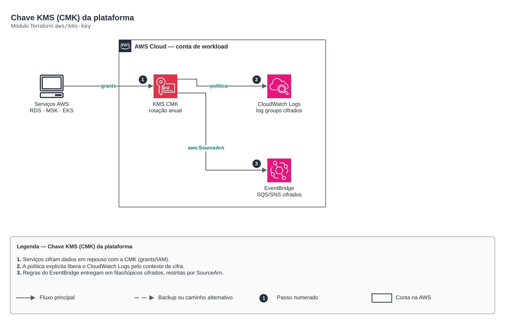

# Chave KMS (CMK) da plataforma

> `aws/kms-key` · categoria **seguranca** · origem: Plataforma de microsserviços em telecom (2026)

> Idealizado em setembro de 2026 e publicado agora.

Chave KMS gerenciada pelo cliente (CMK) para criptografia em repouso de vários serviços da mesma conta (RDS, MSK, ElastiCache, EBS, S3, segredos do EKS, CloudWatch Logs). Rotação automática sempre ligada (pilar Segurança do Well-Architected).

## Arquitetura



Fonte editável: [`diagram.drawio`](diagram.drawio) (abra no draw.io / diagrams.net).

1. Serviços cifram dados em repouso com a CMK (grants/IAM).
2. A política explícita libera o CloudWatch Logs pelo contexto de cifra.
3. Regras do EventBridge entregam em filas/tópicos cifrados, restritas por SourceArn.

## Uso

```hcl
module "kms_key" {
  source = "git::https://github.com/raphaelfcs/automacao_terraform.git//aws/kms-key?ref=v1.0.0"

  name_prefix             = local.name_prefix
  deletion_window_in_days = 7
  tags                    = local.tags
}
```

## Exemplos

| Exemplo | Arquivos |
|---|---|
| [`basico`](examples/basico) | `main.tf`, `locals.tf`, `backend.tf` |
| [`eventbridge-e-sns`](examples/eventbridge-e-sns) | `main.tf`, `locals.tf`, `backend.tf` |

Cada exemplo tem seu próprio backend (state isolado por módulo e exemplo). Ambientes diferentes usam apenas outro `backend.tf`/`*.tfvars`, sem duplicar código.

## Entradas

| Nome | Tipo | Padrão | Obrigatória | Descrição |
|---|---|---|---|---|
| `name_prefix` | `string` | - | **sim** | Prefixo aplicado ao nome e ao alias da chave (alias/<name_prefix>). |
| `description` | `string` | `null` | não | Descrição da chave. Vazio = '<name_prefix> - criptografia em repouso'. |
| `deletion_window_in_days` | `number` | `30` | não | Janela de exclusão da chave (7 a 30). Em dev use 7 para teardown rápido; em produção, 30. |
| `rotation_period_in_days` | `number` | `365` | não | Período da rotação automática (90 a 2560 dias). |
| `multi_region` | `bool` | `false` | não | Cria a chave como multi-região (necessário para réplicas cifradas entre regiões). |
| `key_administrator_arns` | `list(string)` | `[]` | não | ARNs de roles que administram a chave (sem permissão de uso). Vazio = só a conta. |
| `allow_cloudwatch_logs` | `bool` | `true` | não | Permite que o CloudWatch Logs desta conta/região cifre log groups com a chave. |
| `event_rule_arns` | `list(string)` | `[]` | não | ARNs das regras do EventBridge que entregam em filas/tópicos cifrados com esta chave. O ARN é determinístico (arn:aws:events:<regiao>:<conta>:rule/<barramento>/<regra>), então pode ser composto sem ciclo de dependência. |
| `service_principals` | `list(string)` | `[]` | não | Principais de serviço adicionais que usam a chave em nome próprio (ex.: ["sns.amazonaws.com"]). |
| `tags` | `map(string)` | `{}` | não | Tags aplicadas à chave. |

## Saídas

| Nome | Descrição |
|---|---|
| `key_arn` | ARN da chave KMS. |
| `key_id` | ID da chave KMS. |
| `alias_name` | Nome do alias (alias/<name_prefix>). |

## Arquivos

- `iam.tf`: políticas, papéis e permissões
- `main.tf`: recursos principais
- `outputs.tf`: saídas
- `variables.tf`: entradas e validações
- `versions.tf`: versões do Terraform e providers
- `examples/`: composições prontas para uso
- `tests/`: `terraform test` com providers simulados

## Well-Architected

- Segurança: privilégio mínimo nas políticas, criptografia com chave gerenciada pelo cliente e trilha de auditoria.
- Excelência operacional: tudo declarado em código, revisado em PR e testado com `terraform test`.

## Testes

```bash
cd aws/kms-key
terraform init -backend=false
terraform test
```
