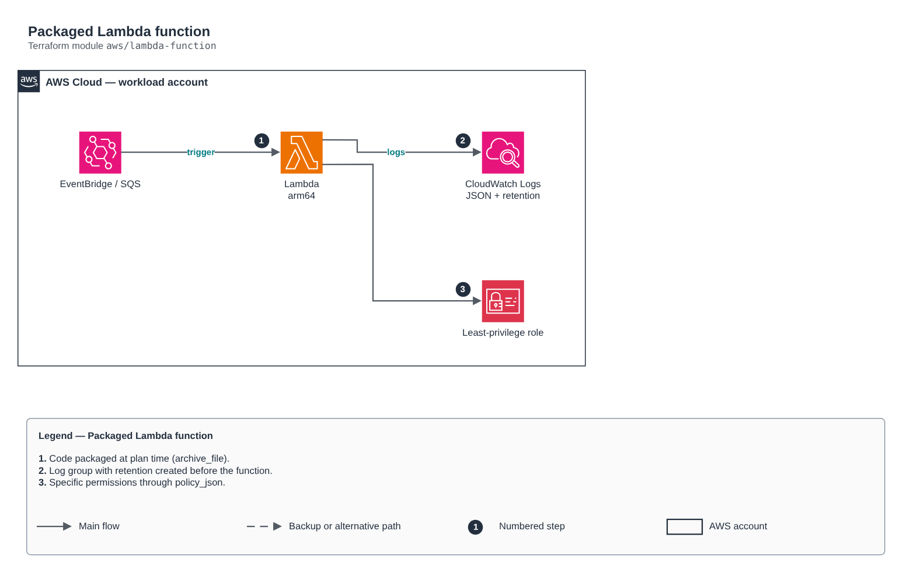

# Packaged Lambda function

[Português](README.md) · **English**

> `aws/lambda-function` · category **computacao** · origin: Health insurer on AWS (2024)

> Designed in February 2024. With no time to keep the repository up to date back then, it is being published and updated now.

Lambda function packaged from a code directory (archive_file), with a managed log group (retention + KMS), least-privilege execution role, optional VPC, DLQ/async destinations, X-Ray and optional triggers (schedule, EventBridge, SQS).

## Architecture



Editable source: [`diagram.drawio`](diagram.drawio) (open it in draw.io / diagrams.net), with Portuguese and English pages.

1. Code packaged at plan time (archive_file).
2. Log group with retention created before the function.
3. Specific permissions through policy_json.

## Usage

```hcl
module "lambda_function" {
  source = "git::https://github.com/raphaelfcs/automacao_terraform.git//aws/lambda-function?ref=v1.0.0"

  function_name       = "demo-dev-relatorio"
  source_dir          = "${path.module}/src"
  schedule_expression = "rate(1 day)"
  environment         = { NIVEL_LOG = "INFO" }
  tags                = local.tags
}
```

## Examples

| Example | Files |
|---|---|
| [`agendada`](examples/agendada) | `main.tf`, `locals.tf`, `backend.tf` |
| [`vpc-sqs`](examples/vpc-sqs) | `main.tf`, `locals.tf`, `backend.tf` |

Each example has its own backend (state isolated per module and example). Different environments only use another `backend.tf`/`*.tfvars`, without duplicating code.

## Inputs

| Name | Type | Default | Required | Description |
|---|---|---|---|---|
| `function_name` | `string` | - | **yes** | Function name. |
| `description` | `string` | `""` | no | Function description. |
| `source_dir` | `string` | - | **yes** | Directory with the code (zipped at plan time). |
| `handler` | `string` | `"app.lambda_handler"` | no | Handler (e.g. app.lambda_handler). |
| `runtime` | `string` | `"python3.12"` | no | Runtime (e.g. python3.12). |
| `architecture` | `string` | `"arm64"` | no | arm64 (Graviton, ~20% cheaper) or x86_64. |
| `memory_size` | `number` | `256` | no | Memory in MB (CPU scales with it). |
| `timeout` | `number` | `60` | no | Timeout in seconds. |
| `reserved_concurrency` | `number` | `-1` | no | Reserved concurrency (-1 = no reservation). |
| `environment` | `map(string)` | `{}` | no | Environment variables (never secrets: use Secrets Manager/Parameter Store). |
| `policy_json` | `string` | `null` | no | JSON policy document with the function-specific permissions. |
| `attach_policy_json` | `bool` | `false` | no | Creates the inline policy from `policy_json`. A separate flag because the JSON often depends on ARNs created in the same apply. |
| `permissions_boundary_arn` | `string` | `null` | no | Execution role permissions boundary. |
| `vpc` | `object(...)` | `null` | no | Runs inside the VPC (private subnets + SGs). null = outside the VPC. |
| `dead_letter_target_arn` | `string` | `null` | no | SQS queue or SNS topic for failed asynchronous invocations. |
| `tracing` | `bool` | `false` | no | Turns on AWS X-Ray. |
| `kms_key_arn` | `string` | `null` | no | KMS key for environment variables and the log group. |
| `log_retention_days` | `number` | `30` | no | Log group retention. |
| `schedule_expression` | `string` | `null` | no | Schedule (e.g. cron(0 22 ? * MON-FRI *) or rate(1 hour)). null = no schedule. |
| `event_patterns` | `map(any)` | `{}` | no | EventBridge rules by name -> event pattern (object). |
| `sqs_trigger_arn` | `string` | `null` | no | SQS queue that triggers the function. null = no SQS trigger. |
| `tags` | `map(string)` | `{}` | no | Tags applied. |
| `dynamodb_stream_arn` | `string` | `null` | no | DynamoDB stream that triggers the function (batches with partial failure and bisection). null = no trigger. |
| `stream_failure_destination_arn` | `string` | `null` | no | SQS queue that receives the reference of stream batches that ran out of retries. |

## Outputs

| Name | Description |
|---|---|
| `function_name` | Function name. |
| `function_arn` | Function ARN. |
| `invoke_arn` | Invoke ARN, used in API Gateway integrations. |
| `role_name` | Execution role (to attach additional policies). |
| `role_arn` | Execution role ARN. |
| `log_group_name` | Function log group. |

## Files

- `iam.tf`: policies, roles and permissions
- `main.tf`: main resources
- `outputs.tf`: outputs
- `triggers.tf`: module-specific resources
- `variables.tf`: inputs and validations
- `versions.tf`: Terraform and provider versions
- `examples/`: ready-to-use compositions
- `tests/`: `terraform test` with mocked providers

## Well-Architected

- Operational excellence: packaging and logs with retention created by IaC.
- Security: least-privilege execution role.

## Tests

```bash
cd aws/lambda-function
terraform init -backend=false
terraform test
```
