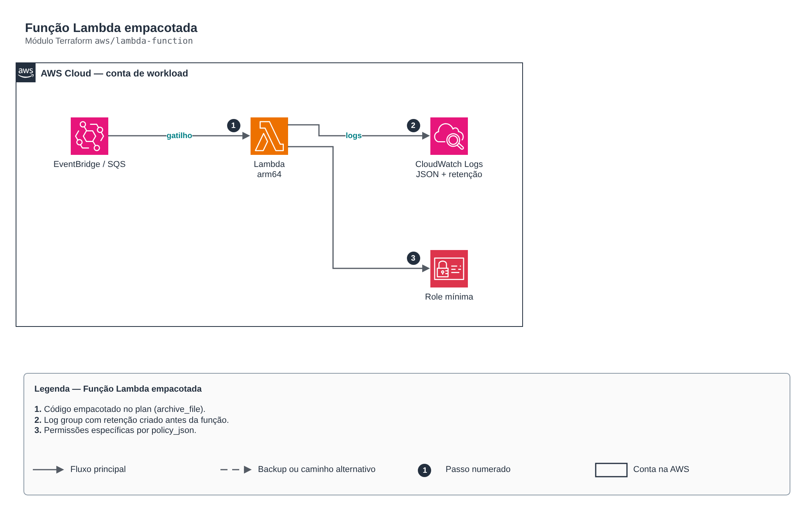

# Função Lambda empacotada

**Português** · [English](README.en.md)

> `aws/lambda-function` · categoria **computacao** · origem: Operadora de saúde em AWS (2024)

> Idealizado em fevereiro de 2024. Por falta de tempo para manter o repositório em dia na época, está sendo publicado e atualizado agora.

Função Lambda empacotada a partir de um diretório de código (archive_file), com log group gerenciado (retenção + KMS), role de execução com menor privilégio, VPC opcional, DLQ/destinos assíncronos, X-Ray e gatilhos opcionais (agenda, EventBridge, SQS).

## Arquitetura



Fonte editável: [`diagram.drawio`](diagram.drawio) (abra no draw.io / diagrams.net), com páginas em português e inglês.

1. Código empacotado no plan (archive_file).
2. Log group com retenção criado antes da função.
3. Permissões específicas por policy_json.

## Uso

```hcl
module "lambda_function" {
  source = "git::https://github.com/raphaelfcs/automacao_terraform.git//aws/lambda-function?ref=v1.0.0"

  function_name       = "demo-dev-relatorio"
  source_dir          = "${path.module}/src"
  schedule_expression = "rate(1 day)"
  environment         = { NIVEL_LOG = "INFO" }
  tags                = local.tags
}
```

## Exemplos

| Exemplo | Arquivos |
|---|---|
| [`agendada`](examples/agendada) | `main.tf`, `locals.tf`, `backend.tf` |
| [`vpc-sqs`](examples/vpc-sqs) | `main.tf`, `locals.tf`, `backend.tf` |

Cada exemplo tem seu próprio backend (state isolado por módulo e exemplo). Ambientes diferentes usam apenas outro `backend.tf`/`*.tfvars`, sem duplicar código.

## Entradas

| Nome | Tipo | Padrão | Obrigatória | Descrição |
|---|---|---|---|---|
| `function_name` | `string` | - | **sim** | Nome da função. |
| `description` | `string` | `""` | não | Descrição da função. |
| `source_dir` | `string` | - | **sim** | Diretório com o código (empacotado em zip no plan). |
| `handler` | `string` | `"app.lambda_handler"` | não | Handler (ex.: app.lambda_handler). |
| `runtime` | `string` | `"python3.12"` | não | Runtime (ex.: python3.12). |
| `architecture` | `string` | `"arm64"` | não | arm64 (Graviton, ~20% mais barato) ou x86_64. |
| `memory_size` | `number` | `256` | não | Memória em MB (CPU escala junto). |
| `timeout` | `number` | `60` | não | Timeout em segundos. |
| `reserved_concurrency` | `number` | `-1` | não | Concorrência reservada (-1 = sem reserva). |
| `environment` | `map(string)` | `{}` | não | Variáveis de ambiente (nunca segredos: use Secrets Manager/Parameter Store). |
| `policy_json` | `string` | `null` | não | Policy document JSON com as permissões específicas da função. |
| `attach_policy_json` | `bool` | `false` | não | Cria a policy inline com `policy_json`. Booleano separado porque o JSON costuma depender de ARNs criados no mesmo apply. |
| `permissions_boundary_arn` | `string` | `null` | não | Permissions boundary da role de execução. |
| `vpc` | `object(...)` | `null` | não | Executa dentro da VPC (subnets privadas + SGs). null = fora da VPC. |
| `dead_letter_target_arn` | `string` | `null` | não | Fila SQS ou tópico SNS para invocações assíncronas que falharam. |
| `tracing` | `bool` | `false` | não | Liga AWS X-Ray. |
| `kms_key_arn` | `string` | `null` | não | Chave KMS das variáveis de ambiente e do log group. |
| `log_retention_days` | `number` | `30` | não | Retenção do log group. |
| `schedule_expression` | `string` | `null` | não | Agenda (ex.: cron(0 22 ? * MON-FRI *) ou rate(1 hour)). null = sem agenda. |
| `event_patterns` | `map(any)` | `{}` | não | Regras do EventBridge por nome -> event pattern (objeto). |
| `sqs_trigger_arn` | `string` | `null` | não | Fila SQS que dispara a função. null = sem gatilho SQS. |
| `tags` | `map(string)` | `{}` | não | Tags aplicadas. |

## Saídas

| Nome | Descrição |
|---|---|
| `function_name` | Nome da função. |
| `function_arn` | ARN da função. |
| `invoke_arn` | ARN de invocação, usado em integrações do API Gateway. |
| `role_name` | Role de execução (para anexar políticas adicionais). |
| `role_arn` | ARN da role de execução. |
| `log_group_name` | Log group da função. |

## Arquivos

- `iam.tf`: políticas, papéis e permissões
- `main.tf`: recursos principais
- `outputs.tf`: saídas
- `triggers.tf`: recursos específicos do módulo
- `variables.tf`: entradas e validações
- `versions.tf`: versões do Terraform e providers
- `examples/`: composições prontas para uso
- `tests/`: `terraform test` com providers simulados

## Well-Architected

- Excelência operacional: empacotamento e logs com retenção criados pela IaC.
- Segurança: papel de execução com permissões mínimas.

## Testes

```bash
cd aws/lambda-function
terraform init -backend=false
terraform test
```
