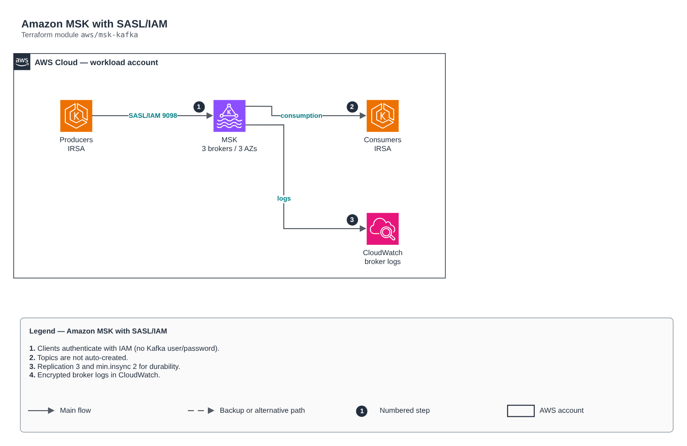

# Amazon MSK with SASL/IAM

[Português](README.md) · **English**

> `aws/msk-kafka` · category **integracao** · origin: Telecom microservices platform (2026)

> Designed in September 2026 and published now.

Amazon MSK (managed Kafka) with SASL/IAM authentication, TLS in transit, KMS at rest and broker logs in CloudWatch. Automatic topic creation is off: topics are declared by their owners, not created by accident on the first produce.

## Architecture



Editable source: [`diagram.drawio`](diagram.drawio) (open it in draw.io / diagrams.net), with Portuguese and English pages.

1. Clients authenticate with IAM (no Kafka user/password).
2. Topics are not auto-created.
3. Replication 3 and min.insync 2 for durability.
4. Encrypted broker logs in CloudWatch.

## Usage

```hcl
module "msk_kafka" {
  source = "git::https://github.com/raphaelfcs/automacao_terraform.git//aws/msk-kafka?ref=v1.0.0"

  name_prefix             = local.name_prefix
  vpc_id                  = "vpc-0123456789abcdef0"
  subnet_ids              = ["subnet-0aaa1111bbbb2222c", "subnet-0ddd3333eeee4444f", "subnet-0ggg5555hhhh6666i"]
  kms_key_arn             = "arn:aws:kms:sa-east-1:123456789012:key/11111111-2222-3333-4444-555555555555"
  kafka_version           = "3.7.x"
  broker_instance_type    = "kafka.t3.small"
  broker_count            = 3
  broker_volume_size      = 50
  ingress_security_groups = { eks = "sg-0123456789abcdef0" }
  client_topic_prefix     = "pedidos."
  tags                    = local.tags
}
```

## Examples

| Example | Files |
|---|---|
| [`basico`](examples/basico) | `main.tf`, `locals.tf`, `backend.tf` |

Each example has its own backend (state isolated per module and example). Different environments only use another `backend.tf`/`*.tfvars`, without duplicating code.

## Inputs

| Name | Type | Default | Required | Description |
|---|---|---|---|---|
| `name_prefix` | `string` | - | **yes** | Prefix applied to messaging resources. |
| `vpc_id` | `string` | - | **yes** | VPC where the brokers live. |
| `subnet_ids` | `list(string)` | - | **yes** | Private broker subnets, one per AZ. |
| `ingress_security_groups` | `map(string)` | `{}` | no | Security groups allowed to produce/consume: static name (key) -> id (value). |
| `kms_key_arn` | `string` | - | **yes** | KMS key for broker volumes and the log group. |
| `kafka_version` | `string` | - | **yes** | Managed Kafka version (e.g. 3.7.x). |
| `broker_instance_type` | `string` | - | **yes** | Broker instance type (e.g. kafka.t3.small in dev, kafka.m7g.large in production). |
| `broker_count` | `number` | `3` | no | Desired number of brokers (adjusted to a multiple of the subnet count). |
| `broker_volume_size` | `number` | `100` | no | EBS volume per broker, in GB. |
| `default_partitions` | `number` | `3` | no | Default partitions for new topics. |
| `log_retention_hours` | `number` | `168` | no | Default message retention in hours. |
| `log_retention_days` | `number` | `14` | no | Broker log retention in CloudWatch. |
| `enhanced_monitoring` | `string` | `"DEFAULT"` | no | DEFAULT, PER_BROKER, PER_TOPIC_PER_BROKER or PER_TOPIC_PER_PARTITION. |
| `client_topic_prefix` | `string` | `""` | no | Topic/group prefix allowed in the client policy ("" = all). |
| `tags` | `map(string)` | `{}` | no | Tags applied to all resources. |

## Outputs

| Name | Description |
|---|---|
| `bootstrap_brokers_sasl_iam` | SASL/IAM bootstrap servers — how clients connect. |
| `cluster_arn` | MSK cluster ARN. |
| `security_group_id` | Cluster security group. |
| `client_policy_arn` | IAM policy to attach to producer/consumer roles. |

## Files

- `iam.tf`: policies, roles and permissions
- `locals.tf`: derived values
- `main.tf`: main resources
- `outputs.tf`: outputs
- `security-group.tf`: module-specific resources
- `variables.tf`: inputs and validations
- `versions.tf`: Terraform and provider versions
- `examples/`: ready-to-use compositions
- `tests/`: `terraform test` with mocked providers

## Well-Architected

- Reliability: dead-letter queues (DLQ), retries and event archiving.
- Security: resource policies restricted by source and message encryption.

## Tests

```bash
cd aws/msk-kafka
terraform init -backend=false
terraform test
```
