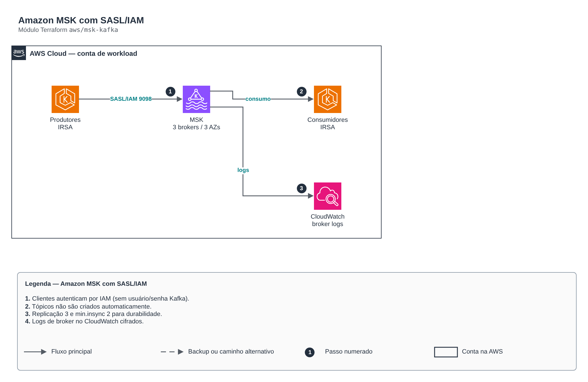

# Amazon MSK com SASL/IAM

> `aws/msk-kafka` · categoria **integracao** · origem: Plataforma de microsserviços em telecom (2026)

> Idealizado em setembro de 2026 e publicado agora.

Amazon MSK (Kafka gerenciado) com autenticação SASL/IAM, TLS em trânsito, KMS em repouso e logs de broker no CloudWatch. Criação automática de tópicos desligada: tópicos são declarados pelos donos, não criados por acidente no primeiro produce.

## Arquitetura



Fonte editável: [`diagram.drawio`](diagram.drawio) (abra no draw.io / diagrams.net).

1. Clientes autenticam por IAM (sem usuário/senha Kafka).
2. Tópicos não são criados automaticamente.
3. Replicação 3 e min.insync 2 para durabilidade.
4. Logs de broker no CloudWatch cifrados.

## Uso

```hcl
module "msk_kafka" {
  source = "git::https://github.com/raphaelfcs/automacao_terraform.git//aws/msk-kafka?ref=v1.0.0"

  name_prefix             = local.name_prefix
  vpc_id                  = "vpc-0123456789abcdef0"
  subnet_ids              = ["subnet-0aaa1111bbbb2222c", "subnet-0ddd3333eeee4444f", "subnet-0ggg5555hhhh6666i"]
  kms_key_arn             = "arn:aws:kms:sa-east-1:123456789012:key/11111111-2222-3333-4444-555555555555"
  kafka_version           = "3.7.x"
  broker_instance_type    = "kafka.t3.small"
  broker_count            = 3
  broker_volume_size      = 50
  ingress_security_groups = { eks = "sg-0123456789abcdef0" }
  client_topic_prefix     = "pedidos."
  tags                    = local.tags
}
```

## Exemplos

| Exemplo | Arquivos |
|---|---|
| [`basico`](examples/basico) | `main.tf`, `locals.tf`, `backend.tf` |

Cada exemplo tem seu próprio backend (state isolado por módulo e exemplo). Ambientes diferentes usam apenas outro `backend.tf`/`*.tfvars`, sem duplicar código.

## Entradas

| Nome | Tipo | Padrão | Obrigatória | Descrição |
|---|---|---|---|---|
| `name_prefix` | `string` | - | **sim** | Prefixo aplicado aos recursos de mensageria. |
| `vpc_id` | `string` | - | **sim** | VPC onde os brokers vivem. |
| `subnet_ids` | `list(string)` | - | **sim** | Subnets privadas dos brokers, uma por AZ. |
| `ingress_security_groups` | `map(string)` | `{}` | não | Security groups autorizados a produzir/consumir: nome estático (chave) -> id (valor). |
| `kms_key_arn` | `string` | - | **sim** | Chave KMS para os volumes dos brokers e o log group. |
| `kafka_version` | `string` | - | **sim** | Versão do Kafka gerenciado (ex.: 3.7.x). |
| `broker_instance_type` | `string` | - | **sim** | Tipo de instância dos brokers (ex.: kafka.t3.small em dev, kafka.m7g.large em produção). |
| `broker_count` | `number` | `3` | não | Número desejado de brokers (ajustado para múltiplo do número de subnets). |
| `broker_volume_size` | `number` | `100` | não | Volume EBS por broker, em GB. |
| `default_partitions` | `number` | `3` | não | Partições padrão de novos tópicos. |
| `log_retention_hours` | `number` | `168` | não | Retenção padrão das mensagens em horas. |
| `log_retention_days` | `number` | `14` | não | Retenção dos logs de broker no CloudWatch. |
| `enhanced_monitoring` | `string` | `"DEFAULT"` | não | DEFAULT, PER_BROKER, PER_TOPIC_PER_BROKER ou PER_TOPIC_PER_PARTITION. |
| `client_topic_prefix` | `string` | `""` | não | Prefixo de tópicos/grupos liberado na política de cliente ("" = todos). |
| `tags` | `map(string)` | `{}` | não | Tags aplicadas a todos os recursos. |

## Saídas

| Nome | Descrição |
|---|---|
| `bootstrap_brokers_sasl_iam` | Bootstrap servers SASL/IAM — como os clientes se conectam. |
| `cluster_arn` | ARN do cluster MSK. |
| `security_group_id` | Security group do cluster. |
| `client_policy_arn` | Política IAM para anexar às roles dos produtores/consumidores. |

## Arquivos

- `iam.tf`: políticas, papéis e permissões
- `locals.tf`: valores derivados
- `main.tf`: recursos principais
- `outputs.tf`: saídas
- `security-group.tf`: recursos específicos do módulo
- `variables.tf`: entradas e validações
- `versions.tf`: versões do Terraform e providers
- `examples/`: composições prontas para uso
- `tests/`: `terraform test` com providers simulados

## Well-Architected

- Confiabilidade: filas de mensagens mortas (DLQ), retentativas e arquivamento de eventos.
- Segurança: políticas de recurso restritas por origem e cifragem das mensagens.

## Testes

```bash
cd aws/msk-kafka
terraform init -backend=false
terraform test
```
