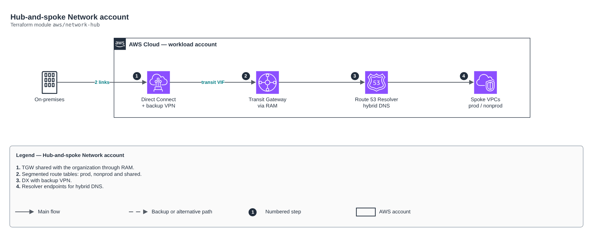

# Hub-and-spoke Network account

[Português](README.md) · **English**

> `aws/network-hub` · category **rede** · origin: Architecture case studies (2026)

> Designed in October 2026 and published now.

Network account (hub-and-spoke): Transit Gateway shared through RAM with workload accounts, segmented route tables (prod, nonprod, shared), Direct Connect (transit VIFs), backup VPN and hybrid DNS (Route 53 Resolver). Spoke VPCs attach to the TGW and are associated with a routing domain.

## Architecture



Editable source: [`diagram.drawio`](diagram.drawio) (open it in draw.io / diagrams.net), with Portuguese and English pages.

1. TGW shared with the organization through RAM.
2. Segmented route tables: prod, nonprod and shared.
3. DX with backup VPN.
4. Resolver endpoints for hybrid DNS.

## Usage

```hcl
module "network_hub" {
  source = "git::https://github.com/raphaelfcs/automacao_terraform.git//aws/network-hub?ref=v1.0.0"

  share_with_principals = ["arn:aws:organizations::123456789012:organization/o-exemplo123"]
  tags                  = local.tags
}
```

## Examples

| Example | Files |
|---|---|
| [`basico`](examples/basico) | `main.tf`, `locals.tf`, `backend.tf` |

Each example has its own backend (state isolated per module and example). Different environments only use another `backend.tf`/`*.tfvars`, without duplicating code.

## Inputs

| Name | Type | Default | Required | Description |
|---|---|---|---|---|
| `name_prefix` | `string` | `"network-hub"` | no | Network resource prefix. |
| `tags` | `map(string)` | `{}` | no | Additional tags. |
| `tgw_asn` | `number` | `64512` | no | ASN on the AWS side of the Transit Gateway. |
| `route_domains` | `list(string)` | `["prod", "nonprod", "shared"]` | no | Routing domains (TGW tables). Prod does not talk to NonProd; all talk to Shared and on-premises. |
| `share_with_principals` | `list(string)` | - | **yes** | ARNs of the organization or OUs the TGW and DNS rules are shared with (RAM). |
| `hub_vpc_cidr` | `string` | `"10.10.0.0/22"` | no | Hub VPC CIDR (TGW attachment, Resolver, inspection). |
| `availability_zones` | `list(string)` | `["sa-east-1a", "sa-east-1b"]` | no | AZs used (2 for high availability). |
| `onprem_cidrs` | `list(string)` | `["172.16.0.0/12"]` | no | Data center and DC networks (routes through Direct Connect/VPN). |
| `flow_logs_bucket_arn` | `string` | `""` | no | Log Archive account bucket for VPC Flow Logs (empty = no flow logs). |
| `enable_direct_connect` | `bool` | `true` | no | Creates the Direct Connect Gateway associated with the TGW. |
| `dx_gateway_asn` | `number` | `64513` | no | Direct Connect Gateway ASN. |
| `dx_transit_vifs` | `list(...)` | `[]` | no | One transit VIF per physical connection (2 × 1 Gbps at different locations). Connections are ordered from the partner beforehand. |
| `vpn_customer_gateways` | `list(...)` | `[]` | no | Data center routers for the backup VPN (BGP). |
| `onprem_dns_domain` | `string` | `"corp.internal"` | no | On-prem AD domain resolved by on-premises DNS servers. |
| `onprem_dns_servers` | `list(string)` | `[]` | no | On-prem AD DNS IPs for the forwarding rule. |

## Outputs

| Name | Description |
|---|---|
| `transit_gateway_id` | TGW shared with the workload and data accounts. |
| `route_table_ids` | TGW route tables per domain (associate each spoke with one of them). |
| `dx_gateway_id` | Direct Connect Gateway. |
| `resolver_inbound_ips` | IPs for on-prem AD to forward AWS domain queries. |
| `vpn_tunnels` | Backup VPN tunnel addresses (configure on the data center router). |

## Files

- `locals.tf`: derived values
- `main.tf`: main resources
- `outputs.tf`: outputs
- `variables.tf`: inputs and validations
- `versions.tf`: Terraform and provider versions
- `examples/`: ready-to-use compositions
- `tests/`: `terraform test` with mocked providers

## Well-Architected

- Reliability: resources spread across availability zones and no single point of failure for egress.
- Security: isolated subnet tiers, source-based rules and flow logs enabled.

## Tests

```bash
cd aws/network-hub
terraform init -backend=false
terraform test
```
