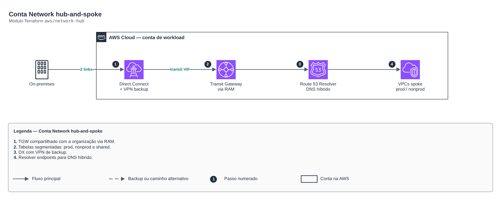

# Conta Network hub-and-spoke

> `aws/network-hub` · categoria **rede** · origem: Estudos de caso de arquitetura (2026)

> Idealizado em outubro de 2026 e publicado agora.

Conta Network (hub-and-spoke): Transit Gateway compartilhado via RAM com as contas de workload, tabelas de rota segmentadas (prod, nonprod, shared), Direct Connect (transit VIFs), VPN de backup e DNS híbrido (Route 53 Resolver). As VPCs spoke se anexam ao TGW e são associadas a um domínio de roteamento.

## Arquitetura



Fonte editável: [`diagram.drawio`](diagram.drawio) (abra no draw.io / diagrams.net).

1. TGW compartilhado com a organização via RAM.
2. Tabelas segmentadas: prod, nonprod e shared.
3. DX com VPN de backup.
4. Resolver endpoints para DNS híbrido.

## Uso

```hcl
module "network_hub" {
  source = "git::https://github.com/raphaelfcs/automacao_terraform.git//aws/network-hub?ref=v1.0.0"

  share_with_principals = ["arn:aws:organizations::123456789012:organization/o-exemplo123"]
  tags                  = local.tags
}
```

## Exemplos

| Exemplo | Arquivos |
|---|---|
| [`basico`](examples/basico) | `main.tf`, `locals.tf`, `backend.tf` |

Cada exemplo tem seu próprio backend (state isolado por módulo e exemplo). Ambientes diferentes usam apenas outro `backend.tf`/`*.tfvars`, sem duplicar código.

## Entradas

| Nome | Tipo | Padrão | Obrigatória | Descrição |
|---|---|---|---|---|
| `name_prefix` | `string` | `"network-hub"` | não | Prefixo dos recursos de rede. |
| `tags` | `map(string)` | `{}` | não | Tags adicionais. |
| `tgw_asn` | `number` | `64512` | não | ASN do lado AWS do Transit Gateway. |
| `route_domains` | `list(string)` | `["prod", "nonprod", "shared"]` | não | Domínios de roteamento (tabelas do TGW). Prod não fala com NonProd; todos falam com Shared e com o on-premises. |
| `share_with_principals` | `list(string)` | - | **sim** | ARNs da organização ou de OUs com quem o TGW e as regras de DNS são compartilhados (RAM). |
| `hub_vpc_cidr` | `string` | `"10.10.0.0/22"` | não | CIDR da VPC do hub (anexo do TGW, Resolver, inspeção). |
| `availability_zones` | `list(string)` | `["sa-east-1a", "sa-east-1b"]` | não | AZs usadas (2 para alta disponibilidade). |
| `onprem_cidrs` | `list(string)` | `["172.16.0.0/12"]` | não | Redes do data center e dos CDs (rotas pelo Direct Connect/VPN). |
| `flow_logs_bucket_arn` | `string` | `""` | não | Bucket da conta Log Archive para os VPC Flow Logs (vazio = sem flow logs). |
| `enable_direct_connect` | `bool` | `true` | não | Cria o Direct Connect Gateway associado ao TGW. |
| `dx_gateway_asn` | `number` | `64513` | não | ASN do Direct Connect Gateway. |
| `dx_transit_vifs` | `list(...)` | `[]` | não | Uma transit VIF por conexão física (2 × 1 Gbps em locais distintos). Conexões são pedidas ao parceiro antes. |
| `vpn_customer_gateways` | `list(...)` | `[]` | não | Roteadores do data center para a VPN de backup (BGP). |
| `onprem_dns_domain` | `string` | `"corp.internal"` | não | Domínio do AD local resolvido pelos servidores DNS on-premises. |
| `onprem_dns_servers` | `list(string)` | `[]` | não | IPs dos DNS do AD local para a regra de encaminhamento. |

## Saídas

| Nome | Descrição |
|---|---|
| `transit_gateway_id` | TGW compartilhado com as contas de carga e de dados. |
| `route_table_ids` | Tabelas do TGW por domínio (associe cada spoke a uma delas). |
| `dx_gateway_id` | Direct Connect Gateway. |
| `resolver_inbound_ips` | IPs para o AD local encaminhar consultas de domínios AWS. |
| `vpn_tunnels` | Endereços dos túneis da VPN de backup (configurar no roteador do data center). |

## Arquivos

- `locals.tf`: valores derivados
- `main.tf`: recursos principais
- `outputs.tf`: saídas
- `variables.tf`: entradas e validações
- `versions.tf`: versões do Terraform e providers
- `examples/`: composições prontas para uso
- `tests/`: `terraform test` com providers simulados

## Well-Architected

- Confiabilidade: recursos distribuídos por zonas de disponibilidade e sem ponto único de falha na saída.
- Segurança: camadas de sub-rede isoladas, regras por origem e logs de fluxo habilitados.

## Testes

```bash
cd aws/network-hub
terraform init -backend=false
terraform test
```
