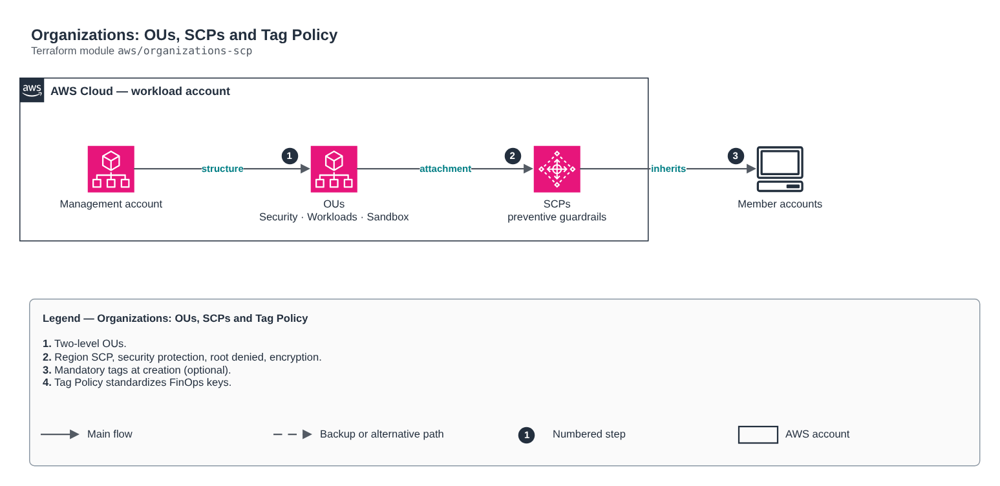

# Organizations: OUs, SCPs and Tag Policy

[Português](README.md) · **English**

> `aws/organizations-scp` · category **governanca** · origin: Telecom CCoE and landing zone (2025)

> Designed in October 2025. With no time to keep the repository up to date back then, it is being published and updated now.

AWS Organizations governance as code: two-level OUs, preventive SCPs (allowed region, organization and security service protection, root denied, mandatory encryption, tags at creation), a "deny all" SCP for suspended accounts and a FinOps Tag Policy. Runs in the management account; Control Tower/AFT creates the accounts.

## Architecture



Editable source: [`diagram.drawio`](diagram.drawio) (open it in draw.io / diagrams.net), with Portuguese and English pages.

1. Two-level OUs.
2. Region SCP, security protection, root denied, encryption.
3. Mandatory tags at creation (optional).
4. Tag Policy standardizes FinOps keys.

## Usage

```hcl
module "organizations_scp" {
  source = "git::https://github.com/raphaelfcs/automacao_terraform.git//aws/organizations-scp?ref=v1.0.0"

  allowed_regions        = ["sa-east-1", "us-east-1"]
  required_tags          = ["CentroCusto", "Ambiente", "Dono"]
  create_tag_enforcement = ["CentroCusto"]
  attach_target          = ["Workloads", "Sandbox"]
  tags                   = local.tags
}
```

## Examples

| Example | Files |
|---|---|
| [`landing-zone`](examples/landing-zone) | `main.tf`, `locals.tf`, `backend.tf` |

Each example has its own backend (state isolated per module and example). Different environments only use another `backend.tf`/`*.tfvars`, without duplicating code.

## Inputs

| Name | Type | Default | Required | Description |
|---|---|---|---|---|
| `allowed_regions` | `list(string)` | `["sa-east-1"]` | no | Allowed regions for data and workloads (data residency). |
| `organizational_units` | `map(object({ parent = string }))` | `{ Security = { parent = "root" } Infr...` | no | Organization OUs. parent = "root" or the name of another top-level OU. |
| `exempt_role_patterns` | `list(string)` | `[ "arn:aws:iam::*:role/AWSControlTowe...` | no | Roles exempt from the protection SCPs (Control Tower, AFT and break-glass). |
| `global_services_exempt` | `list(string)` | `[ "iam:*", "organizations:*", "sts:*"...` | no | Global service actions that the region SCP must not block. |
| `required_tags` | `list(string)` | `["CentroCusto", "Ambiente", "Dono", "...` | no | Tag keys required by the tag policy (FinOps: cost per unit). |
| `attach_target` | `list(string)` | `["root"]` | no | Where to attach the protection SCPs: root (whole organization) or a list of OU names. |
| `tags` | `map(string)` | `{}` | no | Policy tags. |
| `create_tag_enforcement` | `list(string)` | `[]` | no | Tags required AT CREATION of resources (SCP). Empty = SCP not created. Start in a sandbox OU: a wrong SCP blocks deploys. |
| `tag_enforced_actions` | `list(string)` | `[ "ec2:RunInstances", "ec2:CreateVolu...` | no | Create actions subject to the tag requirement (must support tag-on-create). |

## Outputs

| Name | Description |
|---|---|
| `root_id` | Organization root ID. |
| `organization_arn` | Organization ARN (used for the Transit Gateway RAM share). |
| `ou_ids` | OU IDs by name. |
| `ou_arns` | OU ARNs by name. |
| `scp_ids` | IDs of the SCPs created. |

## Files

- `iam.tf`: policies, roles and permissions
- `locals.tf`: derived values
- `main.tf`: main resources
- `outputs.tf`: outputs
- `variables.tf`: inputs and validations
- `versions.tf`: Terraform and provider versions
- `examples/`: ready-to-use compositions
- `tests/`: `terraform test` with mocked providers

## Well-Architected

- Security: preventive guardrails at the organization (SCP/org policies) instead of manual fixes.
- Operational excellence: standards applied when the account/project is created, not afterwards.

## Tests

```bash
cd aws/organizations-scp
terraform init -backend=false
terraform test
```
