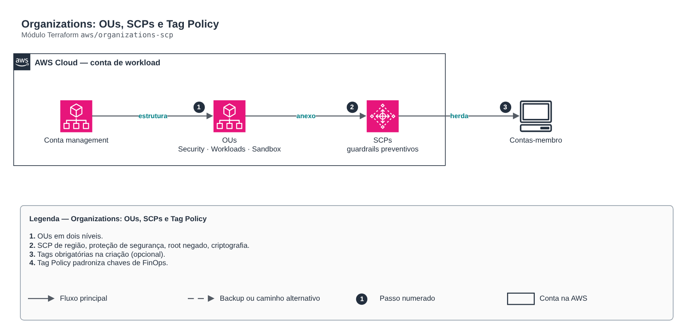

# Organizations: OUs, SCPs, RCPs e Tag Policy

**Português** · [English](README.en.md)

> `aws/organizations-scp` · categoria **governanca** · origem: CCoE e landing zone de telecom (2025)

> Idealizado em outubro de 2025. Por falta de tempo para manter o repositório em dia na época, está sendo publicado e atualizado agora.

Governança da AWS Organizations como código: OUs (dois níveis), SCPs preventivas (região permitida, proteção da organização e dos serviços de segurança, root negado, criptografia obrigatória, tags na criação), SCP "negar tudo" para contas suspensas, Tag Policy de FinOps e RCPs de perímetro de dados (opcionais). Roda na conta de gerenciamento; o Control Tower/AFT cria as contas.

## Arquitetura



Fonte editável: [`diagram.drawio`](diagram.drawio) (abra no draw.io / diagrams.net), com páginas em português e inglês.

1. OUs em dois níveis.
2. SCP de região, proteção de segurança, root negado, criptografia.
3. Tags obrigatórias na criação (opcional).
4. Tag Policy padroniza chaves de FinOps.
5. RCPs de perímetro de dados (opcional, `enable_rcp = true`).

## SCP e RCP: o perímetro de dados

| | SCP (Service Control Policy) | RCP (Resource Control Policy) |
|---|---|---|
| Limita | o que as **identidades** da organização podem fazer | quem pode chegar aos **recursos** da organização |
| Alcança identidades de fora? | não | sim |
| Exemplo | "ninguém aqui desliga o CloudTrail" | "este bucket não aceita uma conta de fora, mesmo com bucket policy aberta por engano" |

Com `enable_rcp = true` o módulo cria duas RCPs, anexadas aos mesmos alvos das SCPs (`attach_target`):

- `rcp-perimetro-de-identidade`: S3, STS (AssumeRole), KMS, SQS e Secrets Manager só aceitam identidades da organização (`aws:PrincipalOrgID`), serviços AWS e as contas de `rcp_trusted_accounts` (parceiro, fornecedor de backup).
- `rcp-exigir-tls`: nega acesso a esses recursos sem TLS, venha de onde vier.

Pré-requisito: o tipo `RESOURCE_CONTROL_POLICY` habilitado na raiz da organização. Se não estiver, o plano falha com uma mensagem explicando o que habilitar, em vez de quebrar no apply. Comece anexando a uma OU de sandbox: RCP errada bloqueia integrações legítimas de terceiros.

## Uso

```hcl
module "organizations_scp" {
  source = "git::https://github.com/raphaelfcs/automacao_terraform.git//aws/organizations-scp?ref=v1.0.0"

  allowed_regions        = ["sa-east-1", "us-east-1"]
  required_tags          = ["CentroCusto", "Ambiente", "Dono"]
  create_tag_enforcement = ["CentroCusto"]
  attach_target          = ["Workloads", "Sandbox"]
  enable_rcp             = true
  tags                   = local.tags
}
```

## Exemplos

| Exemplo | Arquivos |
|---|---|
| [`landing-zone`](examples/landing-zone) | `main.tf`, `locals.tf`, `backend.tf` |

Cada exemplo tem seu próprio backend (state isolado por módulo e exemplo). Ambientes diferentes usam apenas outro `backend.tf`/`*.tfvars`, sem duplicar código.

## Entradas

| Nome | Tipo | Padrão | Obrigatória | Descrição |
|---|---|---|---|---|
| `allowed_regions` | `list(string)` | `["sa-east-1"]` | não | Regiões permitidas para dados e cargas (residência de dados). |
| `organizational_units` | `map(object({ parent = string }))` | `{ Security = { parent = "root" } Infr...` | não | OUs da organização. parent = "root" ou o nome de outra OU de primeiro nível. |
| `exempt_role_patterns` | `list(string)` | `[ "arn:aws:iam::*:role/AWSControlTowe...` | não | Roles isentas das SCPs de proteção (Control Tower, AFT e break-glass). |
| `global_services_exempt` | `list(string)` | `[ "iam:*", "organizations:*", "sts:*"...` | não | Ações de serviços globais que não podem ser bloqueadas pela SCP de região. |
| `required_tags` | `list(string)` | `["CentroCusto", "Ambiente", "Dono", "...` | não | Chaves de tag exigidas pela política de tags (FinOps: custo por unidade). |
| `attach_target` | `list(string)` | `["root"]` | não | Onde anexar as SCPs de proteção: root (toda a organização) ou lista de nomes de OU. |
| `tags` | `map(string)` | `{}` | não | Tags das políticas. |
| `create_tag_enforcement` | `list(string)` | `[]` | não | Tags exigidas NA CRIAÇÃO dos recursos (SCP). Vazio = SCP não criada. Comece em OU de sandbox: SCP errada bloqueia deploys. |
| `enable_rcp` | `bool` | `false` | não | Cria as RCPs de perímetro de dados. Exige RESOURCE_CONTROL_POLICY habilitado na raiz. |
| `rcp_services` | `list(string)` | `["s3:*", "sts:AssumeRole", "kms:*", ...` | não | Ações cobertas pelas RCPs (só serviços que aceitam RCP). |
| `rcp_trusted_accounts` | `list(string)` | `[]` | não | Contas fora da organização que podem acessar os recursos. Vazio = só a organização. |
| `tag_enforced_actions` | `list(string)` | `[ "ec2:RunInstances", "ec2:CreateVolu...` | não | Ações de criação sujeitas à exigência de tags (precisam suportar tag-on-create). |

## Saídas

| Nome | Descrição |
|---|---|
| `root_id` | ID da raiz da organização. |
| `organization_arn` | ARN da organização (usado no compartilhamento RAM do Transit Gateway). |
| `ou_ids` | IDs das OUs por nome. |
| `ou_arns` | ARNs das OUs por nome. |
| `scp_ids` | IDs das SCPs criadas. |
| `rcp_ids` | IDs das RCPs criadas (vazio se `enable_rcp = false`). |

## Arquivos

- `iam.tf`: políticas, papéis e permissões
- `locals.tf`: valores derivados
- `main.tf`: recursos principais
- `outputs.tf`: saídas
- `variables.tf`: entradas e validações
- `versions.tf`: versões do Terraform e providers
- `examples/`: composições prontas para uso
- `tests/`: `terraform test` com providers simulados

## Well-Architected

- Segurança: guardrails preventivos na organização (SCP/org policies) em vez de correções manuais; perímetro de dados com SCP + RCP (SEC03, controle de acesso em camadas).
- Excelência operacional: padrões aplicados na criação da conta/projeto, não depois.

## Testes

```bash
cd aws/organizations-scp
terraform init -backend=false
terraform test
```
