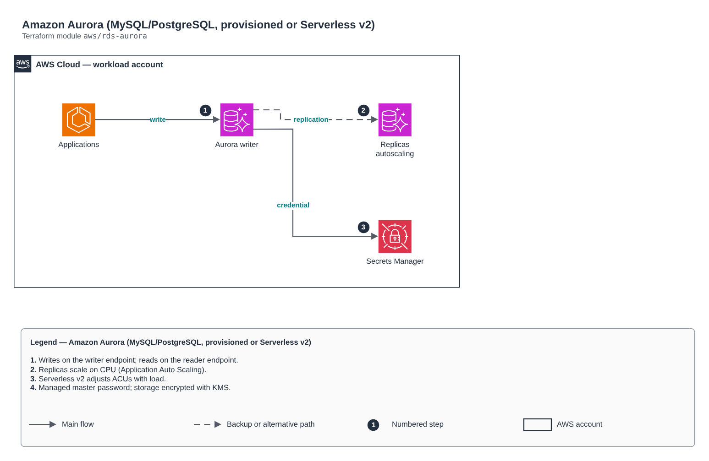

# Amazon Aurora (MySQL/PostgreSQL, provisioned or Serverless v2)

[Português](README.md) · **English**

> `aws/rds-aurora` · category **dados** · origin: Benefits platform on AWS (2023-2024)

> Designed in November 2023. With no time to keep the repository up to date back then, it is being published and updated now.

Amazon Aurora cluster (MySQL or PostgreSQL), provisioned or Serverless v2, in private subnets, KMS-encrypted, AWS-managed master password (Secrets Manager), read replicas with optional autoscaling and logs exported to CloudWatch.

## Architecture



Editable source: [`diagram.drawio`](diagram.drawio) (open it in draw.io / diagrams.net), with Portuguese and English pages.

1. Writes on the writer endpoint; reads on the reader endpoint.
2. Replicas scale on CPU (Application Auto Scaling).
3. Serverless v2 adjusts ACUs with load.
4. Managed master password; storage encrypted with KMS.

## Usage

```hcl
module "rds_aurora" {
  source = "git::https://github.com/raphaelfcs/automacao_terraform.git//aws/rds-aurora?ref=v1.0.0"

  name                   = "${local.name_prefix}-pg"
  engine                 = "aurora-postgresql"
  engine_version         = "16.4"
  parameter_group_family = "aurora-postgresql16"
  vpc_id                 = "vpc-0123456789abcdef0"
  subnet_ids             = ["subnet-0aaa1111bbbb2222c", "subnet-0ddd3333eeee4444f"]
  kms_key_arn            = "arn:aws:kms:sa-east-1:123456789012:key/11111111-2222-3333-4444-555555555555"
  database_name          = "app"
  instances              = { "1" = { instance_class = "db.r7g.large", promotion_tier = 0 }, "2" = { instance_class = "db.r7g.large" } }
  tags                   = local.tags
}
```

## Examples

| Example | Files |
|---|---|
| [`postgresql`](examples/postgresql) | `main.tf`, `locals.tf`, `backend.tf` |
| [`mysql`](examples/mysql) | `main.tf`, `locals.tf`, `backend.tf` |
| [`serverless-v2`](examples/serverless-v2) | `main.tf`, `locals.tf`, `backend.tf` |
| [`avancado`](examples/avancado) | `main.tf`, `locals.tf`, `backend.tf` |

Each example has its own backend (state isolated per module and example). Different environments only use another `backend.tf`/`*.tfvars`, without duplicating code.

## Inputs

| Name | Type | Default | Required | Description |
|---|---|---|---|---|
| `name` | `string` | - | **yes** | Cluster identifier. |
| `engine` | `string` | `"aurora-postgresql"` | no | aurora-mysql or aurora-postgresql. |
| `engine_version` | `string` | - | **yes** | Engine version (e.g. 16.4 for PostgreSQL, 8.0.mysql_aurora.3.08.0 for MySQL). |
| `parameter_group_family` | `string` | - | **yes** | Parameter group family (e.g. aurora-postgresql16, aurora-mysql8.0). |
| `cluster_parameters` | `map(string)` | `{}` | no | Additional cluster parameters. |
| `vpc_id` | `string` | - | **yes** | Cluster VPC. |
| `subnet_ids` | `list(string)` | - | **yes** | Private subnets (at least two AZs). |
| `ingress_security_groups` | `map(string)` | `{}` | no | SGs allowed on the database port: static name -> id. |
| `ingress_cidrs` | `list(string)` | `[]` | no | Allowed CIDRs (prefer SGs; use for on-premises networks over VPN/DX). |
| `kms_key_arn` | `string` | - | **yes** | KMS key for storage, master secret and Performance Insights. |
| `database_name` | `string` | `null` | no | Initial database. |
| `master_username` | `string` | `"dbadmin"` | no | Master user (password managed by AWS in Secrets Manager). |
| `instances` | `map(...)` | `{ "1" = { promotion_tier = 0 } "2" = ...` | no | Cluster instances by name (the lowest promotion_tier becomes the preferred writer). |
| `serverless_v2` | `object(...)` | `null` | no | Serverless v2 capacity in ACUs. null = provisioned instances. |
| `replica_autoscaling` | `object(...)` | `null` | no | Read replica autoscaling on CPU. null = off. |
| `backup_retention_period` | `number` | `7` | no | Backup days (1 to 35). |
| `backup_window` | `string` | `"05:00-06:00"` | no | Daily backup window (UTC). |
| `maintenance_window` | `string` | `"sun:06:30-sun:07:30"` | no | Weekly maintenance window (UTC). |
| `backtrack_window_hours` | `number` | `0` | no | Backtrack (Aurora MySQL only), in hours. 0 disables. |
| `deletion_protection` | `bool` | `true` | no | Prevents accidental deletion. |
| `final_snapshot` | `bool` | `true` | no | Creates a final snapshot on destroy. |
| `iam_database_authentication` | `bool` | `false` | no | Enables IAM authentication. |
| `performance_insights_enabled` | `bool` | `true` | no | Turns on Performance Insights. |
| `enhanced_monitoring_interval` | `number` | `0` | no | Enhanced Monitoring interval (0 disables). |
| `tags` | `map(string)` | `{}` | no | Tags applied to all resources. |

## Outputs

| Name | Description |
|---|---|
| `cluster_id` | Cluster identifier. |
| `cluster_arn` | Cluster ARN. |
| `writer_endpoint` | Write endpoint. |
| `reader_endpoint` | Read endpoint (balances across replicas). |
| `port` | Cluster port. |
| `master_user_secret_arn` | Secret with the master credential (AWS-managed). |
| `security_group_id` | Cluster security group. |

## Files

- `autoscaling.tf`: module-specific resources
- `iam.tf`: policies, roles and permissions
- `locals.tf`: derived values
- `main.tf`: main resources
- `outputs.tf`: outputs
- `security-group.tf`: module-specific resources
- `variables.tf`: inputs and validations
- `versions.tf`: Terraform and provider versions
- `examples/`: ready-to-use compositions
- `tests/`: `terraform test` with mocked providers

## Well-Architected

- Reliability: automatic backups, configurable Multi-AZ/high availability and deletion protection.
- Security: private-only access, mandatory TLS and data encrypted at rest with KMS/CMK.

## Tests

```bash
cd aws/rds-aurora
terraform init -backend=false
terraform test
```
