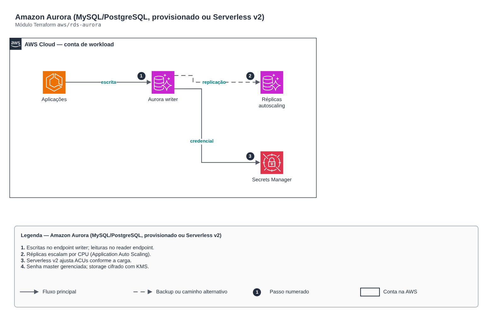

# Amazon Aurora (MySQL/PostgreSQL, provisionado ou Serverless v2)

**Português** · [English](README.en.md)

> `aws/rds-aurora` · categoria **dados** · origem: Plataforma de benefícios em AWS (2023-2024)

> Idealizado em novembro de 2023. Por falta de tempo para manter o repositório em dia na época, está sendo publicado e atualizado agora.

Cluster Amazon Aurora (MySQL ou PostgreSQL), provisionado ou Serverless v2, em subnets privadas, cifrado com KMS, senha master gerenciada pela AWS (Secrets Manager), réplicas de leitura com autoscaling opcional e logs exportados ao CloudWatch.

## Arquitetura



Fonte editável: [`diagram.drawio`](diagram.drawio) (abra no draw.io / diagrams.net), com páginas em português e inglês.

1. Escritas no endpoint writer; leituras no reader endpoint.
2. Réplicas escalam por CPU (Application Auto Scaling).
3. Serverless v2 ajusta ACUs conforme a carga.
4. Senha master gerenciada; storage cifrado com KMS.

## Uso

```hcl
module "rds_aurora" {
  source = "git::https://github.com/raphaelfcs/automacao_terraform.git//aws/rds-aurora?ref=v1.0.0"

  name                   = "${local.name_prefix}-pg"
  engine                 = "aurora-postgresql"
  engine_version         = "16.4"
  parameter_group_family = "aurora-postgresql16"
  vpc_id                 = "vpc-0123456789abcdef0"
  subnet_ids             = ["subnet-0aaa1111bbbb2222c", "subnet-0ddd3333eeee4444f"]
  kms_key_arn            = "arn:aws:kms:sa-east-1:123456789012:key/11111111-2222-3333-4444-555555555555"
  database_name          = "app"
  instances              = { "1" = { instance_class = "db.r7g.large", promotion_tier = 0 }, "2" = { instance_class = "db.r7g.large" } }
  tags                   = local.tags
}
```

## Exemplos

| Exemplo | Arquivos |
|---|---|
| [`postgresql`](examples/postgresql) | `main.tf`, `locals.tf`, `backend.tf` |
| [`mysql`](examples/mysql) | `main.tf`, `locals.tf`, `backend.tf` |
| [`serverless-v2`](examples/serverless-v2) | `main.tf`, `locals.tf`, `backend.tf` |
| [`avancado`](examples/avancado) | `main.tf`, `locals.tf`, `backend.tf` |

Cada exemplo tem seu próprio backend (state isolado por módulo e exemplo). Ambientes diferentes usam apenas outro `backend.tf`/`*.tfvars`, sem duplicar código.

## Entradas

| Nome | Tipo | Padrão | Obrigatória | Descrição |
|---|---|---|---|---|
| `name` | `string` | - | **sim** | Identificador do cluster. |
| `engine` | `string` | `"aurora-postgresql"` | não | aurora-mysql ou aurora-postgresql. |
| `engine_version` | `string` | - | **sim** | Versão do motor (ex.: 16.4 para PostgreSQL, 8.0.mysql_aurora.3.08.0 para MySQL). |
| `parameter_group_family` | `string` | - | **sim** | Família do parameter group (ex.: aurora-postgresql16, aurora-mysql8.0). |
| `cluster_parameters` | `map(string)` | `{}` | não | Parâmetros adicionais do cluster. |
| `vpc_id` | `string` | - | **sim** | VPC do cluster. |
| `subnet_ids` | `list(string)` | - | **sim** | Subnets privadas (mínimo duas AZs). |
| `ingress_security_groups` | `map(string)` | `{}` | não | SGs autorizados na porta do banco: nome estático -> id. |
| `ingress_cidrs` | `list(string)` | `[]` | não | CIDRs autorizados (prefira SGs; use para redes on-premises via VPN/DX). |
| `kms_key_arn` | `string` | - | **sim** | Chave KMS do storage, do secret master e do Performance Insights. |
| `database_name` | `string` | `null` | não | Banco inicial. |
| `master_username` | `string` | `"dbadmin"` | não | Usuário master (senha gerenciada pela AWS no Secrets Manager). |
| `instances` | `map(...)` | `{ "1" = { promotion_tier = 0 } "2" = ...` | não | Instâncias do cluster por nome (a de menor promotion_tier vira writer preferida). |
| `serverless_v2` | `object(...)` | `null` | não | Capacidade Serverless v2 em ACUs. null = instâncias provisionadas. |
| `replica_autoscaling` | `object(...)` | `null` | não | Autoscaling de réplicas de leitura por CPU. null = desligado. |
| `backup_retention_period` | `number` | `7` | não | Dias de backup (1 a 35). |
| `backup_window` | `string` | `"05:00-06:00"` | não | Janela diária de backup (UTC). |
| `maintenance_window` | `string` | `"sun:06:30-sun:07:30"` | não | Janela semanal de manutenção (UTC). |
| `backtrack_window_hours` | `number` | `0` | não | Backtrack (só Aurora MySQL), em horas. 0 desliga. |
| `deletion_protection` | `bool` | `true` | não | Impede exclusão acidental. |
| `final_snapshot` | `bool` | `true` | não | Cria snapshot final ao destruir. |
| `iam_database_authentication` | `bool` | `false` | não | Habilita autenticação por IAM. |
| `performance_insights_enabled` | `bool` | `true` | não | Liga o Performance Insights. |
| `enhanced_monitoring_interval` | `number` | `0` | não | Intervalo do Enhanced Monitoring (0 desliga). |
| `tags` | `map(string)` | `{}` | não | Tags aplicadas a todos os recursos. |

## Saídas

| Nome | Descrição |
|---|---|
| `cluster_id` | Identificador do cluster. |
| `cluster_arn` | ARN do cluster. |
| `writer_endpoint` | Endpoint de escrita. |
| `reader_endpoint` | Endpoint de leitura (balanceia entre réplicas). |
| `port` | Porta do cluster. |
| `master_user_secret_arn` | Secret com a credencial master (gerenciado pela AWS). |
| `security_group_id` | Security group do cluster. |

## Arquivos

- `autoscaling.tf`: recursos específicos do módulo
- `iam.tf`: políticas, papéis e permissões
- `locals.tf`: valores derivados
- `main.tf`: recursos principais
- `outputs.tf`: saídas
- `security-group.tf`: recursos específicos do módulo
- `variables.tf`: entradas e validações
- `versions.tf`: versões do Terraform e providers
- `examples/`: composições prontas para uso
- `tests/`: `terraform test` com providers simulados

## Well-Architected

- Confiabilidade: backups automáticos, Multi-AZ/alta disponibilidade configuráveis e proteção contra exclusão.
- Segurança: acesso somente privado, TLS obrigatório e dados cifrados em repouso com KMS/CMK.

## Testes

```bash
cd aws/rds-aurora
terraform init -backend=false
terraform test
```
