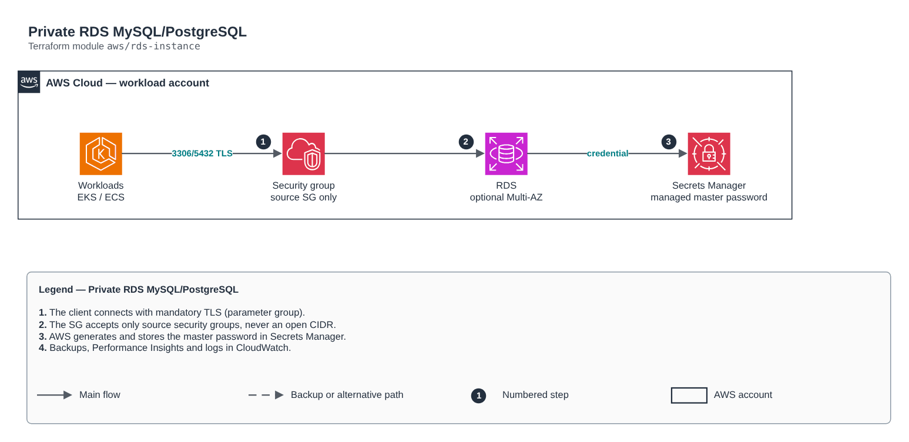

# Private RDS MySQL/PostgreSQL

[Português](README.md) · **English**

> `aws/rds-instance` · category **dados** · origin: Telecom microservices platform (2026)

> Designed in October 2026 and published now.

RDS (MySQL or PostgreSQL) in private subnets, KMS-encrypted, with no public access. The master password is managed by AWS (manage_master_user_password) and lives only in Secrets Manager: no password in variables, readable state or repositories.

## Architecture



Editable source: [`diagram.drawio`](diagram.drawio) (open it in draw.io / diagrams.net), with Portuguese and English pages.

1. The client connects with mandatory TLS (parameter group).
2. The SG accepts only source security groups, never an open CIDR.
3. AWS generates and stores the master password in Secrets Manager.
4. Backups, Performance Insights and logs in CloudWatch.

## Usage

```hcl
module "rds_instance" {
  source = "git::https://github.com/raphaelfcs/automacao_terraform.git//aws/rds-instance?ref=v1.0.0"

  name_prefix             = local.name_prefix
  engine                  = "mysql"
  engine_version          = "8.4.3"
  instance_class          = "db.t4g.micro"
  vpc_id                  = "vpc-0123456789abcdef0"
  subnet_ids              = ["subnet-0aaa1111bbbb2222c", "subnet-0ddd3333eeee4444f"]
  kms_key_arn             = "arn:aws:kms:sa-east-1:123456789012:key/11111111-2222-3333-4444-555555555555"
  database_name           = "app"
  ingress_security_groups = { eks = "sg-0123456789abcdef0" }
  deletion_protection     = false
  final_snapshot          = false
  tags                    = local.tags
}
```

## Examples

| Example | Files |
|---|---|
| [`mysql`](examples/mysql) | `main.tf`, `locals.tf`, `backend.tf` |
| [`postgres-multi-az`](examples/postgres-multi-az) | `main.tf`, `locals.tf`, `backend.tf` |

Each example has its own backend (state isolated per module and example). Different environments only use another `backend.tf`/`*.tfvars`, without duplicating code.

## Inputs

| Name | Type | Default | Required | Description |
|---|---|---|---|---|
| `name_prefix` | `string` | - | **yes** | Prefix applied to database resources. |
| `engine` | `string` | `"mysql"` | no | Database engine: mysql or postgres. |
| `engine_version` | `string` | - | **yes** | Engine version (e.g. 8.4.3 for MySQL, 16.4 for PostgreSQL). |
| `instance_class` | `string` | - | **yes** | Instance class (e.g. db.t4g.micro in dev, db.r7g.large in production). |
| `vpc_id` | `string` | - | **yes** | VPC where the instance lives. |
| `subnet_ids` | `list(string)` | - | **yes** | Private subnets of the subnet group (at least two AZs). |
| `ingress_security_groups` | `map(string)` | `{}` | no | Security groups allowed on the database port: static name (key) -> id (value). |
| `kms_key_arn` | `string` | - | **yes** | KMS key for encryption at rest, the master secret and Performance Insights. |
| `allocated_storage` | `number` | `20` | no | Initial storage in GB. |
| `max_allocated_storage` | `number` | `null` | no | Storage autoscaling limit in GB. null = 2x the initial size. |
| `database_name` | `string` | - | **yes** | Initial schema/database name. |
| `master_username` | `string` | `"dbadmin"` | no | Administrative user. The password is generated by AWS and stored in Secrets Manager. |
| `multi_az` | `bool` | `false` | no | Synchronous standby in another AZ. Mandatory in production (RPO/RTO); optional in sandbox. |
| `availability_zone` | `string` | `null` | no | AZ of the single-AZ instance. null = AWS chooses. |
| `backup_retention_period` | `number` | `7` | no | Automatic backup retention days (0 to 35). |
| `backup_window` | `string` | `"05:00-06:00"` | no | Daily backup window in UTC (hh24:mi-hh24:mi). |
| `maintenance_window` | `string` | `"sun:06:30-sun:07:30"` | no | Weekly maintenance window in UTC. |
| `deletion_protection` | `bool` | `true` | no | Prevents accidental deletion. Use true in production. |
| `final_snapshot` | `bool` | `true` | no | Creates a final snapshot on destroy. |
| `performance_insights_enabled` | `bool` | `true` | no | Turns on Performance Insights (7 free days). |
| `enhanced_monitoring_interval` | `number` | `0` | no | Enhanced Monitoring interval in seconds (0 disables; 1, 5, 10, 15, 30, 60). |
| `iam_database_authentication` | `bool` | `false` | no | Allows IAM authentication (tokens) in addition to user/password. |
| `extra_parameters` | `map(string)` | `{}` | no | Additional parameter group parameters (name -> value). |
| `tags` | `map(string)` | `{}` | no | Tags applied to all resources. |

## Outputs

| Name | Description |
|---|---|
| `endpoint` | Instance host:port endpoint. |
| `address` | Instance hostname. |
| `port` | Instance port. |
| `database_name` | Initial database. |
| `master_user_secret_arn` | ARN of the AWS-managed secret with the master credential. Applications read from here. |
| `security_group_id` | Instance security group (use it to allow new clients). |

## Files

- `iam.tf`: policies, roles and permissions
- `locals.tf`: derived values
- `main.tf`: main resources
- `outputs.tf`: outputs
- `parameters.tf`: module-specific resources
- `security-group.tf`: module-specific resources
- `variables.tf`: inputs and validations
- `versions.tf`: Terraform and provider versions
- `examples/`: ready-to-use compositions
- `tests/`: `terraform test` with mocked providers

## Well-Architected

- Reliability: automatic backups, configurable Multi-AZ/high availability and deletion protection.
- Security: private-only access, mandatory TLS and data encrypted at rest with KMS/CMK.

## Tests

```bash
cd aws/rds-instance
terraform init -backend=false
terraform test
```
