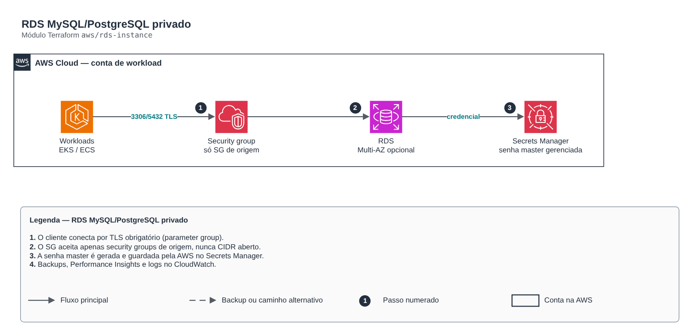

# RDS MySQL/PostgreSQL privado

**Português** · [English](README.en.md)

> `aws/rds-instance` · categoria **dados** · origem: Plataforma de microsserviços em telecom (2026)

> Idealizado em outubro de 2026 e publicado agora.

RDS (MySQL ou PostgreSQL) em subnets privadas, cifrado com KMS, sem acesso público. A senha do usuário master é gerenciada pela AWS (manage_master_user_password) e fica apenas no Secrets Manager: não existe senha em variável, em state legível ou em repositório.

## Arquitetura



Fonte editável: [`diagram.drawio`](diagram.drawio) (abra no draw.io / diagrams.net), com páginas em português e inglês.

1. O cliente conecta por TLS obrigatório (parameter group).
2. O SG aceita apenas security groups de origem, nunca CIDR aberto.
3. A senha master é gerada e guardada pela AWS no Secrets Manager.
4. Backups, Performance Insights e logs no CloudWatch.

## Uso

```hcl
module "rds_instance" {
  source = "git::https://github.com/raphaelfcs/automacao_terraform.git//aws/rds-instance?ref=v1.0.0"

  name_prefix             = local.name_prefix
  engine                  = "mysql"
  engine_version          = "8.4.3"
  instance_class          = "db.t4g.micro"
  vpc_id                  = "vpc-0123456789abcdef0"
  subnet_ids              = ["subnet-0aaa1111bbbb2222c", "subnet-0ddd3333eeee4444f"]
  kms_key_arn             = "arn:aws:kms:sa-east-1:123456789012:key/11111111-2222-3333-4444-555555555555"
  database_name           = "app"
  ingress_security_groups = { eks = "sg-0123456789abcdef0" }
  deletion_protection     = false
  final_snapshot          = false
  tags                    = local.tags
}
```

## Exemplos

| Exemplo | Arquivos |
|---|---|
| [`mysql`](examples/mysql) | `main.tf`, `locals.tf`, `backend.tf` |
| [`postgres-multi-az`](examples/postgres-multi-az) | `main.tf`, `locals.tf`, `backend.tf` |

Cada exemplo tem seu próprio backend (state isolado por módulo e exemplo). Ambientes diferentes usam apenas outro `backend.tf`/`*.tfvars`, sem duplicar código.

## Entradas

| Nome | Tipo | Padrão | Obrigatória | Descrição |
|---|---|---|---|---|
| `name_prefix` | `string` | - | **sim** | Prefixo aplicado aos recursos do banco. |
| `engine` | `string` | `"mysql"` | não | Motor do banco: mysql ou postgres. |
| `engine_version` | `string` | - | **sim** | Versão do motor (ex.: 8.4.3 para MySQL, 16.4 para PostgreSQL). |
| `instance_class` | `string` | - | **sim** | Classe da instância (ex.: db.t4g.micro em dev, db.r7g.large em produção). |
| `vpc_id` | `string` | - | **sim** | VPC onde a instância vive. |
| `subnet_ids` | `list(string)` | - | **sim** | Subnets privadas do subnet group (mínimo duas AZs). |
| `ingress_security_groups` | `map(string)` | `{}` | não | Security groups autorizados na porta do banco: nome estático (chave) -> id (valor). |
| `kms_key_arn` | `string` | - | **sim** | Chave KMS para criptografia em repouso, do secret master e do Performance Insights. |
| `allocated_storage` | `number` | `20` | não | Armazenamento inicial em GB. |
| `max_allocated_storage` | `number` | `null` | não | Limite do autoscaling de storage em GB. null = 2x o inicial. |
| `database_name` | `string` | - | **sim** | Nome do schema/banco inicial. |
| `master_username` | `string` | `"dbadmin"` | não | Usuário administrativo. A senha é gerada pela AWS e guardada no Secrets Manager. |
| `multi_az` | `bool` | `false` | não | Standby síncrono em outra AZ. Obrigatório em produção (RPO/RTO); dispensável em sandbox. |
| `availability_zone` | `string` | `null` | não | AZ da instância single-AZ. null = AWS escolhe. |
| `backup_retention_period` | `number` | `7` | não | Dias de retenção do backup automático (0 a 35). |
| `backup_window` | `string` | `"05:00-06:00"` | não | Janela diária de backup em UTC (hh24:mi-hh24:mi). |
| `maintenance_window` | `string` | `"sun:06:30-sun:07:30"` | não | Janela semanal de manutenção em UTC. |
| `deletion_protection` | `bool` | `true` | não | Impede exclusão acidental. Use true em produção. |
| `final_snapshot` | `bool` | `true` | não | Cria snapshot final ao destruir. |
| `performance_insights_enabled` | `bool` | `true` | não | Liga o Performance Insights (7 dias gratuitos). |
| `enhanced_monitoring_interval` | `number` | `0` | não | Intervalo do Enhanced Monitoring em segundos (0 desliga; 1, 5, 10, 15, 30, 60). |
| `iam_database_authentication` | `bool` | `false` | não | Permite autenticação por IAM (tokens) além de usuário/senha. |
| `extra_parameters` | `map(string)` | `{}` | não | Parâmetros adicionais do parameter group (nome -> valor). |
| `tags` | `map(string)` | `{}` | não | Tags aplicadas a todos os recursos. |

## Saídas

| Nome | Descrição |
|---|---|
| `endpoint` | Endpoint host:porta da instância. |
| `address` | Hostname da instância. |
| `port` | Porta da instância. |
| `database_name` | Banco inicial. |
| `master_user_secret_arn` | ARN do secret gerenciado pela AWS com a credencial master. Aplicações leem daqui. |
| `security_group_id` | Security group da instância (use para liberar novos clientes). |

## Arquivos

- `iam.tf`: políticas, papéis e permissões
- `locals.tf`: valores derivados
- `main.tf`: recursos principais
- `outputs.tf`: saídas
- `parameters.tf`: recursos específicos do módulo
- `security-group.tf`: recursos específicos do módulo
- `variables.tf`: entradas e validações
- `versions.tf`: versões do Terraform e providers
- `examples/`: composições prontas para uso
- `tests/`: `terraform test` com providers simulados

## Well-Architected

- Confiabilidade: backups automáticos, Multi-AZ/alta disponibilidade configuráveis e proteção contra exclusão.
- Segurança: acesso somente privado, TLS obrigatório e dados cifrados em repouso com KMS/CMK.

## Testes

```bash
cd aws/rds-instance
terraform init -backend=false
terraform test
```
