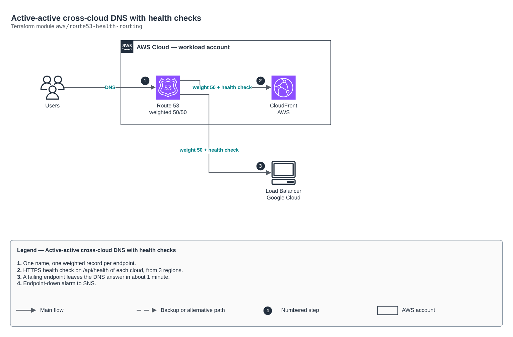

# Active-active cross-cloud DNS with health checks

[Português](README.md) · **English**

> `aws/route53-health-routing` · category **rede** · origin: Health records platform (2026)

> Designed in November 2026 and published now.

Active-active DNS routing across clouds: one name (e.g. app.example.com) with weighted records for each endpoint (CloudFront, another cloud load balancer IP), each with its own HTTPS health check. A failing endpoint leaves the DNS answer in about a minute; if all fail, Route 53 answers with all of them (fail-open), which avoids an outage caused by health checks.

## Architecture



Editable source: [`diagram.drawio`](diagram.drawio) (open it in draw.io / diagrams.net), with Portuguese and English pages.

1. One name, one weighted record per endpoint.
2. HTTPS health check on /api/health of each cloud, from 3 regions.
3. A failing endpoint leaves the DNS answer in about 1 minute.
4. Endpoint-down alarm to SNS.

## Usage

```hcl
module "route53_health_routing" {
  source = "git::https://github.com/raphaelfcs/automacao_terraform.git//aws/route53-health-routing?ref=v1.0.0"

  zone_id     = "Z0123456789ABCDEFGHIJ"
  record_name = "app.example.com"
  endpoints = {
    aws = { alias = { name = "d111111abcdef8.cloudfront.net", zone_id = "Z2FDTNDATAQYW2" }, health_fqdn = "d111111abcdef8.cloudfront.net" }
    gcp = { ips = ["34.120.0.10"], health_fqdn = "app.example.com", health_ip = "34.120.0.10" }
  }
  tags = local.tags
}
```

## Examples

| Example | Files |
|---|---|
| [`aws-e-gcp`](examples/aws-e-gcp) | `main.tf`, `locals.tf`, `backend.tf` |

Each example has its own backend (state isolated per module and example). Different environments only use another `backend.tf`/`*.tfvars`, without duplicating code.

## Inputs

| Name | Type | Default | Required | Description |
|---|---|---|---|---|
| `zone_id` | `string` | - | **yes** | Route 53 hosted zone. |
| `record_name` | `string` | - | **yes** | Published name (e.g. app.example.com). |
| `endpoints` | `map(...)` | - | **yes** | Endpoints by logical name (e.g. aws, gcp). Each has an alias (CloudFront/ALB) OR ips, its DNS weight and the health check target: health_fqdn (a name that answers directly on that endpoint) and, for IPs, health_ip. |
| `health_path` | `string` | `"/api/health"` | no | Path that answers 200 without authentication. |
| `health_regions` | `list(string)` | `["sa-east-1", "us-east-1", "us-west-2"]` | no | Regions Route 53 checks from (minimum 3). |
| `alarm_topic_arn` | `string` | `null` | no | SNS topic for the endpoint-down alarm (the Route 53 alarm lives in us-east-1). null = no alarm. |
| `tags` | `map(string)` | `{}` | no | Tags applied. |

## Outputs

| Name | Description |
|---|---|
| `health_check_ids` | Health check IDs per endpoint. |
| `fqdn` | Published name. |

## Files

- `main.tf`: main resources
- `outputs.tf`: outputs
- `variables.tf`: inputs and validations
- `versions.tf`: Terraform and provider versions
- `examples/`: ready-to-use compositions
- `tests/`: `terraform test` with mocked providers

## Well-Architected

- Reliability: resources spread across availability zones and no single point of failure for egress.
- Security: isolated subnet tiers, source-based rules and flow logs enabled.

## Tests

```bash
cd aws/route53-health-routing
terraform init -backend=false
terraform test
```
