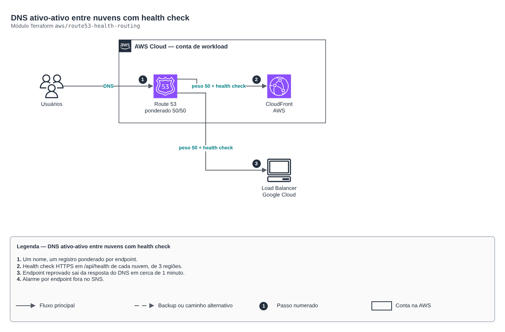

# DNS ativo-ativo entre nuvens com health check

**Português** · [English](README.en.md)

> `aws/route53-health-routing` · categoria **rede** · origem: Plataforma de documentos de saúde (2026)

> Idealizado em novembro de 2026 e publicado agora.

Roteamento DNS ativo-ativo entre nuvens: um nome (ex.: app.example.com) com registros ponderados para cada endpoint (CloudFront, IP de load balancer de outra nuvem), cada um com health check HTTPS próprio. Endpoint que falha sai da resposta do DNS em ~1 minuto; se todos falharem, o Route 53 volta a responder com todos (fail-open), o que evita apagão por health check.

## Arquitetura



Fonte editável: [`diagram.drawio`](diagram.drawio) (abra no draw.io / diagrams.net), com páginas em português e inglês.

1. Um nome, um registro ponderado por endpoint.
2. Health check HTTPS em /api/health de cada nuvem, de 3 regiões.
3. Endpoint reprovado sai da resposta do DNS em cerca de 1 minuto.
4. Alarme por endpoint fora no SNS.

## Uso

```hcl
module "route53_health_routing" {
  source = "git::https://github.com/raphaelfcs/automacao_terraform.git//aws/route53-health-routing?ref=v1.0.0"

  zone_id     = "Z0123456789ABCDEFGHIJ"
  record_name = "app.example.com"
  endpoints = {
    aws = { alias = { name = "d111111abcdef8.cloudfront.net", zone_id = "Z2FDTNDATAQYW2" }, health_fqdn = "d111111abcdef8.cloudfront.net" }
    gcp = { ips = ["34.120.0.10"], health_fqdn = "app.example.com", health_ip = "34.120.0.10" }
  }
  tags = local.tags
}
```

## Exemplos

| Exemplo | Arquivos |
|---|---|
| [`aws-e-gcp`](examples/aws-e-gcp) | `main.tf`, `locals.tf`, `backend.tf` |

Cada exemplo tem seu próprio backend (state isolado por módulo e exemplo). Ambientes diferentes usam apenas outro `backend.tf`/`*.tfvars`, sem duplicar código.

## Entradas

| Nome | Tipo | Padrão | Obrigatória | Descrição |
|---|---|---|---|---|
| `zone_id` | `string` | - | **sim** | Zona hospedada do Route 53. |
| `record_name` | `string` | - | **sim** | Nome publicado (ex.: app.example.com). |
| `endpoints` | `map(...)` | - | **sim** | Endpoints por nome lógico (ex.: aws, gcp). Cada um tem alias (CloudFront/ALB) OU ips, o peso no DNS e o alvo do health check: health_fqdn (nome que responde direto naquele endpoint) e, para IP, health_ip. |
| `health_path` | `string` | `"/api/health"` | não | Caminho que responde 200 sem autenticação. |
| `health_regions` | `list(string)` | `["sa-east-1", "us-east-1", "us-west-2"]` | não | Regiões de onde o Route 53 checa (mínimo 3). |
| `alarm_topic_arn` | `string` | `null` | não | Tópico SNS para alarme de endpoint fora (o alarme do Route 53 fica em us-east-1). null = sem alarme. |
| `tags` | `map(string)` | `{}` | não | Tags aplicadas. |

## Saídas

| Nome | Descrição |
|---|---|
| `health_check_ids` | IDs dos health checks por endpoint. |
| `fqdn` | Nome publicado. |

## Arquivos

- `main.tf`: recursos principais
- `outputs.tf`: saídas
- `variables.tf`: entradas e validações
- `versions.tf`: versões do Terraform e providers
- `examples/`: composições prontas para uso
- `tests/`: `terraform test` com providers simulados

## Well-Architected

- Confiabilidade: recursos distribuídos por zonas de disponibilidade e sem ponto único de falha na saída.
- Segurança: camadas de sub-rede isoladas, regras por origem e logs de fluxo habilitados.

## Testes

```bash
cd aws/route53-health-routing
terraform init -backend=false
terraform test
```
