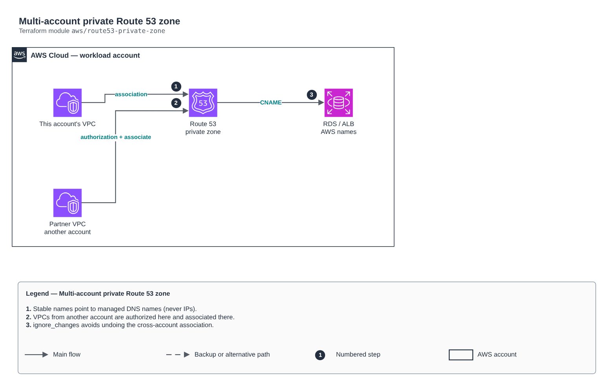

# Multi-account private Route 53 zone

[Português](README.md) · **English**

> `aws/route53-private-zone` · category **rede** · origin: Telecom microservices platform (2026)

> Designed in October 2026 and published now.

PRIVATE Route 53 zone with stable names for internal resources (ALB, RDS, cache, fixed-IP services), associated with VPCs in this account and authorized for VPCs in other accounts (partners, workload accounts) through cross-account authorization.

## Architecture



Editable source: [`diagram.drawio`](diagram.drawio) (open it in draw.io / diagrams.net), with Portuguese and English pages.

1. Stable names point to managed DNS names (never IPs).
2. VPCs from another account are authorized here and associated there.
3. ignore_changes avoids undoing the cross-account association.

## Usage

```hcl
module "route53_private_zone" {
  source = "git::https://github.com/raphaelfcs/automacao_terraform.git//aws/route53-private-zone?ref=v1.0.0"

  zone_name          = "interno.demo.local"
  vpcs               = { principal = { vpc_id = "vpc-0123456789abcdef0", region = "sa-east-1" } }
  cross_account_vpcs = { parceiro = { vpc_id = "vpc-0fedcba9876543210", region = "us-east-1" } }
  cname_records      = { db = "demo.abc123.sa-east-1.rds.amazonaws.com", api = "internal-api-123.sa-east-1.elb.amazonaws.com" }
  a_records          = { gateway = ["10.20.10.10", "10.20.11.10"] }
  tags               = local.tags
}
```

## Examples

| Example | Files |
|---|---|
| [`nomes-estaveis`](examples/nomes-estaveis) | `main.tf`, `locals.tf`, `backend.tf` |

Each example has its own backend (state isolated per module and example). Different environments only use another `backend.tf`/`*.tfvars`, without duplicating code.

## Inputs

| Name | Type | Default | Required | Description |
|---|---|---|---|---|
| `zone_name` | `string` | - | **yes** | Private zone name (e.g. internal.company.local). Avoid colliding with the other account's zones. |
| `comment` | `string` | `"Zona privada gerenciada por Terraform"` | no | Zone comment. |
| `vpcs` | `map(...)` | - | **yes** | VPCs in this account associated at creation: label -> { vpc_id, region }. |
| `additional_vpcs` | `map(...)` | `{}` | no | VPCs in this account associated after creation. |
| `cross_account_vpcs` | `map(...)` | `{}` | no | VPCs from OTHER accounts authorized to associate the zone. |
| `cname_records` | `map(string)` | `{}` | no | Short name -> AWS-managed DNS name (e.g. { db = "x.rds.amazonaws.com" }). |
| `a_records` | `map(list(string))` | `{}` | no | Short name -> list of fixed private IPs. |
| `ttl` | `number` | `60` | no | Record TTL in seconds (low makes switching easier). |
| `tags` | `map(string)` | `{}` | no | Zone tags. |

## Outputs

| Name | Description |
|---|---|
| `zone_id` | Private zone ID. |
| `record_fqdns` | FQDN of each record created. |
| `cross_account_commands` | Command the OTHER account runs to complete the association (without it the authorization stays pending). |

## Files

- `main.tf`: main resources
- `outputs.tf`: outputs
- `variables.tf`: inputs and validations
- `versions.tf`: Terraform and provider versions
- `examples/`: ready-to-use compositions
- `tests/`: `terraform test` with mocked providers

## Well-Architected

- Reliability: resources spread across availability zones and no single point of failure for egress.
- Security: isolated subnet tiers, source-based rules and flow logs enabled.

## Tests

```bash
cd aws/route53-private-zone
terraform init -backend=false
terraform test
```
