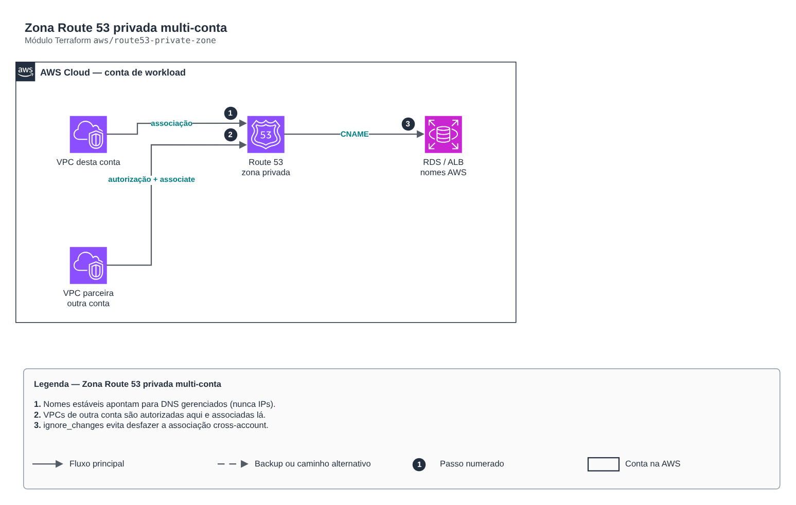

# Zona Route 53 privada multi-conta

**Português** · [English](README.en.md)

> `aws/route53-private-zone` · categoria **rede** · origem: Plataforma de microsserviços em telecom (2026)

> Idealizado em outubro de 2026 e publicado agora.

Zona Route 53 PRIVADA com nomes estáveis para recursos internos (ALB, RDS, cache, serviços por IP fixo), associada a VPCs desta conta e autorizada para VPCs de outras contas (parceiros, contas de workload) via autorização cross-account.

## Arquitetura



Fonte editável: [`diagram.drawio`](diagram.drawio) (abra no draw.io / diagrams.net), com páginas em português e inglês.

1. Nomes estáveis apontam para DNS gerenciados (nunca IPs).
2. VPCs de outra conta são autorizadas aqui e associadas lá.
3. ignore_changes evita desfazer a associação cross-account.

## Uso

```hcl
module "route53_private_zone" {
  source = "git::https://github.com/raphaelfcs/automacao_terraform.git//aws/route53-private-zone?ref=v1.0.0"

  zone_name          = "interno.demo.local"
  vpcs               = { principal = { vpc_id = "vpc-0123456789abcdef0", region = "sa-east-1" } }
  cross_account_vpcs = { parceiro = { vpc_id = "vpc-0fedcba9876543210", region = "us-east-1" } }
  cname_records      = { db = "demo.abc123.sa-east-1.rds.amazonaws.com", api = "internal-api-123.sa-east-1.elb.amazonaws.com" }
  a_records          = { gateway = ["10.20.10.10", "10.20.11.10"] }
  tags               = local.tags
}
```

## Exemplos

| Exemplo | Arquivos |
|---|---|
| [`nomes-estaveis`](examples/nomes-estaveis) | `main.tf`, `locals.tf`, `backend.tf` |

Cada exemplo tem seu próprio backend (state isolado por módulo e exemplo). Ambientes diferentes usam apenas outro `backend.tf`/`*.tfvars`, sem duplicar código.

## Entradas

| Nome | Tipo | Padrão | Obrigatória | Descrição |
|---|---|---|---|---|
| `zone_name` | `string` | - | **sim** | Nome da zona privada (ex.: interno.empresa.local). Evite colidir com zonas da outra conta. |
| `comment` | `string` | `"Zona privada gerenciada por Terraform"` | não | Comentário da zona. |
| `vpcs` | `map(...)` | - | **sim** | VPCs desta conta associadas na criação: rótulo -> { vpc_id, region }. |
| `additional_vpcs` | `map(...)` | `{}` | não | VPCs desta conta associadas depois da criação. |
| `cross_account_vpcs` | `map(...)` | `{}` | não | VPCs de OUTRAS contas autorizadas a associar a zona. |
| `cname_records` | `map(string)` | `{}` | não | Nome curto -> DNS gerenciado pela AWS (ex.: { db = "x.rds.amazonaws.com" }). |
| `a_records` | `map(list(string))` | `{}` | não | Nome curto -> lista de IPs privados fixos. |
| `ttl` | `number` | `60` | não | TTL dos registros em segundos (baixo facilita trocas). |
| `tags` | `map(string)` | `{}` | não | Tags da zona. |

## Saídas

| Nome | Descrição |
|---|---|
| `zone_id` | ID da zona privada. |
| `record_fqdns` | FQDN de cada registro criado. |
| `cross_account_commands` | Comando que a OUTRA conta executa para concluir a associação (sem ele a autorização fica pendente). |

## Arquivos

- `main.tf`: recursos principais
- `outputs.tf`: saídas
- `variables.tf`: entradas e validações
- `versions.tf`: versões do Terraform e providers
- `examples/`: composições prontas para uso
- `tests/`: `terraform test` com providers simulados

## Well-Architected

- Confiabilidade: recursos distribuídos por zonas de disponibilidade e sem ponto único de falha na saída.
- Segurança: camadas de sub-rede isoladas, regras por origem e logs de fluxo habilitados.

## Testes

```bash
cd aws/route53-private-zone
terraform init -backend=false
terraform test
```
