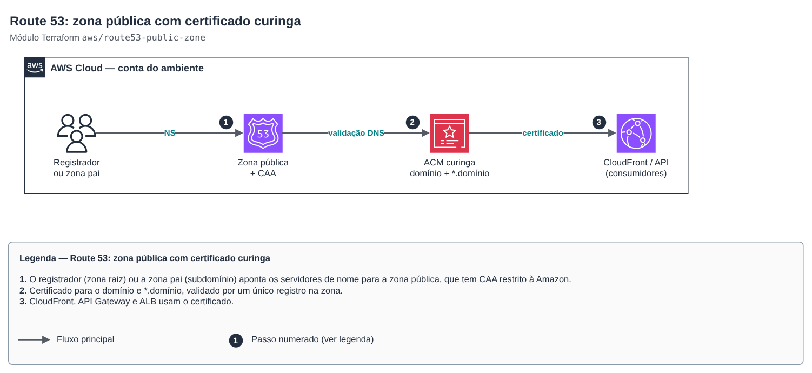

# Route 53: public zone with wildcard certificate

[Português](README.md) · **English**

> `aws/route53-public-zone` · category **rede** · origin: SaaS platform landing zone (2026)

> Created in November 2026 for the landing zone of an in-house SaaS platform.

Route 53 **public** zone for a domain or subdomain (e.g. `example.com` in the production account and `dev.example.com` in the dev account), with a DNS-validated ACM wildcard certificate and a CAA record that restricts issuance to Amazon. Delegating the subdomain from the parent zone is done by `route53-zone-delegation`, in its own state (cross-account interconnection).

## Architecture



Editable source: [`diagram.drawio`](diagram.drawio) (open in draw.io / diagrams.net), with pages in Portuguese and English.

1. The registrar (root zone) or the parent zone (subdomain) points the name servers to the public zone, which has CAA restricted to Amazon.
2. Certificate for domain and *.domain, validated by a single record in the zone.
3. CloudFront, API Gateway and ALB use the certificate.

A wildcard covers a single level (`*.example.com` does not match `a.b.example.com`). For CloudFront, apply with a `us-east-1` provider. For a new subdomain, keep `wait_for_validation = false` until the delegation exists.

## Usage

```hcl
module "dns_dev" {
  source = "git::https://github.com/raphaelfcs/automacao_terraform.git//aws/route53-public-zone?ref=v1.1.0"

  zone_name                   = "dev.example.com"
  create_wildcard_certificate = true
  wait_for_validation         = false
  tags                        = local.tags
}
```

## Examples

| Example | Files |
|---|---|
| [`zona-com-wildcard`](examples/zona-com-wildcard) | `main.tf`, `locals.tf`, `backend.tf` |

Each example has its own backend (state isolated per module and example). Other environments only change `backend.tf`/`*.tfvars`, without duplicating code.

## Inputs

| Name | Type | Default | Required | Description |
|---|---|---|---|---|
| `zone_name` | `string` | — | yes | Zone domain (e.g. example.com or dev.example.com), without trailing dot. |
| `comment` | `string` | `"Gerenciada por Terraform"` | no | Zone comment. |
| `create_wildcard_certificate` | `bool` | `true` | no | Issues an ACM certificate for the domain and *.domain, validated in this zone. For CloudFront, apply with a us-east-1 provider. |
| `wait_for_validation` | `bool` | `false` | no | Waits for ACM to validate the certificate. For a new subdomain, it only validates after the NS delegation exists in the parent zone. |
| `certificate_key_algorithm` | `string` | `"EC_prime256v1"` | no | Certificate key algorithm. |
| `caa_issuers` | `list(string)` | `["amazon.com", "amazontrust.com", "aw...` | no | Authorities allowed to issue certificates (CAA record). Empty = no CAA. |
| `tags` | `map(string)` | `{}` | no | Additional tags. |

## Outputs

| Name | Description |
|---|---|
| `zone_id` | Hosted zone ID. |
| `zone_name` | Zone domain. |
| `name_servers` | Name servers: register them at the registrar (root zone) or delegate in the parent zone (subdomain). |
| `certificate_arn` | Wildcard certificate ARN (null if not issued). |

## Files

- `locals.tf`: derived values
- `main.tf`: main resources
- `outputs.tf`: outputs
- `variables.tf`: inputs and validations
- `versions.tf`: Terraform and provider versions
- `examples/`: ready-to-use compositions
- `tests/`: `terraform test` with mocked providers

## Well-Architected

- Security: TLS on every name, CAA limiting who can issue certificates.
- Reliability: automatic ACM renewal, no manual certificates.

## Tests

```bash
cd aws/route53-public-zone
terraform init -backend=false
terraform test
```
