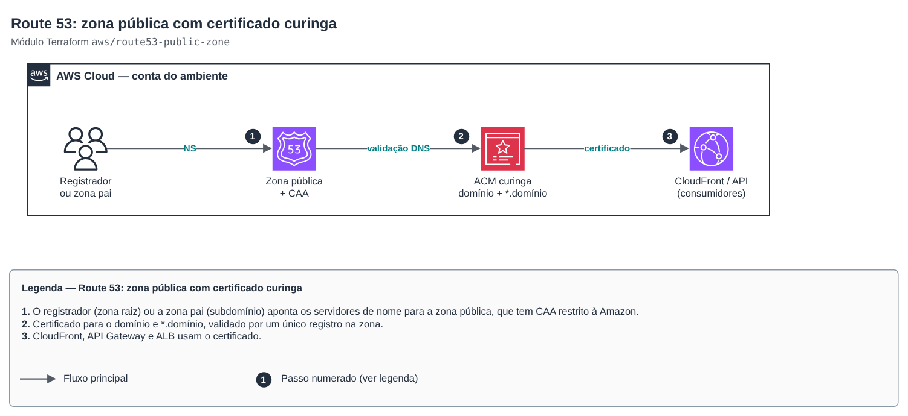

# Route 53: zona pública com certificado curinga

**Português** · [English](README.en.md)

> `aws/route53-public-zone` · categoria **rede** · origem: landing zone de plataforma SaaS (2026)

> Criado em novembro de 2026, para a landing zone de uma plataforma SaaS própria.

Zona Route 53 **pública** de um domínio ou subdomínio (ex.: `example.com` na conta de produção e `dev.example.com` na conta de dev), com certificado ACM curinga validado por DNS e registro CAA que restringe a emissão à Amazon. A delegação do subdomínio para a zona pai é feita pelo módulo `route53-zone-delegation`, em estado próprio (interconexão entre contas).

## Arquitetura



Fonte editável: [`diagram.drawio`](diagram.drawio) (abra no draw.io / diagrams.net), com páginas em português e inglês.

1. O registrador (zona raiz) ou a zona pai (subdomínio) aponta os servidores de nome para a zona pública, que tem CAA restrito à Amazon.
2. Certificado para o domínio e *.domínio, validado por um único registro na zona.
3. CloudFront, API Gateway e ALB usam o certificado.

Um curinga cobre um nível só (`*.example.com` não vale para `a.b.example.com`). Para CloudFront, aplique com provider em `us-east-1`. Em subdomínio novo, deixe `wait_for_validation = false` até a delegação existir.

## Uso

```hcl
module "dns_dev" {
  source = "git::https://github.com/raphaelfcs/automacao_terraform.git//aws/route53-public-zone?ref=v1.1.0"

  zone_name                   = "dev.example.com"
  create_wildcard_certificate = true
  wait_for_validation         = false
  tags                        = local.tags
}
```

## Exemplos

| Exemplo | Arquivos |
|---|---|
| [`zona-com-wildcard`](examples/zona-com-wildcard) | `main.tf`, `locals.tf`, `backend.tf` |

Cada exemplo tem seu próprio backend (state isolado por módulo e exemplo). Ambientes diferentes usam apenas outro `backend.tf`/`*.tfvars`, sem duplicar código.

## Entradas

| Nome | Tipo | Padrão | Obrigatória | Descrição |
|---|---|---|---|---|
| `zone_name` | `string` | — | sim | Domínio da zona (ex.: example.com ou dev.example.com), sem ponto final. |
| `comment` | `string` | `"Gerenciada por Terraform"` | não | Comentário da zona. |
| `create_wildcard_certificate` | `bool` | `true` | não | Emite certificado ACM para o domínio e *.domínio, validado nesta zona. Para CloudFront, aplique com provider em us-east-1. |
| `wait_for_validation` | `bool` | `false` | não | Espera o ACM validar o certificado. Em subdomínio novo, só valida depois que a delegação NS existir na zona pai. |
| `certificate_key_algorithm` | `string` | `"EC_prime256v1"` | não | Algoritmo da chave do certificado. |
| `caa_issuers` | `list(string)` | `["amazon.com", "amazontrust.com", "aw...` | não | Autoridades autorizadas a emitir certificados (registro CAA). Vazio = sem CAA. |
| `tags` | `map(string)` | `{}` | não | Tags adicionais. |

## Saídas

| Nome | Descrição |
|---|---|
| `zone_id` | ID da zona hospedada. |
| `zone_name` | Domínio da zona. |
| `name_servers` | Servidores de nome: cadastre no registrador (zona raiz) ou delegue na zona pai (subdomínio). |
| `certificate_arn` | ARN do certificado curinga (null se não emitido). |

## Arquivos

- `locals.tf`: valores derivados
- `main.tf`: recursos principais
- `outputs.tf`: saídas
- `variables.tf`: entradas e validações
- `versions.tf`: versões do Terraform e providers
- `examples/`: composições prontas para uso
- `tests/`: `terraform test` com providers simulados

## Well-Architected

- Segurança: TLS em todos os nomes, CAA limitando quem emite certificado.
- Confiabilidade: renovação automática do ACM, sem certificado manual.

## Testes

```bash
cd aws/route53-public-zone
terraform init -backend=false
terraform test
```
