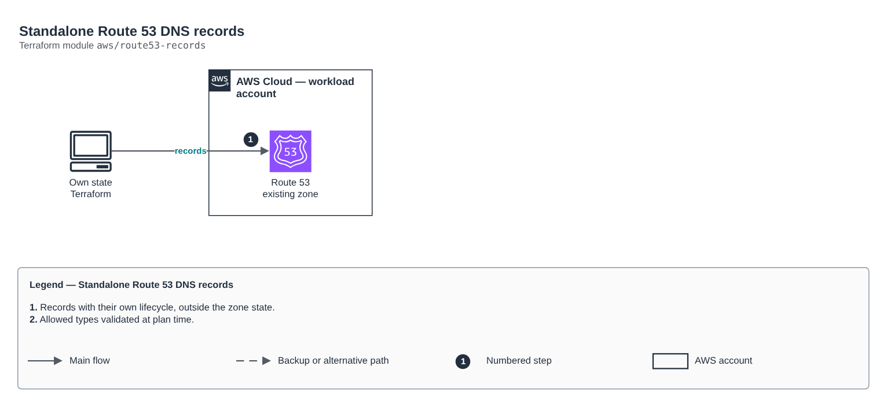

# Standalone Route 53 DNS records

[Português](README.md) · **English**

> `aws/route53-records` · category **rede** · origin: Health records platform (2026)

> Designed in November 2026 and published now.

Standalone DNS records in an existing zone (another cloud certificate validation, domain verification, CNAMEs). Keeps records with a different lifecycle out of the zone state.

## Architecture



Editable source: [`diagram.drawio`](diagram.drawio) (open it in draw.io / diagrams.net), with Portuguese and English pages.

1. Records with their own lifecycle, outside the zone state.
2. Allowed types validated at plan time.

## Usage

```hcl
module "route53_records" {
  source = "git::https://github.com/raphaelfcs/automacao_terraform.git//aws/route53-records?ref=v1.0.0"

  zone_id = "Z0123456789ABCDEFGHIJ"
  records = {
    gcp-cert = { name = "_acme-challenge.app.example.com.", type = "CNAME", values = ["abc.1.authorize.certificatemanager.goog."] }
  }
}
```

## Examples

| Example | Files |
|---|---|
| [`validacao-gcp`](examples/validacao-gcp) | `main.tf`, `locals.tf`, `backend.tf` |

Each example has its own backend (state isolated per module and example). Different environments only use another `backend.tf`/`*.tfvars`, without duplicating code.

## Inputs

| Name | Type | Default | Required | Description |
|---|---|---|---|---|
| `zone_id` | `string` | - | **yes** | Route 53 hosted zone. |
| `records` | `map(...)` | - | **yes** | Records: logical key -> { name, type, values, ttl }. |

## Outputs

| Name | Description |
|---|---|
| `fqdns` | Names created per logical key. |

## Files

- `main.tf`: main resources
- `outputs.tf`: outputs
- `variables.tf`: inputs and validations
- `versions.tf`: Terraform and provider versions
- `examples/`: ready-to-use compositions
- `tests/`: `terraform test` with mocked providers

## Well-Architected

- Reliability: resources spread across availability zones and no single point of failure for egress.
- Security: isolated subnet tiers, source-based rules and flow logs enabled.

## Tests

```bash
cd aws/route53-records
terraform init -backend=false
terraform test
```
