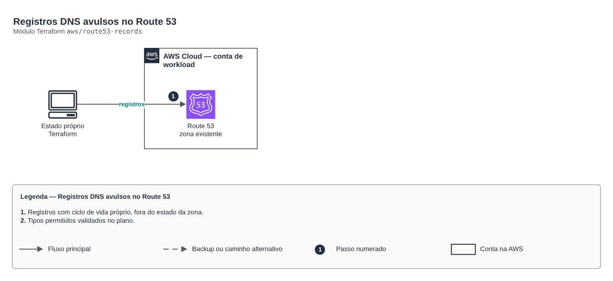

# Registros DNS avulsos no Route 53

**Português** · [English](README.en.md)

> `aws/route53-records` · categoria **rede** · origem: Plataforma de documentos de saúde (2026)

> Idealizado em novembro de 2026 e publicado agora.

Registros DNS avulsos numa zona existente (validação de certificado de outra nuvem, verificação de domínio, CNAMEs). Mantém registros de ciclo de vida diferente fora do estado da zona.

## Arquitetura



Fonte editável: [`diagram.drawio`](diagram.drawio) (abra no draw.io / diagrams.net), com páginas em português e inglês.

1. Registros com ciclo de vida próprio, fora do estado da zona.
2. Tipos permitidos validados no plano.

## Uso

```hcl
module "route53_records" {
  source = "git::https://github.com/raphaelfcs/automacao_terraform.git//aws/route53-records?ref=v1.0.0"

  zone_id = "Z0123456789ABCDEFGHIJ"
  records = {
    gcp-cert = { name = "_acme-challenge.app.example.com.", type = "CNAME", values = ["abc.1.authorize.certificatemanager.goog."] }
  }
}
```

## Exemplos

| Exemplo | Arquivos |
|---|---|
| [`validacao-gcp`](examples/validacao-gcp) | `main.tf`, `locals.tf`, `backend.tf` |

Cada exemplo tem seu próprio backend (state isolado por módulo e exemplo). Ambientes diferentes usam apenas outro `backend.tf`/`*.tfvars`, sem duplicar código.

## Entradas

| Nome | Tipo | Padrão | Obrigatória | Descrição |
|---|---|---|---|---|
| `zone_id` | `string` | - | **sim** | Zona hospedada do Route 53. |
| `records` | `map(...)` | - | **sim** | Registros: chave lógica -> { name, type, values, ttl }. |

## Saídas

| Nome | Descrição |
|---|---|
| `fqdns` | Nomes criados por chave lógica. |

## Arquivos

- `main.tf`: recursos principais
- `outputs.tf`: saídas
- `variables.tf`: entradas e validações
- `versions.tf`: versões do Terraform e providers
- `examples/`: composições prontas para uso
- `tests/`: `terraform test` com providers simulados

## Well-Architected

- Confiabilidade: recursos distribuídos por zonas de disponibilidade e sem ponto único de falha na saída.
- Segurança: camadas de sub-rede isoladas, regras por origem e logs de fluxo habilitados.

## Testes

```bash
cd aws/route53-records
terraform init -backend=false
terraform test
```
