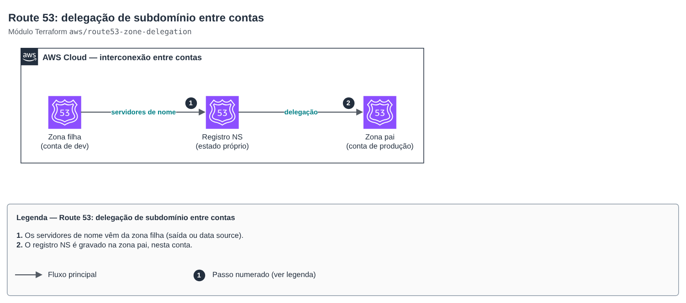

# Route 53: cross-account subdomain delegation

[Português](README.md) · **English**

> `aws/route53-zone-delegation` · category **rede** · origin: SaaS platform landing zone (2026)

> Created in November 2026 for the landing zone of an in-house SaaS platform.

Cross-account DNS interconnection: delegates a subdomain (child zone in another account, e.g. `dev.example.com`) by creating the NS record in the parent zone (e.g. `example.com` in the production account). It has its own state, separate from both zones, so neither depends on the other's lifecycle; the name servers come from the child zone's output/parameter.

## Architecture



Editable source: [`diagram.drawio`](diagram.drawio) (open in draw.io / diagrams.net), with pages in Portuguese and English.

1. Name servers come from the child zone (output or data source).
2. The NS record is written to the parent zone, in this account.

## Usage

```hcl
module "delegacao_dev" {
  source = "git::https://github.com/raphaelfcs/automacao_terraform.git//aws/route53-zone-delegation?ref=v1.1.0"

  parent_zone_id = "Z0123456789ABCDEFGHIJ"
  subdomain      = "dev.example.com"
  name_servers   = ["ns-1.awsdns-01.org", "ns-2.awsdns-02.co.uk", "ns-3.awsdns-03.com", "ns-4.awsdns-04.net"]
}
```

## Examples

| Example | Files |
|---|---|
| [`delegar-subdominio`](examples/delegar-subdominio) | `main.tf`, `locals.tf`, `backend.tf` |

Each example has its own backend (state isolated per module and example). Other environments only change `backend.tf`/`*.tfvars`, without duplicating code.

## Inputs

| Name | Type | Default | Required | Description |
|---|---|---|---|---|
| `parent_zone_id` | `string` | — | yes | Parent zone ID (in the account where this module is applied). |
| `subdomain` | `string` | — | yes | FQDN of the delegated subdomain (e.g. dev.example.com). |
| `name_servers` | `list(string)` | — | yes | Child zone name servers. |
| `ttl` | `number` | `300` | no | NS record TTL (seconds). Start low and raise it once stable. |

## Outputs

| Name | Description |
|---|---|
| `fqdn` | Delegated name. |

## Files

- `main.tf`: main resources
- `outputs.tf`: outputs
- `variables.tf`: inputs and validations
- `versions.tf`: Terraform and provider versions
- `examples/`: ready-to-use compositions
- `tests/`: `terraform test` with mocked providers

## Well-Architected

- Reliability: each zone has its own lifecycle; the link between them is a small, isolated state.
- Security: the child account gets no write permission on the parent zone.

## Tests

```bash
cd aws/route53-zone-delegation
terraform init -backend=false
terraform test
```
