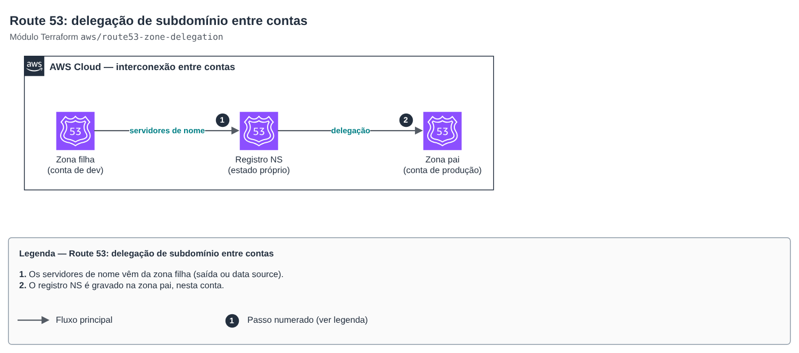

# Route 53: delegação de subdomínio entre contas

**Português** · [English](README.en.md)

> `aws/route53-zone-delegation` · categoria **rede** · origem: landing zone de plataforma SaaS (2026)

> Criado em novembro de 2026, para a landing zone de uma plataforma SaaS própria.

Interconexão de DNS entre contas: delega um subdomínio (zona filha em outra conta, ex.: `dev.example.com`) criando o registro NS na zona pai (ex.: `example.com` na conta de produção). Fica num estado próprio, separado das duas zonas, para que nenhuma delas dependa do ciclo de vida da outra; os servidores de nome chegam por saída/parâmetro da zona filha.

## Arquitetura



Fonte editável: [`diagram.drawio`](diagram.drawio) (abra no draw.io / diagrams.net), com páginas em português e inglês.

1. Os servidores de nome vêm da zona filha (saída ou data source).
2. O registro NS é gravado na zona pai, nesta conta.

## Uso

```hcl
module "delegacao_dev" {
  source = "git::https://github.com/raphaelfcs/automacao_terraform.git//aws/route53-zone-delegation?ref=v1.1.0"

  parent_zone_id = "Z0123456789ABCDEFGHIJ"
  subdomain      = "dev.example.com"
  name_servers   = ["ns-1.awsdns-01.org", "ns-2.awsdns-02.co.uk", "ns-3.awsdns-03.com", "ns-4.awsdns-04.net"]
}
```

## Exemplos

| Exemplo | Arquivos |
|---|---|
| [`delegar-subdominio`](examples/delegar-subdominio) | `main.tf`, `locals.tf`, `backend.tf` |

Cada exemplo tem seu próprio backend (state isolado por módulo e exemplo). Ambientes diferentes usam apenas outro `backend.tf`/`*.tfvars`, sem duplicar código.

## Entradas

| Nome | Tipo | Padrão | Obrigatória | Descrição |
|---|---|---|---|---|
| `parent_zone_id` | `string` | — | sim | ID da zona pai (na conta onde este módulo é aplicado). |
| `subdomain` | `string` | — | sim | FQDN do subdomínio delegado (ex.: dev.example.com). |
| `name_servers` | `list(string)` | — | sim | Servidores de nome da zona filha. |
| `ttl` | `number` | `300` | não | TTL do registro NS (segundos). Comece baixo e aumente quando estabilizar. |

## Saídas

| Nome | Descrição |
|---|---|
| `fqdn` | Nome delegado. |

## Arquivos

- `main.tf`: recursos principais
- `outputs.tf`: saídas
- `variables.tf`: entradas e validações
- `versions.tf`: versões do Terraform e providers
- `examples/`: composições prontas para uso
- `tests/`: `terraform test` com providers simulados

## Well-Architected

- Confiabilidade: cada zona tem ciclo de vida próprio; a ligação entre elas é um estado pequeno e isolado.
- Segurança: a conta filha não recebe permissão de escrita na zona pai.

## Testes

```bash
cd aws/route53-zone-delegation
terraform init -backend=false
terraform test
```
