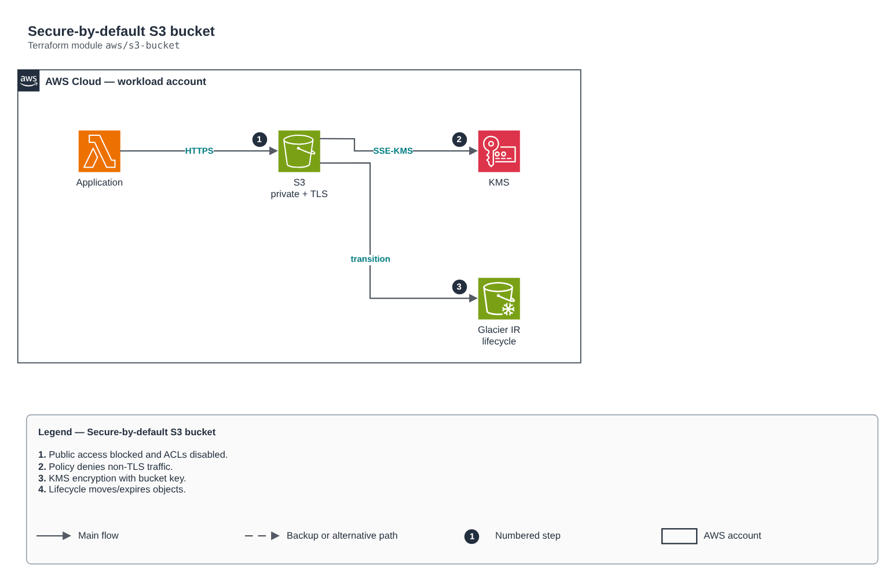

# Secure-by-default S3 bucket

[Português](README.md) · **English**

> `aws/s3-bucket` · category **armazenamento** · origin: Telecom microservices platform (2026)

> Designed in October 2026 and published now.

Secure-by-default S3 bucket: public access blocked, bucket owner enforced (no ACLs), KMS (or SSE-S3) encryption, mandatory TLS, optional versioning and lifecycle rules.

## Architecture



Editable source: [`diagram.drawio`](diagram.drawio) (open it in draw.io / diagrams.net), with Portuguese and English pages.

1. Public access blocked and ACLs disabled.
2. Policy denies non-TLS traffic.
3. KMS encryption with bucket key.
4. Lifecycle moves/expires objects.

## Usage

```hcl
module "s3_bucket" {
  source = "git::https://github.com/raphaelfcs/automacao_terraform.git//aws/s3-bucket?ref=v1.0.0"

  bucket_name = "demo-dev-dados-123456789012"
  tags        = local.tags
}
```

## Examples

| Example | Files |
|---|---|
| [`basico`](examples/basico) | `main.tf`, `locals.tf`, `backend.tf` |
| [`kms-ciclo-de-vida`](examples/kms-ciclo-de-vida) | `main.tf`, `locals.tf`, `backend.tf` |

Each example has its own backend (state isolated per module and example). Different environments only use another `backend.tf`/`*.tfvars`, without duplicating code.

## Inputs

| Name | Type | Default | Required | Description |
|---|---|---|---|---|
| `bucket_name` | `string` | - | **yes** | Bucket name (globally unique). |
| `kms_key_arn` | `string` | `null` | no | Encryption KMS key. null = SSE-S3 (AES256). |
| `versioning` | `bool` | `true` | no | Turns on versioning (recommended for business data; optional for ephemeral artifacts). |
| `lifecycle_rules` | `map(...)` | `{}` | no | Lifecycle rules by id. |
| `read_principal_arns` | `list(string)` | `[]` | no | ARNs allowed to read the bucket (other accounts/roles). |
| `access_log_bucket` | `string` | `null` | no | Server access logging target bucket. null = off. |
| `force_destroy` | `bool` | `false` | no | Allows destroying with objects (true only in sandbox). |
| `tags` | `map(string)` | `{}` | no | Tags applied to all resources. |
| `cors_allowed_origins` | `list(string)` | `[]` | no | Origins (https://...) allowed to upload/read straight from the browser with a signed URL. Empty = no CORS. |
| `eventbridge_notifications` | `bool` | `false` | no | Publishes bucket events (Object Created etc.) to the account default EventBridge bus. |
| `object_lock` | `object(...)` | `null` | no | Default Object Lock retention (WORM). It can only be turned on when the bucket is created. mode: GOVERNANCE or COMPLIANCE. |

## Outputs

| Name | Description |
|---|---|
| `bucket_name` | Bucket name. |
| `bucket_arn` | Bucket ARN. |
| `bucket_regional_domain_name` | Regional domain (CloudFront origin). |

## Files

- `iam.tf`: policies, roles and permissions
- `main.tf`: main resources
- `outputs.tf`: outputs
- `variables.tf`: inputs and validations
- `versions.tf`: Terraform and provider versions
- `examples/`: ready-to-use compositions
- `tests/`: `terraform test` with mocked providers

## Well-Architected

- Security: public access blocked, encryption and identity-based authentication.
- Reliability: versioning and reversible deletion.

## Tests

```bash
cd aws/s3-bucket
terraform init -backend=false
terraform test
```
