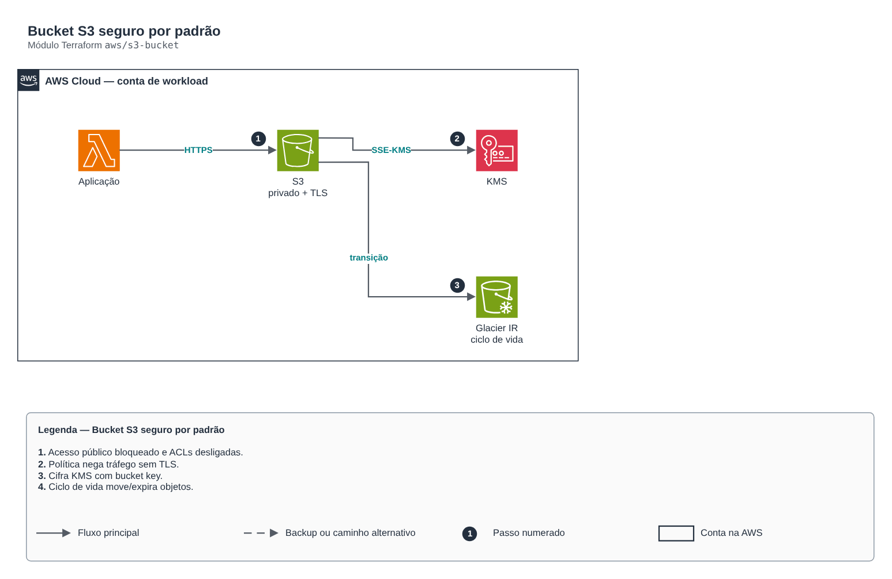

# Bucket S3 seguro por padrão

**Português** · [English](README.en.md)

> `aws/s3-bucket` · categoria **armazenamento** · origem: Plataforma de microsserviços em telecom (2026)

> Idealizado em outubro de 2026 e publicado agora.

Bucket S3 seguro por padrão: acesso público bloqueado, ownership do bucket (sem ACLs), cifra KMS (ou SSE-S3), TLS obrigatório, versionamento e regras de ciclo de vida opcionais.

## Arquitetura



Fonte editável: [`diagram.drawio`](diagram.drawio) (abra no draw.io / diagrams.net), com páginas em português e inglês.

1. Acesso público bloqueado e ACLs desligadas.
2. Política nega tráfego sem TLS.
3. Cifra KMS com bucket key.
4. Ciclo de vida move/expira objetos.

## Uso

```hcl
module "s3_bucket" {
  source = "git::https://github.com/raphaelfcs/automacao_terraform.git//aws/s3-bucket?ref=v1.0.0"

  bucket_name = "demo-dev-dados-123456789012"
  tags        = local.tags
}
```

## Exemplos

| Exemplo | Arquivos |
|---|---|
| [`basico`](examples/basico) | `main.tf`, `locals.tf`, `backend.tf` |
| [`kms-ciclo-de-vida`](examples/kms-ciclo-de-vida) | `main.tf`, `locals.tf`, `backend.tf` |

Cada exemplo tem seu próprio backend (state isolado por módulo e exemplo). Ambientes diferentes usam apenas outro `backend.tf`/`*.tfvars`, sem duplicar código.

## Entradas

| Nome | Tipo | Padrão | Obrigatória | Descrição |
|---|---|---|---|---|
| `bucket_name` | `string` | - | **sim** | Nome do bucket (globalmente único). |
| `kms_key_arn` | `string` | `null` | não | Chave KMS da cifra. null = SSE-S3 (AES256). |
| `versioning` | `bool` | `true` | não | Liga o versionamento (recomendado para dados de negócio; dispensável para artefatos efêmeros). |
| `lifecycle_rules` | `map(...)` | `{}` | não | Regras de ciclo de vida por id. |
| `read_principal_arns` | `list(string)` | `[]` | não | ARNs autorizados a ler o bucket (outras contas/roles). |
| `access_log_bucket` | `string` | `null` | não | Bucket de destino do server access logging. null = desligado. |
| `force_destroy` | `bool` | `false` | não | Permite destruir com objetos (true só em sandbox). |
| `tags` | `map(string)` | `{}` | não | Tags aplicadas a todos os recursos. |
| `cors_allowed_origins` | `list(string)` | `[]` | não | Origens (https://...) que podem enviar/ler direto do navegador com URL assinada. Vazio = sem CORS. |
| `eventbridge_notifications` | `bool` | `false` | não | Publica eventos do bucket (Object Created etc.) no EventBridge padrão da conta. |
| `object_lock` | `object(...)` | `null` | não | Retenção padrão com Object Lock (WORM). Só pode ser ligado na criação do bucket. mode: GOVERNANCE ou COMPLIANCE. |

## Saídas

| Nome | Descrição |
|---|---|
| `bucket_name` | Nome do bucket. |
| `bucket_arn` | ARN do bucket. |
| `bucket_regional_domain_name` | Domínio regional (origem de CloudFront). |

## Arquivos

- `iam.tf`: políticas, papéis e permissões
- `main.tf`: recursos principais
- `outputs.tf`: saídas
- `variables.tf`: entradas e validações
- `versions.tf`: versões do Terraform e providers
- `examples/`: composições prontas para uso
- `tests/`: `terraform test` com providers simulados

## Well-Architected

- Segurança: acesso público bloqueado, criptografia e autenticação por identidade.
- Confiabilidade: versionamento e exclusão reversível.

## Testes

```bash
cd aws/s3-bucket
terraform init -backend=false
terraform test
```
