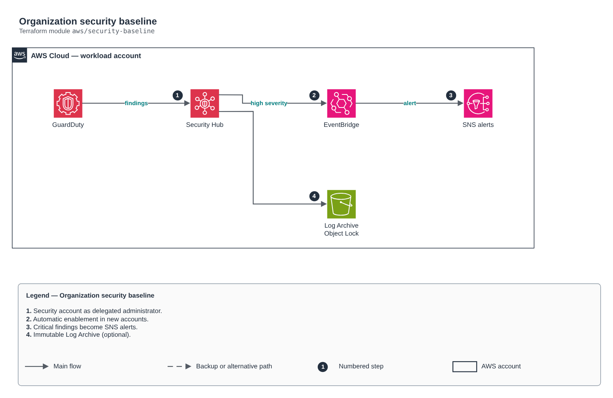

# Organization security baseline

[Português](README.md) · **English**

> `aws/security-baseline` · category **seguranca** · origin: Architecture case studies (2026)

> Designed in October 2026 and published now.

Organization security baseline from the Security account (delegated administrator): GuardDuty, Security Hub, Inspector, Macie and Access Analyzer for all accounts, finding alerts through EventBridge -> SNS and, optionally, the immutable (Object Lock) Log Archive bucket.

## Architecture



Editable source: [`diagram.drawio`](diagram.drawio) (open it in draw.io / diagrams.net), with Portuguese and English pages.

1. Security account as delegated administrator.
2. Automatic enablement in new accounts.
3. Critical findings become SNS alerts.
4. Immutable Log Archive (optional).

## Usage

```hcl
module "security_baseline" {
  source = "git::https://github.com/raphaelfcs/automacao_terraform.git//aws/security-baseline?ref=v1.0.0"

  tags = local.tags
}
```

## Examples

| Example | Files |
|---|---|
| [`basico`](examples/basico) | `main.tf`, `locals.tf`, `backend.tf` |

Each example has its own backend (state isolated per module and example). Different environments only use another `backend.tf`/`*.tfvars`, without duplicating code.

## Inputs

| Name | Type | Default | Required | Description |
|---|---|---|---|---|
| `name_prefix` | `string` | `"security-baseline"` | no | Security resource prefix. |
| `tags` | `map(string)` | `{}` | no | Additional tags. |
| `enable_detection` | `bool` | `true` | no | Turns on detection and alerts (GuardDuty, Security Hub, Inspector, Macie, Access Analyzer). Turn it off in the instance that only creates the Log Archive bucket. |
| `alert_emails` | `list(string)` | `[]` | no | Team e-mails that receive critical alerts (GuardDuty, Security Hub). |
| `guardduty_min_severity` | `number` | `7` | no | Minimum GuardDuty finding severity that raises an alert (7 = high). |
| `enable_inspector` | `bool` | `true` | no | Enables Inspector for EC2, ECR and Lambda across the organization accounts. |
| `enable_macie` | `bool` | `true` | no | Enables Macie (personal data discovery in S3, LGPD). |
| `securityhub_standards` | `list(string)` | `[ "standards/aws-foundational-securit...` | no | Enabled Security Hub standards. |
| `create_log_archive_bucket` | `bool` | `false` | no | Creates the Log Archive account's immutable bucket (run with that account's provider). |
| `organization_id` | `string` | `""` | no | Organization ID (o-xxxx), for the log bucket policy. |
| `log_retention_days` | `number` | `365` | no | Minimum retention (Object Lock COMPLIANCE) of audit logs. |

## Outputs

| Name | Description |
|---|---|
| `alerts_topic_arn` | SNS topic for critical security alerts. |
| `guardduty_detector_id` | GuardDuty detector (delegated administrator). |
| `log_archive_bucket_arn` | Immutable Log Archive bucket (CloudTrail, Config, Flow Logs). |

## Files

- `iam.tf`: policies, roles and permissions
- `locals.tf`: derived values
- `main.tf`: main resources
- `outputs.tf`: outputs
- `variables.tf`: inputs and validations
- `versions.tf`: Terraform and provider versions
- `examples/`: ready-to-use compositions
- `tests/`: `terraform test` with mocked providers

## Well-Architected

- Security: least privilege in policies, customer-managed key encryption and an audit trail.
- Operational excellence: everything declared in code, reviewed in PRs and tested with `terraform test`.

## Tests

```bash
cd aws/security-baseline
terraform init -backend=false
terraform test
```
