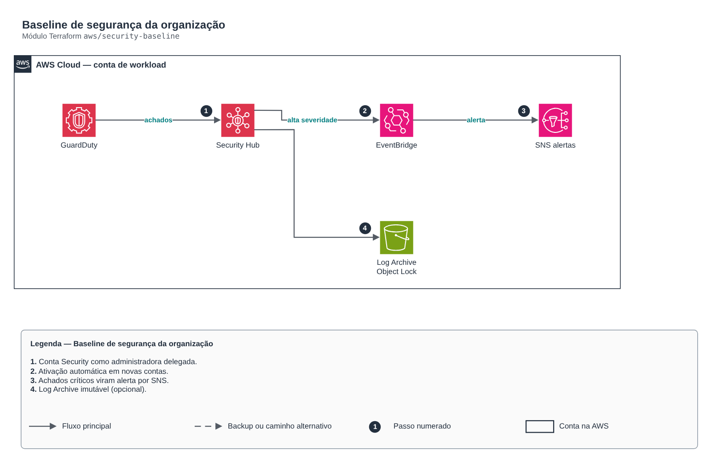

# Baseline de segurança da organização

**Português** · [English](README.en.md)

> `aws/security-baseline` · categoria **seguranca** · origem: Estudos de caso de arquitetura (2026)

> Idealizado em outubro de 2026 e publicado agora.

Baseline de segurança da organização a partir da conta Security (administradora delegada): GuardDuty, Security Hub, Inspector, Macie e Access Analyzer para todas as contas, alertas de achados por EventBridge -> SNS e, opcionalmente, o bucket imutável (Object Lock) da conta Log Archive. Pré-requisito: a conta de gerenciamento delegou a administração destes serviços.

## Arquitetura



Fonte editável: [`diagram.drawio`](diagram.drawio) (abra no draw.io / diagrams.net), com páginas em português e inglês.

1. Conta Security como administradora delegada.
2. Ativação automática em novas contas.
3. Achados críticos viram alerta por SNS.
4. Log Archive imutável (opcional).

## Uso

```hcl
module "security_baseline" {
  source = "git::https://github.com/raphaelfcs/automacao_terraform.git//aws/security-baseline?ref=v1.0.0"

  tags = local.tags
}
```

## Exemplos

| Exemplo | Arquivos |
|---|---|
| [`basico`](examples/basico) | `main.tf`, `locals.tf`, `backend.tf` |

Cada exemplo tem seu próprio backend (state isolado por módulo e exemplo). Ambientes diferentes usam apenas outro `backend.tf`/`*.tfvars`, sem duplicar código.

## Entradas

| Nome | Tipo | Padrão | Obrigatória | Descrição |
|---|---|---|---|---|
| `name_prefix` | `string` | `"security-baseline"` | não | Prefixo dos recursos de segurança. |
| `tags` | `map(string)` | `{}` | não | Tags adicionais. |
| `enable_detection` | `bool` | `true` | não | Liga detecção e alertas (GuardDuty, Security Hub, Inspector, Macie, Access Analyzer). Desligue na instância que cria só o bucket da Log Archive. |
| `alert_emails` | `list(string)` | `[]` | não | E-mails do time que recebem alertas críticos (GuardDuty, Security Hub). |
| `guardduty_min_severity` | `number` | `7` | não | Severidade mínima de achados do GuardDuty que geram alerta (7 = alta). |
| `enable_inspector` | `bool` | `true` | não | Ativa o Inspector para EC2, ECR e Lambda nas contas da organização. |
| `enable_macie` | `bool` | `true` | não | Ativa o Macie (descoberta de dados pessoais em S3, LGPD). |
| `securityhub_standards` | `list(string)` | `[ "standards/aws-foundational-securit...` | não | Padrões do Security Hub habilitados. |
| `create_log_archive_bucket` | `bool` | `false` | não | Cria o bucket imutável da conta Log Archive (rode com o provider dessa conta). |
| `organization_id` | `string` | `""` | não | ID da organização (o-xxxx), para a política do bucket de logs. |
| `log_retention_days` | `number` | `365` | não | Retenção mínima (Object Lock COMPLIANCE) dos logs de auditoria. |

## Saídas

| Nome | Descrição |
|---|---|
| `alerts_topic_arn` | Tópico SNS de alertas críticos de segurança. |
| `guardduty_detector_id` | Detector do GuardDuty (administrador delegado). |
| `log_archive_bucket_arn` | Bucket imutável da Log Archive (CloudTrail, Config, Flow Logs). |

## Arquivos

- `iam.tf`: políticas, papéis e permissões
- `locals.tf`: valores derivados
- `main.tf`: recursos principais
- `outputs.tf`: saídas
- `variables.tf`: entradas e validações
- `versions.tf`: versões do Terraform e providers
- `examples/`: composições prontas para uso
- `tests/`: `terraform test` com providers simulados

## Well-Architected

- Segurança: privilégio mínimo nas políticas, criptografia com chave gerenciada pelo cliente e trilha de auditoria.
- Excelência operacional: tudo declarado em código, revisado em PR e testado com `terraform test`.

## Testes

```bash
cd aws/security-baseline
terraform init -backend=false
terraform test
```
