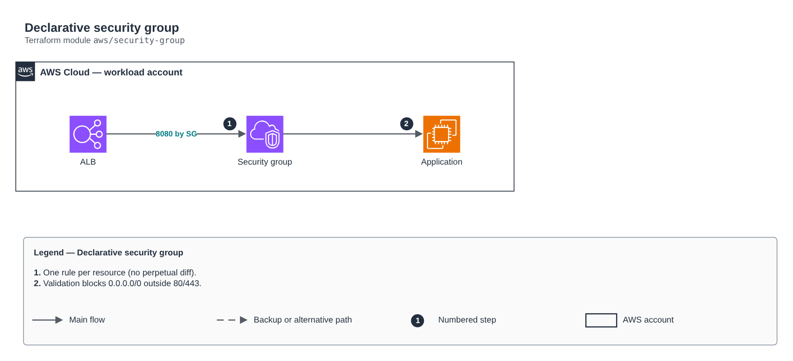

# Declarative security group

[Português](README.md) · **English**

> `aws/security-group` · category **rede** · origin: Fintechs and Open Finance on AWS (2021)

> Designed in August 2021. With no time to keep the repository up to date back then, it is being published and updated now.

Declarative security group: ingress/egress rules as a map, using aws_vpc_security_group_*_rule resources (one rule per resource, no perpetual diff from inline rules) and references to other SGs instead of CIDRs whenever possible.

## Architecture



Editable source: [`diagram.drawio`](diagram.drawio) (open it in draw.io / diagrams.net), with Portuguese and English pages.

1. One rule per resource (no perpetual diff).
2. Validation blocks 0.0.0.0/0 outside 80/443.

## Usage

```hcl
module "security_group" {
  source = "git::https://github.com/raphaelfcs/automacao_terraform.git//aws/security-group?ref=v1.0.0"

  name        = "demo-dev-app"
  description = "App atras do ALB"
  vpc_id      = "vpc-0123456789abcdef0"
  ingress_rules = {
    "http-do-alb"   = { from_port = 8080, source_security_group_id = "sg-0aaaaaaaaaaaaaaaa" }
    "https-publico" = { from_port = 443, cidr_ipv4 = "0.0.0.0/0" }
  }
  tags = local.tags
}
```

## Examples

| Example | Files |
|---|---|
| [`alb-e-app`](examples/alb-e-app) | `main.tf`, `locals.tf`, `backend.tf` |

Each example has its own backend (state isolated per module and example). Different environments only use another `backend.tf`/`*.tfvars`, without duplicating code.

## Inputs

| Name | Type | Default | Required | Description |
|---|---|---|---|---|
| `name` | `string` | - | **yes** | Security group name. |
| `description` | `string` | - | **yes** | Description (immutable after creation in AWS). |
| `vpc_id` | `string` | - | **yes** | SG VPC. |
| `ingress_rules` | `map(...)` | `{}` | no | Ingress rules by description. Provide exactly one source: cidr_ipv4, source_security_group_id or prefix_list_id. |
| `egress_rules` | `map(...)` | `{ "toda-saida" = { protocol = "-1", c...` | no | Egress rules by description. Default: all egress. |
| `tags` | `map(string)` | `{}` | no | Tags applied. |

## Outputs

| Name | Description |
|---|---|
| `security_group_id` | Security group ID. |
| `security_group_arn` | Security group ARN. |

## Files

- `main.tf`: main resources
- `outputs.tf`: outputs
- `variables.tf`: inputs and validations
- `versions.tf`: Terraform and provider versions
- `examples/`: ready-to-use compositions
- `tests/`: `terraform test` with mocked providers

## Well-Architected

- Reliability: resources spread across availability zones and no single point of failure for egress.
- Security: isolated subnet tiers, source-based rules and flow logs enabled.

## Tests

```bash
cd aws/security-group
terraform init -backend=false
terraform test
```
