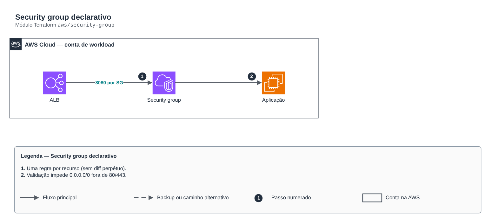

# Security group declarativo

**Português** · [English](README.en.md)

> `aws/security-group` · categoria **rede** · origem: Fintechs e Open Finance em AWS (2021)

> Idealizado em agosto de 2021. Por falta de tempo para manter o repositório em dia na época, está sendo publicado e atualizado agora.

Security group declarativo: regras de entrada/saída por mapa, usando os recursos aws_vpc_security_group_*_rule (uma regra por recurso, sem diff perpétuo de regras inline) e referência a outros SGs em vez de CIDR sempre que possível.

## Arquitetura



Fonte editável: [`diagram.drawio`](diagram.drawio) (abra no draw.io / diagrams.net), com páginas em português e inglês.

1. Uma regra por recurso (sem diff perpétuo).
2. Validação impede 0.0.0.0/0 fora de 80/443.

## Uso

```hcl
module "security_group" {
  source = "git::https://github.com/raphaelfcs/automacao_terraform.git//aws/security-group?ref=v1.0.0"

  name        = "demo-dev-app"
  description = "App atras do ALB"
  vpc_id      = "vpc-0123456789abcdef0"
  ingress_rules = {
    "http-do-alb"   = { from_port = 8080, source_security_group_id = "sg-0aaaaaaaaaaaaaaaa" }
    "https-publico" = { from_port = 443, cidr_ipv4 = "0.0.0.0/0" }
  }
  tags = local.tags
}
```

## Exemplos

| Exemplo | Arquivos |
|---|---|
| [`alb-e-app`](examples/alb-e-app) | `main.tf`, `locals.tf`, `backend.tf` |

Cada exemplo tem seu próprio backend (state isolado por módulo e exemplo). Ambientes diferentes usam apenas outro `backend.tf`/`*.tfvars`, sem duplicar código.

## Entradas

| Nome | Tipo | Padrão | Obrigatória | Descrição |
|---|---|---|---|---|
| `name` | `string` | - | **sim** | Nome do security group. |
| `description` | `string` | - | **sim** | Descrição (imutável após a criação na AWS). |
| `vpc_id` | `string` | - | **sim** | VPC do SG. |
| `ingress_rules` | `map(...)` | `{}` | não | Regras de entrada por descrição. Informe exatamente uma origem: cidr_ipv4, source_security_group_id ou prefix_list_id. |
| `egress_rules` | `map(...)` | `{ "toda-saida" = { protocol = "-1", c...` | não | Regras de saída por descrição. Padrão: toda saída. |
| `tags` | `map(string)` | `{}` | não | Tags aplicadas. |

## Saídas

| Nome | Descrição |
|---|---|
| `security_group_id` | ID do security group. |
| `security_group_arn` | ARN do security group. |

## Arquivos

- `main.tf`: recursos principais
- `outputs.tf`: saídas
- `variables.tf`: entradas e validações
- `versions.tf`: versões do Terraform e providers
- `examples/`: composições prontas para uso
- `tests/`: `terraform test` com providers simulados

## Well-Architected

- Confiabilidade: recursos distribuídos por zonas de disponibilidade e sem ponto único de falha na saída.
- Segurança: camadas de sub-rede isoladas, regras por origem e logs de fluxo habilitados.

## Testes

```bash
cd aws/security-group
terraform init -backend=false
terraform test
```
