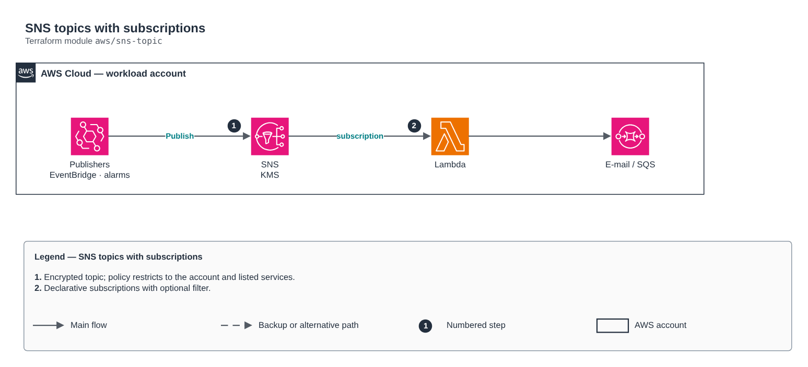

# SNS topics with subscriptions

[Português](README.md) · **English**

> `aws/sns-topic` · category **integracao** · origin: Health insurer on AWS (2024)

> Designed in April 2024. With no time to keep the repository up to date back then, it is being published and updated now.

KMS-encrypted SNS topics with declarative subscriptions (lambda, sqs, email, https) and a topic policy restricted to the account and the listed publisher services.

## Architecture



Editable source: [`diagram.drawio`](diagram.drawio) (open it in draw.io / diagrams.net), with Portuguese and English pages.

1. Encrypted topic; policy restricts to the account and listed services.
2. Declarative subscriptions with optional filter.

## Usage

```hcl
module "sns_topic" {
  source = "git::https://github.com/raphaelfcs/automacao_terraform.git//aws/sns-topic?ref=v1.0.0"

  name_prefix        = "demo-dev-"
  topic_names        = ["alertas"]
  kms_key_arn        = "arn:aws:kms:sa-east-1:123456789012:key/11111111-2222-3333-4444-555555555555"
  publisher_services = ["events.amazonaws.com", "cloudwatch.amazonaws.com"]
  subscriptions      = { alertas = [{ protocol = "email", endpoint = "plataforma@example.com" }] }
  tags               = local.tags
}
```

## Examples

| Example | Files |
|---|---|
| [`alertas`](examples/alertas) | `main.tf`, `locals.tf`, `backend.tf` |
| [`fanout-lambda`](examples/fanout-lambda) | `main.tf`, `locals.tf`, `backend.tf` |

Each example has its own backend (state isolated per module and example). Different environments only use another `backend.tf`/`*.tfvars`, without duplicating code.

## Inputs

| Name | Type | Default | Required | Description |
|---|---|---|---|---|
| `name_prefix` | `string` | `""` | no | Topic name prefix (e.g. "app-dev-"). |
| `topic_names` | `list(string)` | - | **yes** | Topic names. |
| `fifo` | `bool` | `false` | no | Creates FIFO topics (ordering and deduplication). |
| `kms_key_arn` | `string` | `null` | no | Topic KMS key (alias/aws/sns does not work for publishers from other services). |
| `subscriptions` | `map(...)` | `{}` | no | Subscriptions per topic: list of { protocol, endpoint, raw_message_delivery, filter_policy }. |
| `publisher_services` | `list(string)` | `[]` | no | AWS services allowed to publish (e.g. ["events.amazonaws.com", "cloudwatch.amazonaws.com"]). |
| `tags` | `map(string)` | `{}` | no | Tags applied. |

## Outputs

| Name | Description |
|---|---|
| `topic_arns` | Name -> topic ARN map. |

## Files

- `iam.tf`: policies, roles and permissions
- `locals.tf`: derived values
- `main.tf`: main resources
- `outputs.tf`: outputs
- `variables.tf`: inputs and validations
- `versions.tf`: Terraform and provider versions
- `examples/`: ready-to-use compositions
- `tests/`: `terraform test` with mocked providers

## Well-Architected

- Reliability: dead-letter queues (DLQ), retries and event archiving.
- Security: resource policies restricted by source and message encryption.

## Tests

```bash
cd aws/sns-topic
terraform init -backend=false
terraform test
```
