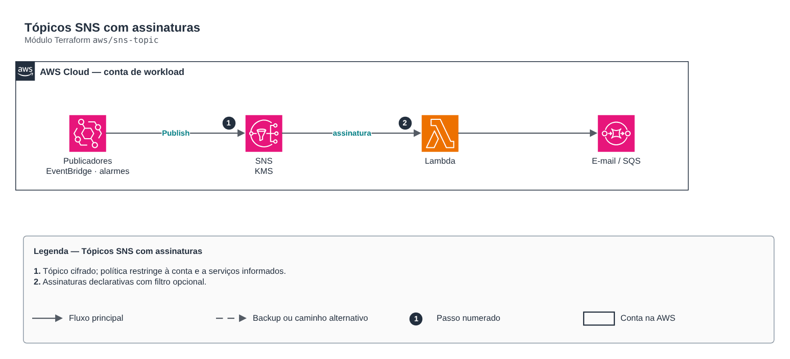

# Tópicos SNS com assinaturas

**Português** · [English](README.en.md)

> `aws/sns-topic` · categoria **integracao** · origem: Operadora de saúde em AWS (2024)

> Idealizado em abril de 2024. Por falta de tempo para manter o repositório em dia na época, está sendo publicado e atualizado agora.

Tópicos SNS cifrados com KMS, com assinaturas declarativas (lambda, sqs, email, https) e política de tópico restrita à conta e a serviços publicadores informados.

## Arquitetura



Fonte editável: [`diagram.drawio`](diagram.drawio) (abra no draw.io / diagrams.net), com páginas em português e inglês.

1. Tópico cifrado; política restringe à conta e a serviços informados.
2. Assinaturas declarativas com filtro opcional.

## Uso

```hcl
module "sns_topic" {
  source = "git::https://github.com/raphaelfcs/automacao_terraform.git//aws/sns-topic?ref=v1.0.0"

  name_prefix        = "demo-dev-"
  topic_names        = ["alertas"]
  kms_key_arn        = "arn:aws:kms:sa-east-1:123456789012:key/11111111-2222-3333-4444-555555555555"
  publisher_services = ["events.amazonaws.com", "cloudwatch.amazonaws.com"]
  subscriptions      = { alertas = [{ protocol = "email", endpoint = "plataforma@example.com" }] }
  tags               = local.tags
}
```

## Exemplos

| Exemplo | Arquivos |
|---|---|
| [`alertas`](examples/alertas) | `main.tf`, `locals.tf`, `backend.tf` |
| [`fanout-lambda`](examples/fanout-lambda) | `main.tf`, `locals.tf`, `backend.tf` |

Cada exemplo tem seu próprio backend (state isolado por módulo e exemplo). Ambientes diferentes usam apenas outro `backend.tf`/`*.tfvars`, sem duplicar código.

## Entradas

| Nome | Tipo | Padrão | Obrigatória | Descrição |
|---|---|---|---|---|
| `name_prefix` | `string` | `""` | não | Prefixo dos nomes dos tópicos (ex.: "app-dev-"). |
| `topic_names` | `list(string)` | - | **sim** | Nomes dos tópicos. |
| `fifo` | `bool` | `false` | não | Cria tópicos FIFO (ordem e deduplicação). |
| `kms_key_arn` | `string` | `null` | não | Chave KMS dos tópicos (alias/aws/sns não serve para publicadores de outros serviços). |
| `subscriptions` | `map(...)` | `{}` | não | Assinaturas por tópico: lista de { protocol, endpoint, raw_message_delivery, filter_policy }. |
| `publisher_services` | `list(string)` | `[]` | não | Serviços AWS autorizados a publicar (ex.: ["events.amazonaws.com", "cloudwatch.amazonaws.com"]). |
| `tags` | `map(string)` | `{}` | não | Tags aplicadas. |

## Saídas

| Nome | Descrição |
|---|---|
| `topic_arns` | Mapa nome -> ARN do tópico. |

## Arquivos

- `iam.tf`: políticas, papéis e permissões
- `locals.tf`: valores derivados
- `main.tf`: recursos principais
- `outputs.tf`: saídas
- `variables.tf`: entradas e validações
- `versions.tf`: versões do Terraform e providers
- `examples/`: composições prontas para uso
- `tests/`: `terraform test` com providers simulados

## Well-Architected

- Confiabilidade: filas de mensagens mortas (DLQ), retentativas e arquivamento de eventos.
- Segurança: políticas de recurso restritas por origem e cifragem das mensagens.

## Testes

```bash
cd aws/sns-topic
terraform init -backend=false
terraform test
```
